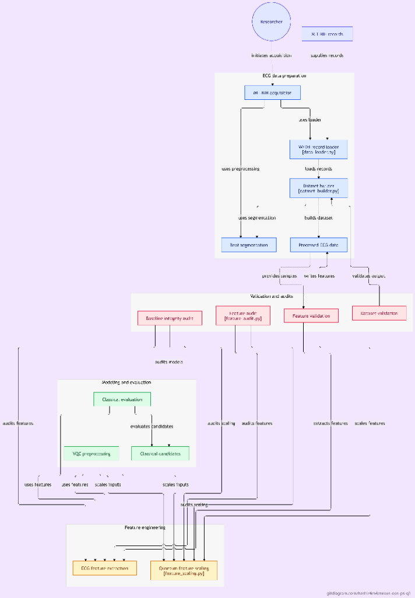

# NEXUS-OPS — Variational Quantum Biomedical Signal Classifier (PS-Q1)
## IBM Quantum Qiskit Fall Fest 2026 | Project Q

[](https://qiskit.org/)
[](https://qiskit.org/)
[](tests/)
[](https://www.python.org/)
[](https://github.com/Hashir4m4/NEXUS-OPS-PS-Q1)

---

## 1. Executive Overview & Problem Statement

**NEXUS-OPS (Project Q)** is an end-to-end quantum machine learning (QML) research implementation developed for the **IBM Quantum Qiskit Fall Fest 2026**, addressing **Problem Statement PS-Q1: Biomedical Signal Classifier**.

### Clinical Motivation
Cardiovascular disease remains the leading cause of mortality globally. Ventricular Ectopic Beats (VEBs, MIT-BIH annotation class `V`) originate from ectopic ventricular foci rather than the sinoatrial node. In automated arrhythmia screening benchmarks, prioritizing **Sensitivity (Recall on class `V`)** is standard practice to minimize missed ectopic events. This project addresses the automated classification of class `N` vs class `V` heartbeats as formulated in Problem Statement PS-Q1.

### Research Objective
This project designs, trains, and validates a 6-qubit **Variational Quantum Classifier (VQC)** to discriminate between **MIT-BIH annotation class `N` (Normal beats, class 0)** and **annotation class `V` (Ventricular Ectopic Beats, class 1)**. The implementation strictly investigates:
1. High-fidelity quantum state encoding of morphological and interval ECG features.
2. Leakage-controlled, record-level Leave-One-Record-Out (LORO) machine learning evaluation.
3. Hardware compilation and topological compatibility on designated challenge architectures: **Processor A (5 physical qubits)** and **Processor B (9 physical qubits)**.

---

## 2. Dataset Construction & Leakage-Controlled Evaluation Pipeline

### 2.1 Data Provenance
The benchmark dataset was constructed by the NEXUS-OPS team from the open-access **PhysioNet MIT-BIH Arrhythmia Database** (Moody & Mark, 1992/2001).

> **Provenance Disclosure:** The MIT-BIH dataset was independently extracted and curated by the NEXUS-OPS team in accordance with challenge guidelines; it was not supplied as a pre-packaged download by hackathon organizers.

### 2.2 Record-Level Cohort Partitioning (LORO Protocol A)
Standard random k-fold cross-validation in ECG analysis causes severe data leakage when beats from the same recording appear in both training and test sets. To enforce rigorous external validity, NEXUS-OPS implemented strict record-level separation between training and held-out test records:

| Cohort Role | Record IDs | Sample Count | Class Balance | Methodological Status |
|:---|:---:|:---:|:---:|:---|
| **Development Cohort** | Records `106` & `119` | $N = 200$ | 100 Normal, 100 VEB | Used for feature scaling and LORO cross-validation model selection |
| **Held-Out Test Cohort** | Records `200` & `208` | $N = 100$ | 50 Normal, 50 VEB | **Quarantined:** Evaluated once under frozen model parameters |

Total dataset: **300 balanced ECG beat segments** extracted from Lead II at a 360 Hz sampling rate, windowed to 360 samples ($1.0\text{ s}$) centered on annotated R-peaks.

### 2.3 Feature Extraction & Signal Processing
Raw electrocardiogram signals undergo two-stage median filtering (200 ms and 600 ms windows) to eliminate baseline wander, followed by 0.5–40 Hz bandpass filtering. For each segmented beat, exactly 6 physiologically grounded numerical features are extracted:

1. **`pre_rr` (seconds):** Preceding R-R interval from prior annotated R-peak ($t_{R_i} - t_{R_{i-1}}$) measured from the continuous record annotation stream (`.atr`); primary prematurity indicator for ventricular ectopic activations.
2. **`post_rr` (seconds):** Succeeding R-R interval to subsequent annotated R-peak ($t_{R_{i+1}} - t_{R_i}$) measured from the continuous record annotation stream; quantifies the compensatory pause characteristic of ventricular ectopic beats.
3. **`qrs_rms` ($mV$):** Root Mean Square signal amplitude in a $[-25, +25]$ sample window ($\pm 69.4\text{ ms}$, $\sim 140\text{ ms}$ total duration) centered on the R-peak (index 144); captures concentrated depolarization voltage energy.
4. **`qrs_duration` (seconds):** Temporal width of the QRS complex estimated by 20% envelope thresholding within a $\pm 36$-sample search window ($\pm 100\text{ ms}$); reflects delayed intraventricular conduction.
5. **`p2p_amplitude` ($mV$):** Peak-to-peak amplitude excursion ($\max(s) - \min(s)$) across the full 360-sample ($1.0\text{ s}$) segmented beat window; captures overall voltage excursion.
6. **`spectral_ratio` (dimensionless):** Ratio of spectral power in the band $[10, 25]\text{ Hz}$ to power in the broad band $[0.5, 40]\text{ Hz}$ computed via FFT periodogram ($P_{[10, 25]\text{ Hz}} / P_{[0.5, 40]\text{ Hz}}$); quantifies spectral energy concentration and distinguishes high-frequency QRS complexes from broadened ectopic waveforms.

### 2.4 Leakage Controls & Boundary Disclosures
To prevent data contamination and preserve experimental validity, the preprocessing pipeline enforces four specific controls:

- **Record-Level Separation (LORO Protocol A):** Record-level separation between training (`106`, `119`) and held-out test records (`200`, `208`) guarantees that no beats or annotations cross the partition boundary.
- **Strict Scaler Quarantine:** The `QuantumFeatureScaler` linear min/max parameters are fitted **exclusively on the development cohort** and applied to test beats with boundary clamping to $[0, \pi]$, ensuring zero distribution lookahead.
- **Continuous Stream R-R Calculation:** The `pre_rr` and `post_rr` features are computed using the full continuous annotation stream of the source recording. In prospective streaming deployments, `post_rr` requires observing the next consecutive beat, introducing a one-beat retrospective latency.
- **Window Segmentation Overlap:** Beats are segmented into 360-sample ($1.0\text{ s}$) windows centered on annotated R-peaks. When consecutive beats occur with an R-R interval under 1.0 s ($> 60\text{ bpm}$), adjacent temporal windows may partially overlap in raw samples, though each segment represents an independent annotated cardiac event.

---

## ECG Data Pipeline and Validation Architecture



The end-to-end data curation, validation, and feature-to-quantum embedding architecture follows a modular pipeline designed for strict reproducibility and data hygiene:

- **MIT-BIH Acquisition and WFDB Record Loading (`src/acquire_and_inspect_mitbih.py` / `src/dataset_builder.py`):**
  PhysioNet MIT-BIH Arrhythmia Database recordings (`106`, `119`, `200`, `208`) are loaded using native WFDB routines. Signal integrity on Lead II (sampled at 360 Hz) is verified alongside standard expert annotation streams (`.atr`).
- **Beat Segmentation and Dataset Construction (`src/dataset_builder.py`):**
  R-peak annotations drive the segmentation of 360-sample (1.0 s) windows centered at sample index 144. Beats are filtered to isolate annotation class `N` (normal sinus rhythm) and class `V` (ventricular ectopic beats), producing a balanced cohort of 300 segments partitioned into development ($N=200$) and held-out test ($N=100$) sets under record-level isolation.
- **Dataset Validation and Feature Auditing (`tests/test_dataset_validation.py` / `tests/test_feature_audit.py`):**
  Automated validation suites continuously audit class balances, zero NaNs/infinities, segment boundary integrity, and feature distributions. The baseline integrity audit ensures no cross-record contamination occurs across partitions.
- **Classical Evaluation and VQC Preprocessing (`src/classical_models.py` / `src/vqc_preprocessing.py`):**
  Partitioned segments feed into parallel evaluation tracks: classical model candidates (Logistic Regression, Random Forest) for baseline benchmarking, and VQC preprocessing modules that format features into deterministic input vectors for quantum encoding.
- **ECG Feature Extraction and Quantum Feature Scaling (`src/feature_extraction.py` / `src/feature_scaling.py`):**
  For each segmented beat, six physiological biomarkers (`pre_rr`, `post_rr`, `qrs_rms`, `qrs_duration`, `p2p_amplitude`, `spectral_ratio`) are computed after two-stage median filtering. The `QuantumFeatureScaler` fits min-max boundaries strictly on development records and scales inputs to $[0, \pi]$ rotation angles with test boundary clamping, directly mapping physiological signals to single-qubit Bloch sphere rotations.

---

## 3. Quantum Architecture: Approved 6-Qubit VQC

The NEXUS-OPS classifier uses an approved, frozen 6-qubit variational circuit:

```
                  ┌──────────────┐ ┌──────────────────────────────────────┐
q_0 (pre_rr): ────┤ Ry(x_0) ├──────┤ p_var[0]  ■──────────────────────────┤
                  ├──────────────┤ ├───────────┼──────────────────────────┤
q_1 (post_rr): ───┤ Ry(x_1) ├──────┤ p_var[1]  ┼───■──────────────────────┤
                  ├──────────────┤ ├───────────┼───┼──────────────────────┤
q_2 (qrs_rms): ───┤ Ry(x_2) ├──────┤ p_var[2]  ┼───┼───■──────────────────┤
                  ├──────────────┤ ├───────────┼───┼───┼──────────────────┤
q_3 (qrs_dur): ───┤ Ry(x_3) ├──────┤ p_var[3]  ┼───┼───┼───■──────────────┤
                  ├──────────────┤ ├───────────┼───┼───┼───┼──────────────┤
q_4 (p2p_amp): ───┤ Ry(x_4) ├──────┤ p_var[4]  ┼───┼───┼───┼───■──────────┤
                  ├──────────────┤ ├───────────┼───┼───┼───┼───┼──────────┤
q_5 (spec_rat): ──┤ Ry(x_5) ├──────┤ p_var[5]  ┼───┼───┼───┼───┼───■ p_var┤
                  └──────────────┘ └───────────┴───┴───┴───┴───┴───┴──────┘
                  First-Order RY      RealAmplitudes (Linear Entanglement)
                  Feature Encoding    1 Repetition, 12 Variational Parameters
```

### Architecture Specifications
- **Logical Qubits & Feature Mapping:** Exactly 6 logical qubits ($q_0 \dots q_5$) in fixed physical order:
  - $q_0 \leftrightarrow \text{`pre_rr`}$ ($x_0$, seconds)
  - $q_1 \leftrightarrow \text{`post_rr`}$ ($x_1$, seconds)
  - $q_2 \leftrightarrow \text{`qrs_rms`}$ ($x_2$, mV)
  - $q_3 \leftrightarrow \text{`qrs_duration`}$ ($x_3$, seconds)
  - $q_4 \leftrightarrow \text{`p2p_amplitude`}$ ($x_4$, mV)
  - $q_5 \leftrightarrow \text{`spectral_ratio`}$ ($x_5$, dimensionless)
- **State Encoding:** First-order $R_y$ rotation encoding: $U_{\Phi}(\mathbf{x}) = \bigotimes_{j=0}^5 R_y(x_j)$.
- **Variational Ansatz:** `RealAmplitudes` with 1 repetition and linear nearest-neighbor entanglement ($5$ CX gates in sequence $0\to1, 1\to2, 2\to3, 3\to4, 4\to5$).
- **Trainable Parameters:** Exactly 12 variational weights ($\theta \in \mathbb{R}^{12}$). Total parameters: 18 ($6$ encoding + $12$ variational).
- **Classification Observable:** Equal-weight ensemble Pauli-$Z$ observable:
  $$\hat{O} = \frac{1}{6} \sum_{j=0}^5 Z_j$$
- **Probability Conversion:** Mapped monotonically from expectation value $\langle\hat{O}\rangle \in [-1, +1]$ to probability:
  $$P(\text{VEB}) = \frac{\langle\hat{O}\rangle + 1}{2} \in [0.0, 1.0]$$
- **Decision Rule:** Binary threshold $\tau = 0.5$ ($\langle\hat{O}\rangle \ge 0 \implies \text{VEB}$, $\langle\hat{O}\rangle < 0 \implies \text{Normal}$).

---

## 4. Training, Model Selection & Held-Out Results

### 4.1 Optimization Protocol
The VQC was optimized classically using the SciPy COBYLA (Constrained Optimization BY Linear Approximation) algorithm minimizing Mean Squared Error (MSE) loss against ground truth labels $y \in \{0, 1\}$. Ten multi-seed training runs were executed across LORO cross-validation partitions.

### 4.2 Frozen Model Checkpoint
Model selection was governed strictly by cross-validation performance on the development records (`106` and `119`) using a balanced validation score. Candidate **`fold_1_seed_303`** was selected and frozen:
- **Optimal Weights $\theta^*$:** `[0.4889, -1.2636, -0.4962, -0.9823, -0.8178, -0.7964, -0.3341, -0.3669, -0.8661, -1.0348, 0.5614, 0.4214]`
- **Validation Metrics (Record 119):** Accuracy 100.0%, Sensitivity 100.0%, Specificity 100.0%, F1 1.0.

### 4.3 Quarantined Held-Out Test Evaluation ($N = 100$)
The frozen model was evaluated on the unseen test cohort (Records `200` & `208`) under both ideal statevector simulation and the challenge synthetic noise model:

| Performance Metric | Classical Baseline (Logistic Regression) | VQC Ideal Simulation (`StatevectorEstimator`) | VQC Full Noise Simulation (`AerSimulator` Measurements) |
|:---|:---:|:---:|:---:|
| **Accuracy** | 92.00% | **76.00%** | **77.00%** |
| **Sensitivity (Recall on VEB)** | 100.00% (50 / 50) | **100.00%** (50 / 50) | **100.00%** (50 / 50) |
| **Specificity (Normal)** | 84.00% (42 / 50) | **52.00%** (26 / 50) | **54.00%** (27 / 50) |
| **Precision** | 86.21% | **67.57%** | **68.49%** |
| **F1-Score** | 0.9259 | **0.8065** | **0.8130** |
| **ROC-AUC** | 0.9960 | **0.9988** | **0.9984** |
| **Brier / MSE Score** | 0.0547 | **0.1626** | **0.1644** |
| **Class Polarity $\Delta p$** | +0.4429 | **+0.2317** | **+0.2246** |

> **Evaluation Protocol & Benchmark Comparison Disclosure:** On the unseen held-out test cohort ($N=100$, Records 200 & 208), the classical $L_2$-regularized Logistic Regression baseline achieved 92.00% accuracy and 0.9259 F1-score when trained on the combined development cohort ($N=200$, Records 106 & 119). In contrast, the frozen 6-qubit VQC (`fold_1_seed_303`) was trained under strict Leave-One-Record-Out cross-validation on the Record 106 partition ($N=100$), achieving 76.00% accuracy (0.8065 F1) in ideal statevector simulation and 77.00% accuracy (0.8130 F1) under synthetic noise. Both quantum and classical models demonstrated **100.00% empirical Sensitivity on VEBs** (identifying all 50 class `V` beats with 0 false negatives in this 100-beat sample). Note: This 100% sensitivity is an empirical result on a fixed test set of 50 VEBs from two held-out records; it does not constitute a generalized clinical guarantee, medical device certification, or diagnostic claim across unconstrained clinical populations.

---

## 5. Quantum Hardware Architecture Benchmarks

In compliance with IBM Quantum Qiskit Fall Fest Phase 1 rules, the classifier was evaluated across challenge-specified processor topologies:

### 5.1 Processor B: 9-Qubit Simulated Heavy-Hex-Inspired Tree (Primary Target)
- **Physical Capacity:** 9 physical qubits.
- **Coupling Map:** 8 bidirectional pairs: `[(0,1), (1,2), (2,3), (2,4), (4,5), (5,6), (4,7), (7,8)]`.
- **Target Basis Gates:** `['rz', 'sx', 'x', 'cx']`.
- **Transpilation Metrics:**
  - **Transpiled Depth:** **15** (16 when appending the 6-bit measurement register).
  - **2-Qubit (CX) Gates:** **5** (matching logical CX count; **0 routing overhead**).
  - **SWAP Gates:** **0** (native topological embedding).
  - **Total Operations:** **65** (`rz`: 36, `sx`: 24, `cx`: 5) without measurements; 71 with measurements.
  - **Qubit Layout:** Logical qubits map directly to physical indices `[0, 1, 2, 4, 5, 6]`.

### 5.2 Processor A: 5-Qubit Linear Chain (Capacity Reference)
- **Physical Capacity:** 5 physical qubits with 1D nearest-neighbor coupling `0-1-2-3-4`.
- **Capacity Boundary Enforcement:** Transpiling the approved 6-qubit circuit onto Processor A correctly triggers `CircuitTooWideForTarget`. In accordance with `Updated_Challenge_Kit.pdf` Section 3.1 and the 13 October 2026 Organizer FAQ:
  > *"For a problem requiring more than 5 logical qubits, do not delete variables merely to force the full problem into A. Treat A as a capacity/routing reference and perform the full-size execution on Processor B where permitted."*
- **Auxiliary 5-Qubit Benchmark:** To quantify routing overhead on 5-qubit topologies, an auxiliary 5-qubit reference circuit was evaluated (depth 14–16, 4 CX on canonical line; depth 21–23, 7 CX on branching tree).
- **Comparability Qualification:** The 5-qubit Processor A reference circuit is an architectural compilation benchmark only; it was not trained on clinical ECG data and is **not a like-for-like comparator** to the 6-qubit Processor B VQC.

### 5.3 Synthetic Noise Model Response
Evaluated under the challenge synthetic noise parameters ($p_{1q} = 0.001$, $p_{2q} = 0.005$, $p_{\text{meas}} = 0.010$):
- Measurement-based `AerSimulator` sampling correctly applies readout bit-flip noise (diagnostic audit proved that `EstimatorV2` primitives bypass readout errors).
- Prediction flip rate on the held-out test cohort was only **1.0%** (1 sample flipped out of 100 beats).
- Performance remained robust at **77.00% accuracy** and **100.00% sensitivity**.

---

## 6. Quickstart & Demonstration

### 6.1 Installation
Clone the repository and set up the Python environment:
```bash
git clone https://github.com/Hashir4m4/NEXUS-OPS-PS-Q1.git
cd NEXUS-OPS-PS-Q1

# Create and activate virtual environment
python -m venv .venv
# Windows:
.venv\Scripts\activate
# Linux/macOS:
source .venv/bin/activate

# Install dependencies
pip install -r requirements.txt
```

### 6.2 Run the Lightweight Demonstration
Execute the fast demonstration runner (~2 seconds, no retraining required):
```bash
python demo.py
```
This runner executes:
1. Loading frozen model weights (`fold_1_seed_303`).
2. Transforming sample test beats using the zero-leakage training scaler.
3. Deterministic quantum inference demonstrating correct Normal and VEB predictions.
4. Transpiling the 6-qubit VQC onto 9-qubit Processor B (depth 15, 5 CX, 0 SWAP).
5. Verifying capacity boundary enforcement on 5-qubit Processor A.

### 6.3 Run the Test Suite
Verify repository integrity across all 116 automated tests:
```bash
pytest -v
```

---

## 7. Repository Structure

```
NEXUS-OPS-PS-Q1/
├── demo.py                          # Lightweight Phase 1 demonstration runner
├── main.ipynb                       # Jupyter demonstration notebook
├── requirements.txt                 # Project dependencies
├── pytest.ini                       # Test configuration
├── processors/                      # Hardware architecture definitions
│   ├── processor_a.py               # Processor A model (5Q linear chain)
│   ├── processor_b.py               # Processor B model (9Q heavy-hex tree)
│   ├── processor_A.json             # Canonical Processor A configuration
│   └── processor_B.json             # Canonical Processor B configuration
├── src/                             # Core scientific implementation
│   ├── vqc_circuit.py               # 6Q VQC architecture & ensemble observable
│   ├── vqc_training.py              # Optimization closures & evaluation metrics
│   ├── vqc_evaluation.py            # Held-out testing & ECE calibration
│   ├── vqc_preprocessing.py         # Leakage-free feature scaling & LORO splits
│   ├── transpilation_experiments.py # Processor A/B compilation suite
│   ├── noise_experiments.py         # Readout error audit & noisy simulations
│   ├── processor_simulation.py      # Finite-shot scaling sweeps (S=256..4096)
│   └── feature_extraction.py        # ECG morphological feature extraction
├── tests/                           # 14 test modules (116 passing tests)
│   ├── test_hardware_experiments.py # Transpilation & layout equivalence tests
│   ├── test_processor_ab.py         # Processor configuration integrity tests
│   ├── test_vqc_circuit.py          # Circuit contracts & observable tests
│   ├── test_vqc_training.py         # Training closures & optimizer tests
│   └── ...
├── results/                         # Empirical experimental data (JSON)
│   ├── vqc_model_selection.json     # Frozen optimal weights (fold_1_seed_303)
│   ├── vqc_heldout_evaluation.json  # Complete held-out test predictions & metrics
│   ├── transpilation_comparison.json# Multi-seed compilation benchmarks
│   ├── noisy_simulation_results.json# Full synthetic noise simulation data
│   └── shot_based_results.json      # Finite shot-noise scaling data
├── report/                          # Technical reports & audit documentation
│   ├── PHASE5_PHASE6_COMPLETION_REPORT.md      # Master technical report
│   ├── quantum_hardware_experiment_report.md  # Hardware & noise experiment report
│   ├── vqc_evaluation_report.md                # Held-out experimental evaluation report
│   ├── processor_architecture_comparison.md   # Processor A vs B compilation report
│   ├── README_SCIENTIFIC_ACCURACY_AUDIT.md     # Feature & clinical accuracy audit
│   ├── FINAL_PUBLIC_REPOSITORY_MANIFEST.md     # Public file manifest & staging review
│   └── PUBLIC_REPOSITORY_REPORT_SELECTION.md   # Report curation framework
├── figures/                         # Diagnostic figures & confusion matrices
└── data/processed/                  # Preprocessed ECG benchmark cohorts
```

---

## 8. Disclosures, Assumptions & Known Limitations

To maintain the highest standards of scientific integrity, the following limitations are explicitly disclosed:

1. **Simulation vs. Physical Hardware:** No physical quantum cryogenic hardware executions were conducted. All hardware experiments reflect compilation analysis and Qiskit Aer 0.17.2 simulation.
2. **Provisional Noise Model:** The synthetic noise parameters ($p_{1q}=0.001$, $p_{2q}=0.005$, $p_{\text{meas}}=0.010$) are provisional challenge simulation assumptions. As clarified in the 13 October 2026 Organizer FAQ, final noise models and native basis sets will be confirmed post-Phase 1 shortlisting.
3. **Research Benchmark Nature:** The MIT-BIH Arrhythmia Database is a retrospective open-source research cohort. This software is an engineering benchmark, not a certified clinical diagnostic medical device.
4. **Post-RR Feature Lookahead & Window Overlap:** The `post_rr` interval feature requires the occurrence of the subsequent heartbeat, introducing a one-beat latency in real-time streaming implementations. Additionally, for heart rates above 60 bpm where consecutive R-R intervals are shorter than 1.0 s, adjacent 360-sample (1.0 s) windows centered on consecutive R-peaks may partially overlap in raw signal samples.
5. **Record 208 Distribution Shift:** Test Record 208 exhibited lower specificity (36.0% ideal, 40.0% noisy) than Record 200 (68.0% ideal, 68.0% noisy). This reflects subject-specific distribution shift; its physiological origin has not been established.
6. **Track Demarcation:** In accordance with organizer clarifications, Problem Statement PS-Q1 (Biomedical Classifier) is strictly isolated from Problem Statement PS-O1 (Max-Cut graph optimization). Combinatorial vertex-reduction concepts do not apply to continuous biomedical features.

---

## 9. Project & Team Attribution

- **Project:** NEXUS-OPS | Project Q
- **Challenge Statement:** PS-Q1 Biomedical Signal Classifier
- **Hackathon:** IBM Quantum Qiskit Fall Fest 2026
- **Repository:** [https://github.com/Hashir4m4/NEXUS-OPS-PS-Q1](https://github.com/Hashir4m4/NEXUS-OPS-PS-Q1)
- **Lead Developer & Submitter:** Hashir4m4 / NEXUS-OPS Research Team
