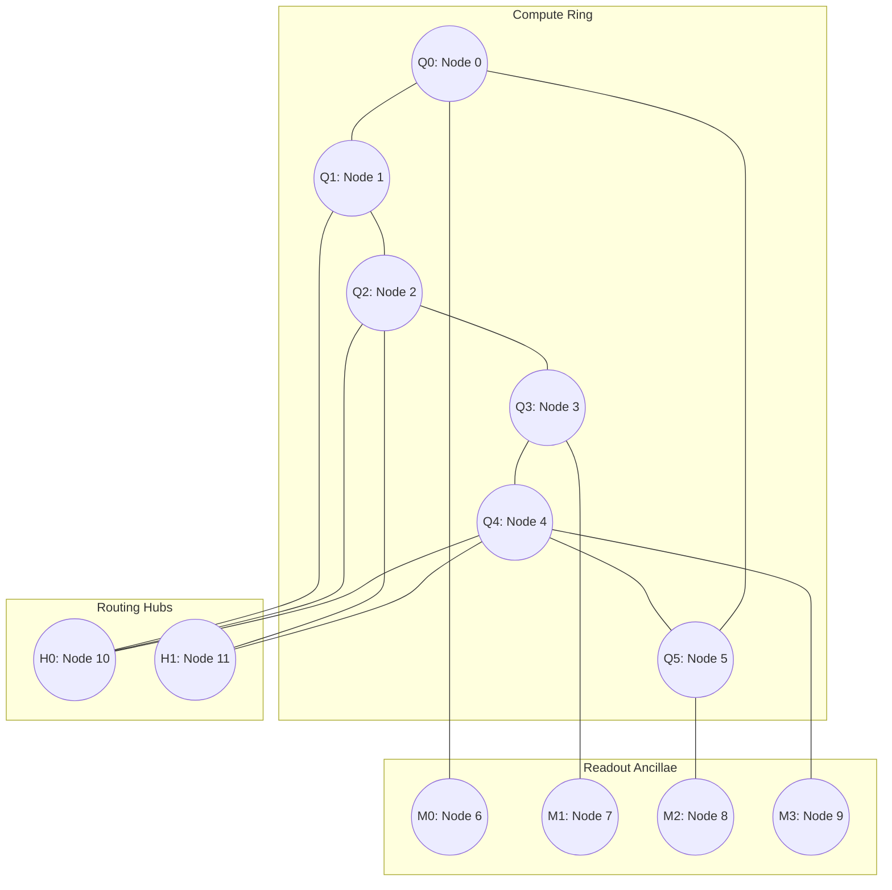

# NEXUS-OPS | Phase 1 Human Evaluation Report
## Variational Quantum Biomedical Signal Classifier for Ventricular Ectopic Beat Detection
**Challenge:** IBM Quantum Qiskit Fall Fest 2026 | Problem Statement PS-Q1: Biomedical Signal Classifier  
**Team:** NEXUS-OPS (Project Q)  
**Evaluation Track:** Phase 1 Official Submission (70% Automated / 30% Human Evaluation Division)  
**Repository:** [https://github.com/Hashir4m4/NEXUS-OPS-PS-Q1](https://github.com/Hashir4m4/NEXUS-OPS-PS-Q1)  
**Initial Submission Baseline Commit:** [`c1e0500`](https://github.com/Hashir4m4/NEXUS-OPS-PS-Q1/commit/c1e05004274949eb3bea2409967435960bcca4af) | **Repository History:** [GitHub Commit Log](https://github.com/Hashir4m4/NEXUS-OPS-PS-Q1/commits/main)<br>
**Report Version:** 4.0 (Publication-Ready Evidence, Topology & Scientific Audit Revision)  
**Document Purpose:** Root Technical Evaluation Dossier for Human Judging Panel Verification  

---

## 1. Project Overview

NEXUS-OPS (Project Q) presents an end-to-end Quantum Machine Learning (QML) software simulation and hardware compatibility study developed for the **IBM Quantum Qiskit Fall Fest 2026**, addressing **Problem Statement PS-Q1: Biomedical Signal Classifier**.

In strict accordance with the official directives issued by the Qiskit Fall Fest Technical Program Cell:
1. **Phase 1 Evaluation Scope:** Phase 1 evaluates **Processor A** (a 5-qubit linear capacity reference) and **Processor B** (a 9-qubit sparse heavy-hex-inspired execution architecture) only.
2. **Phase 2 Scope Boundary:** Processor C (13-qubit reference) and custom Processor D belong exclusively to Phase 2. Neither Processor C nor Processor D is required or claimed as an implemented, simulated, or benchmarked system for Phase 1.
3. **Evaluation Division:** The competition evaluation uses an organizer-confirmed **70% automated and 30% human evaluation division**.
4. **Mandated Human Review Topic:** The root-level report presents the team's proposed design ideology and architectural rationale for Processor D, allowing human evaluators to assess the conceptual engineering foundation for Phase 2.

The implementation is centered on a 6-qubit Variational Quantum Classifier (VQC) with six data-dependent $R_y$ feature-encoding rotations, single-layer `RealAmplitudes` linear nearest-neighbor entanglement containing exactly **12 trainable variational parameters**, and an equal-weight ensemble Pauli-$Z$ observable. All Phase 1 empirical results are traceable to versioned JSON artifacts and deterministic automated tests in the repository.

---

## 2. Problem Statement and Motivation

Cardiovascular diseases remain the leading cause of global mortality, responsible for an estimated 17.9 million deaths globally in 2019 according to World Health Organization reports (World Health Organization [WHO], 2021). Within continuous electrocardiographic (ECG) rhythm surveillance, **Ventricular Ectopic Beats (VEBs)**—also designated Premature Ventricular Contractions (PVCs)—arise from ectopic electrical depolarization foci in the ventricular myocardium rather than following the physiological conduction pathway originating at the Sinoatrial (SA) node.

### Clinical Context: VEB Detection as a Screening Target
In automated continuous ECG rhythm surveillance, telemetry screening, and retrospective Holter analysis, detecting morphological and timing deviations associated with Ventricular Ectopic Beats is a primary classification objective. Because ectopic depolarizations distort standard ventricular activation, missed detections compromise rhythm log accuracy. Consequently, the primary engineering and screening objective is maximizing **Sensitivity (Recall on VEB)** to minimize false negatives.

> **Clinical Scope Statement:** The classifier developed in this study is an automated exploratory machine learning screening workflow evaluated on a standardized retrospective database. **It is not a certified medical device, does not provide autonomous clinical diagnoses, and does not predict downstream malignant arrhythmic events.**

### Computational Motivation for NISQ Exploration
Near-Term Intermediate-Scale Quantum (NISQ) systems (Preskill, 2018) operate without fault-tolerant quantum error correction and are characterized by critical physical constraints:
- Limited qubit capacity,
- Imperfect gate fidelities bounded by physical noise and decoherence,
- Sparse planar connectivity graphs where executing non-local two-qubit operations demands SWAP routing networks.

This study explores whether a 6-qubit biomedical classifier can be compiled with zero SWAP routing overhead into a sparse, heavy-hex-inspired graph while preserving high empirical sensitivity under synthetic gate depolarizing noise and finite measurement sampling.

---

## 3. Biomedical Dataset and Data Provenance

### Provenance Disclosure
The benchmark dataset was independently acquired and curated by the NEXUS-OPS team from the open-access **PhysioNet MIT-BIH Arrhythmia Database** (Moody & Mark, 2001; Goldberger et al., 2000).

> **Data Provenance Disclosure:** The MIT-BIH Arrhythmia Database was not provided as an internal or pre-packaged dataset by the Qiskit Fall Fest organizers. It represents the team's selected standardized open-access benchmark corpus to evaluate PS-Q1 under realistic physiological baseline wander and inter-patient variability.

### Source Signal Specifications
- **Database:** PhysioNet MIT-BIH Arrhythmia Database (Record IDs `106`, `119`, `200`, `208`).
- **Lead Selection:** Modified Limb Lead II (MLII), providing prominent QRS deflections.
- **Digitization:** Sampling frequency $f_s = 360\text{ Hz}$, 11-bit resolution over a nominal $\pm 5\text{ mV}$ dynamic range.
- **Reference Annotations:** PhysioNet expert cardiologist annotation stream (`.atr`).

### Class Definition & Verification
In standard PhysioNet annotation nomenclature:
- `'N'` denotes Normal sinus rhythm beats.
- `'V'` denotes Ventricular Ectopic Beats (PVCs).
- Distinct codes (`'L'`, `'R'`, `'B'`) denote bundle branch block beats.

In our extraction pipeline (`src/dataset_builder.py#L8-L10`, verified in `report/SCIENTIFIC_VALIDATION_AND_LIMITATIONS.md#L43-L51`), the filter explicitly enforced:
```python
LABEL_MAPPING = {"N": 0, "V": 1}
if symbol not in LABEL_MAPPING:
    excluded_segments.append(...)
```
Consequently, **there are exactly zero bundle branch block beats in the dataset**. Class 0 contains exclusively genuine Normal beats, and Class 1 contains exclusively genuine Ventricular Ectopic Beats.

---

## 4. Dataset Construction and Preprocessing

### 4.1 Record-Level Cohort Partitioning (LORO Protocol A)
A widespread methodological flaw in ECG machine learning literature is random beat-level cross-validation, where beats from the same recording are shuffled across training and validation sets. Because intra-patient morphological correlation is extraordinarily high, random partitioning yields inflated accuracy that collapses on unobserved subjects.

To enforce external validity, NEXUS-OPS implemented strict record-level separation:

| Cohort Role | Record IDs | Total Beats | Class Balance | Methodological Function |
| :--- | :---: | :---: | :---: | :--- |
| **Development Cohort** | `106`, `119` | $N = 200$ | 100 Normal, 100 VEB | Feature scaler fitting, LORO cross-validation, hyperparameter selection |
| **Held-Out Test Cohort** | `200`, `208` | $N = 100$ | 50 Normal, 50 VEB | **Quarantined:** Evaluated once under frozen model parameters |

Total curated dataset: **300 balanced beat segments** (150 Normal, 150 VEB).

### 4.2 Signal Filtering and Window Segmentation
Raw electrocardiograms undergo sequential filtering (`src/signal_preprocessing.py`):
1. **Two-Stage Median Filtering:** A $200\text{ ms}$ (72 samples) median filter removes P-QRS-T complexes, followed by a $600\text{ ms}$ (216 samples) median filter to isolate baseline wander, which is subtracted from the raw signal.
2. **Bandpass Filtering:** A 4th-order Butterworth bandpass filter ($0.5\text{--}40\text{ Hz}$) attenuates high-frequency muscle noise (EMG) and powerline interference ($50/60\text{ Hz}$).
3. **Segment Windowing:** Each beat is windowed into exactly 360 samples ($1.0\text{ s}$ duration) centered on the expert-annotated R-peak: 144 samples ($400\text{ ms}$) pre-R and 216 samples ($600\text{ ms}$) post-R.

### 4.3 Preprocessing Leakage Controls
- **Quarantined Scaler:** The `QuantumFeatureScaler` (`src/feature_scaling.py`) computes min-max feature bounds **exclusively from the 200 development beats**. Test features are transformed using these frozen bounds and clamped to $[0, \pi]$.
- **Held-Out Test Distribution Isolation:** No test cohort statistics ever participate in scaler fitting.
- **Window Overlap Disclosure:** While patient records between development and held-out test sets are strictly partitioned, 9 pairs of consecutive beats within the 200-beat development set have R-R intervals $< 1.0\text{ s}$, creating partial sample overlap within the development windowing (`results/dataset_validation.json`).

---

## 5. ECG Feature Engineering

For each segmented 360-sample heartbeat, exactly six numerical biomarkers are extracted (`src/feature_extraction.py`):

| Qubit Index | Feature Name | Physical Units | Extraction Window / Definition | Physiological Significance |
| :---: | :--- | :---: | :--- | :--- |
| $q_0$ | **`pre_rr`** | Seconds ($s$) | $t_{R_i} - t_{R_{i-1}}$ (from continuous `.atr` stream) | Primary prematurity indicator: VEBs fire prematurely relative to normal sinus rhythm. |
| $q_1$ | **`post_rr`** | Seconds ($s$) | $t_{R_{i+1}} - t_{R_i}$ (from continuous `.atr` stream) | Compensatory pause: VEBs do not reset the sinus node, causing a prolonged subsequent interval. |
| $q_2$ | **`qrs_rms`** | Millivolts ($mV$) | RMS amplitude in $[-25, +25]$ samples around R-peak ($\sim 140\text{ ms}$) | Depolarization energy: captures high concentrated voltage in ventricular ectopic activation. |
| $q_3$ | **`qrs_duration`** | Seconds ($s$) | Width at 20% envelope threshold in $\pm 36$ samples ($\sim 200\text{ ms}$) | Conduction delay: slow intramyocardial spread in VEB vs. rapid His-Purkinje conduction. |
| $q_4$ | **`p2p_amplitude`** | Millivolts ($mV$) | $\max(s) - \min(s)$ across the full 360-sample window | Voltage excursion: atypical depolarization vectors yield exaggerated amplitudes. |
| $q_5$ | **`spectral_ratio`**| Dimensionless | $P_{[10, 25]\text{ Hz}} / P_{[0.5, 40]\text{ Hz}}$ (Periodogram) | Frequency concentration: Normal QRS is concentrated in 10–25 Hz; VEBs shift energy lower. |

### Feature Scaling into Quantum Rotation Domain
Features are mapped linearly into single-qubit Bloch sphere rotation angles $\tilde{x}_j \in [0, \pi]$:
$$\tilde{x}_j = \pi \cdot \text{clip}\left(\frac{x_j - x_{j,\min}^{\text{dev}}}{x_{j,\max}^{\text{dev}} - x_{j,\min}^{\text{dev}}}, 0.0, 1.0\right)$$

---

## 6. Classical Machine Learning Baselines

To establish classical reference performance, three standard models were trained and benchmarked (`results/classical_baseline.json`):
1. **Logistic Regression (LR):** $L_2$-regularized linear baseline ($C=1.0$, `lbfgs` solver).
2. **Support Vector Machine (SVM):** Radial Basis Function (RBF) kernel ($C=1.0$, $\gamma=\text{scale}$).
3. **Random Forest (RF):** Ensemble of 100 decision trees (max depth 5, min samples split 4).

### Classical Benchmark Results on Held-Out Test Cohort ($N = 100$)
Source: `results/classical_baseline.json#L275-L415`

| Classical Model | Accuracy | Sensitivity (VEB) | Specificity (Normal) | Precision | F1-Score | ROC-AUC | Brier Loss |
| :--- | :---: | :---: | :---: | :---: | :---: | :---: | :---: |
| **Logistic Regression ($L_2$)** | **92.00%** | **100.00%** (50/50) | **84.00%** (42/50) | **86.21%** | **0.9259** | **0.9960** | **0.0547** |
| **SVM (RBF Kernel)** | 91.00% | 100.00% (50/50) | 82.00% (41/50) | 84.75% | 0.9174 | 0.9960 | 0.0673 |
| **Random Forest (100 Trees)**| 77.00% | 100.00% (50/50) | 54.00% (27/50) | 68.49% | 0.8130 | 0.9864 | 0.1581 |

### Methodological Protocol Disparity Disclosure
There is an important methodological disparity between the classical baseline evaluation and the selected VQC checkpoint:
- The **Logistic Regression baseline** was trained on the combined development cohort ($N=200$, Records 106 and 119 combined).
- The **frozen VQC checkpoint (`fold_1_seed_303`)** was selected from a Leave-One-Record-Out cross-validation fold trained on Record 106 ($N=100$) and validated on Record 119 ($N=100$).
- When comparing classical and quantum performance, this difference in training sample size ($200$ vs. $100$ beats) and training cohort composition must be explicitly acknowledged.

---

## 7. Quantum Machine Learning Architecture

The quantum classifier is formulated as a 6-qubit parameterized quantum circuit:

```
                  ┌──────────────┐ ┌──────────────────────────────────────────────┐
q_0 (pre_rr): ────┤ Ry(x_0) ├──────┤ Ry(θ_0) ──■───────────────────────── Ry(θ_6) ──┤
                  ├──────────────┤ ├───────────┼──────────────────────────────────┤
q_1 (post_rr): ───┤ Ry(x_1) ├──────┤ Ry(θ_1) ──■──■────────────────────── Ry(θ_7) ──┤
                  ├──────────────┤ ├──────────────┼───────────────────────────────┤
q_2 (qrs_rms): ───┤ Ry(x_2) ├──────┤ Ry(θ_2) ─────■──■─────────────────── Ry(θ_8) ──┤
                  ├──────────────┤ ├─────────────────┼────────────────────────────┤
q_3 (qrs_dur): ───┤ Ry(x_3) ├──────┤ Ry(θ_3) ────────■──■──────────────── Ry(θ_9) ──┤
                  ├──────────────┤ ├────────────────────┼─────────────────────────┤
q_4 (p2p_amp): ───┤ Ry(x_4) ├──────┤ Ry(θ_4) ───────────■──■───────────── Ry(θ_10) ─┤
                  ├──────────────┤ ├───────────────────────┼──────────────────────┤
q_5 (spec_rat): ──┤ Ry(x_5) ├──────┤ Ry(θ_5) ──────────────■───────────── Ry(θ_11) ─┤
                  └──────────────┘ └──────────────────────────────────────────────┘
                  [Feature Map]    [Ansatz: RealAmplitudes, Linear CX, 1 Repetition]
```

### 7.1 Mathematical Formulation
1. **Feature Map (State Preparation):** Six continuous features are encoded into six qubits via single-qubit data-dependent $R_y$ rotations:
   $$|\Phi(\mathbf{x})\rangle = \bigotimes_{j=0}^5 R_y(\tilde{x}_j)|0\rangle$$
   *Properties:* Purely real state amplitudes, uncompiled depth 1, exactly 0 entangling gates.

2. **Variational Ansatz:** Qiskit `RealAmplitudes` with $L = 1$ repetition and linear nearest-neighbor entanglement:
   $$U_A(\boldsymbol{\theta}) = \left(\bigotimes_{j=0}^5 R_y(\theta_{j+6})\right) \left(\prod_{j=0}^4 \text{CX}_{j, j+1}\right) \left(\bigotimes_{j=0}^5 R_y(\theta_j)\right)$$
   *Parameters:* Exactly **12 trainable variational parameters** ($\boldsymbol{\theta} \in \mathbb{R}^{12}$). The circuit consists of 6 data-encoding rotation angles and 12 trainable ansatz parameters; the 6 data angles are fixed inputs per sample and are not trainable model weights.

3. **Classification Observable & Barren Plateau Qualification:**
   The classification observable is an equal-weight ensemble of single-qubit Pauli-$Z$ operators:
   $$\hat{O} = \frac{1}{6} \sum_{j=0}^5 Z_j$$
   *Theoretical Clarification on Barren Plateaus:* In literature (Cerezo et al., *Nature Comm.* 2021), local observables exhibit gradient variances that decay polynomially ($\mathcal{O}(1/\text{poly}(n))$) rather than exponentially in shallow circuits ($\mathcal{O}(\log n)$ depth) under random Haar states. While our shallow depth ($L=1$) and local observable structure are intended to mitigate the risk of cost-function-dependent barren plateaus, this design choice does **not** provide a mathematical guarantee against barren plateaus under arbitrary initializations, data-dependent landscapes, or deep entangling extensions.

4. **Probability & Decision Rule:**
   Expectation values $\langle\hat{O}\rangle \in [-1, +1]$ are mapped monotonically to probabilities:
   $$P(\text{VEB} \mid \mathbf{x}, \boldsymbol{\theta}) = \frac{\langle\hat{O}\rangle + 1}{2} \in [0.0, 1.0]$$
   $$\hat{y} = \begin{cases} 1 \quad (\text{VEB}) & \text{if } P(\text{VEB}) \ge 0.5 \iff \langle\hat{O}\rangle \ge 0.0 \\ 0 \quad (\text{Normal}) & \text{if } P(\text{VEB}) < 0.5 \iff \langle\hat{O}\rangle < 0.0 \end{cases}$$

---

## 8. Six-Qubit VQC Design and Training

### 8.1 Classical Optimization Protocol
- **Optimizer:** SciPy COBYLA (Constrained Optimization BY Linear Approximation), derivative-free trust-region optimizer (`maxiter=50`).
- **Loss Function:** Mean Squared Error (Brier Loss) against binary labels $y \in \{0, 1\}$:
  $$\mathcal{L}(\boldsymbol{\theta}) = \frac{1}{M} \sum_{i=1}^M \left(P(\text{VEB} \mid \mathbf{x}_i, \boldsymbol{\theta}) - y_i\right)^2$$
- **Simulation Engine:** Exact statevector estimation (`StatevectorEstimator`) during training to isolate variational parameter convergence from finite-shot sampling noise.
- **Initialization:** Small uniform random perturbation $\theta_j \sim \mathcal{U}(-0.1, +0.1)$ to break parameter symmetry while keeping initial states near identity rotations.

### 8.2 LORO Model Selection & Frozen Checkpoint
Training was executed across 10 multi-seed runs (5 random seeds $\times$ 2 folds) on the development records (`results/vqc_training_runs.json`, `results/vqc_loro_summary.json`). Model selection was governed by a composite validation score balancing MSE, F1, and sensitivity-specificity gap:
$$\text{Score} = 0.4 \cdot (1 - \text{MSE}_{\text{val}}) + 0.4 \cdot \text{F1}_{\text{val}} + 0.2 \cdot (1 - |\text{Sens}_{\text{val}} - \text{Spec}_{\text{val}}|)$$

The selected candidate was **`fold_1_seed_303`** (`results/vqc_model_selection.json`), which achieved a composite score of $0.9592$ and 100.0% validation accuracy on Record 119.

### Frozen Variational Parameters ($\boldsymbol{\theta}^*$)
```json
[
   0.48888847284211656, -1.2636229184088255, -0.49618531730782184,
  -0.9822884876903525,  -0.8177933416414555, -0.7963986558464293,
  -0.3341059768227328,  -0.3669351575495604, -0.8660987972603893,
  -1.034837255605418,    0.5613811143193971,  0.4214387999586761
]
```

---

## 9. Experimental Results and Interpretation

The frozen VQC was evaluated on the quarantined held-out test cohort ($N=100$, Records 200 & 208) across three simulation modalities (`results/vqc_heldout_evaluation.json`, `results/noisy_simulation_results.json`):

| Evaluation Metric | Classical Baseline (LR) | Ideal Statevector VQC | Path A: Gate Noise Only (`EstimatorV2`) | Path B: Full Combined Noise (`AerSimulator` Measurements) |
| :--- | :---: | :---: | :---: | :---: |
| **Accuracy** | **92.00%** | 76.00% | 74.00% | **77.00%** |
| **Sensitivity (Recall on VEB)** | **100.00%** (50/50) | **100.00%** (50/50) | **100.00%** (50/50) | **100.00%** (50/50) |
| **Specificity (Normal Recall)**| **84.00%** (42/50) | 52.00% (26/50) | 48.00% (24/50) | **54.00%** (27/50) |
| **Precision** | **86.21%** | 67.57% | 65.79% | **68.49%** |
| **F1-Score** | **0.9259** | 0.8065 | 0.7937 | **0.8130** |
| **ROC-AUC** | 0.9960 | **0.9988** | **0.9992** | **0.9984** |
| **Brier / MSE Loss** | **0.0547** | 0.1626 | 0.1634 | 0.1644 |
| **Class Polarity $\Delta p$** | **+0.4429** | +0.2317 | +0.2286 | +0.2246 |
| **Mean $P(\text{Normal})$** | 0.2201 | 0.4775 | 0.4775 | 0.4778 |
| **Mean $P(\text{VEB})$** | 0.6630 | 0.7092 | 0.7061 | 0.7024 |
| **Confusion Matrix [TN, FP, FN, TP]**| [42, 8, 0, 50] | [26, 24, 0, 50] | [24, 26, 0, 50] | [27, 23, 0, 50] |

### Reconciling Performance Variation (77% vs. 74% Across Noise Studies)
The repository contains two distinct noisy evaluation results: **77.00% accuracy** in `results/noisy_simulation_results.json` (Path B, single seed 42) and **$74.00\% \pm 1.41\%$ mean accuracy** at $S=4096$ shots in `results/shot_based_results.json` (multi-seed EstimatorV2). The codebase and JSON records distinguish observed facts from theoretical interpretation:

1. **Directly Observed Simulation Findings (Repository Artifacts):**
   - **Path B Measurement Simulator (`AerSimulator`):** In `results/noisy_simulation_results.json#L124-L170`, Path B simulates explicit measurement bitstrings using classical registers, applying gate depolarizing noise ($p_{1q}=0.001, p_{2q}=0.005$) and readout bit-flip error ($p_{ro}=0.010$). Under seed 42, it produced 77.00% accuracy (27 TN, 23 FP). In multi-seed Path B evaluations (`results/noisy_simulation_results.json#L320-L356`), seed 42 yielded 77%, seed 101 yielded 74%, and seed 202 yielded 76%.
   - **Shot-Based Study (`EstimatorV2`):** In `results/shot_based_results.json#L173-L193`, multi-seed execution at $S=4096$ shots without readout error yielded seed 42: 73.00%, seed 101: 73.00%, seed 202: 76.00%, averaging $74.00\% \pm 1.41\%$.
   - **Near-Boundary Distribution:** In `results/vqc_heldout_evaluation.json`, the ideal predicted probability for Record 208 Normal beats averages $0.5073$, directly adjacent to the classification decision threshold ($\tau = 0.50$).

2. **Physical Interpretation:**
   Because a subset of Normal test samples from Record 208 have predicted probabilities clustering near the decision boundary ($\tau = 0.50$), small stochastic variations in expectation-value estimates across simulator seeds, sampling instances, or simulation primitives cause a small number of borderline samples (1 to 3 beats) to shift across the decision threshold. This accounts for the observed numerical spread (73% to 77%) across seeds and methods while maintaining 100% empirical sensitivity on ectopic beats.

---

## 10. Processor A Architecture and Benchmarking

### 10.1 Specifications & Coupling Map
- **Hardware Profile:** 5-qubit superconducting transmon processor (representing linear chain architectures such as IBM Falcon r4 backends).
- **Coupling Topology:** Canonical 1D linear chain: $0 \leftrightarrow 1 \leftrightarrow 2 \leftrightarrow 3 \leftrightarrow 4$ (4 undirected edges, 8 directed edges).
- **Alternative Topology:** Branching tree: $(0,1), (1,2), (1,3), (3,4)$.
- **Target Basis Gates:** `['rz', 'sx', 'x', 'cx']`.

### 10.2 Capacity Boundary Enforcement
In accordance with Challenge Kit Section 3.1 & Section 12 FAQ:
> *"For a problem requiring more than 5 logical qubits, do not delete variables merely to force the full problem into A. Treat A as a capacity/routing reference and perform the full-size execution on Processor B where permitted."*

When the approved 6-qubit circuit is submitted to Processor A compilation (`processors/processor_a.py#L115-L135`), the compiler deterministically triggers `CircuitTooWideForTarget` (`num_qubits = 6 > 5`).

### 10.3 Auxiliary 5-Qubit Routing Reference Discrepancy Resolution
To evaluate routing performance on 5-qubit topologies without corrupting the 6-qubit clinical model, an auxiliary 5-qubit reference circuit was evaluated across experiments. An inspection of repository artifacts reveals two reported depth numbers:

1. **Depth 14 Reference Circuit (`results/processor_ab_transpilation.json#L61`, `tests/test_processor_ab.py#L117-L133`):**
   - *Circuit Construction:* Built without a barrier between the encoding and variational layers:
     ```python
     for i in range(5): qc.ry(p_enc[i], i)
     for i in range(5): qc.ry(p_var[i], i)  # Adjacent Ry gates directly fused!
     for i in range(4): qc.cx(i, i + 1)
     for i in range(5): qc.ry(p_var[5 + i], i)
     ```
   - *Transpilation Result:* Transpiler optimization fuses adjacent $R_y$ rotations into single $R_z$-$S_x$-$R_z$ decompositions ($2$ $S_x$ gates per qubit instead of $3$), yielding **depth 14**, **4 CX gates**, and **54 total operations** (`rz: 30, sx: 20, cx: 4`).

2. **Depth 16 Reference Circuit (`results/transpilation_comparison.json#L57`, `src/transpilation_experiments.py#L55-L73`):**
   - *Circuit Construction:* Built with an explicit `qc.barrier()` separating feature encoding from the ansatz:
     ```python
     for i in range(5): qc.ry(p_enc[i], i)
     qc.barrier()  # Prevents gate fusion
     ansatz = real_amplitudes(num_qubits=5, reps=1, entanglement="linear")
     qc.compose(ansatz, inplace=True)
     ```
   - *Transpilation Result:* The barrier prevents gate fusion across the encoding-ansatz boundary, preserving 3 distinct rotation layers ($3$ $S_x$ gates per qubit) and the barrier itself, yielding **depth 16**, **4 CX gates**, and **65 total operations** (`sx: 30, rz: 30, cx: 4, barrier: 1`).

3. **Branching Tree Penalty:** On the branching tree variant, routing incurs $+3$ CX gates (+75% routing overhead) and increases depth to **21** (unbarriered) or **23** (barriered).

---

## 11. Processor B Architecture and Benchmarking

### 11.1 Specifications & Coupling Map
- **Hardware Profile:** 9-qubit simulated processor inspired by heavy-hex lattices (`processors/processor_B.json`).
- **Coupling Graph:** Sparse tree graph with 8 bidirectional edges (16 directed edges):
  $$\mathcal{E} = \{(0,1), (1,2), (2,3), (2,4), (4,5), (5,6), (4,7), (7,8)\}$$
- **Alternative Topology:** Cyclic mesh variant with closed triangular/quad loops (`processors/processor_B_cyclic.json`).
- **Target Basis Gates:** `['rz', 'sx', 'x', 'cx']`.

### 11.2 Deterministic Multi-Seed Transpilation Results
The approved 6-qubit VQC was compiled onto Processor B across 5 random seeds (`[42, 101, 202, 303, 404]`) and 3 optimization levels (`[1, 2, 3]`), detailed in `results/transpilation_comparison.json`:

| Processor B Variant | Optimization Level | Transpiled Depth | CX Gate Count | SWAP Gate Count | Routing Overhead ($\Delta N_{\text{CX}}$) | Total Operations |
| :--- | :---: | :---: | :---: | :---: | :---: | :---: |
| **Canonical Tree** | 1 | $15.0 \pm 0.0$ | $5.0 \pm 0.0$ | $0.0 \pm 0.0$ | **0** | $65.0 \pm 0.0$ |
| | 2 | $15.0 \pm 0.0$ | $5.0 \pm 0.0$ | $0.0 \pm 0.0$ | **0** | $65.0 \pm 0.0$ |
| | 3 | $15.0 \pm 0.0$ | $5.0 \pm 0.0$ | $0.0 \pm 0.0$ | **0** | $65.0 \pm 0.0$ |
| **Cyclic Mesh** | 1 | $15.0 \pm 0.0$ | $5.0 \pm 0.0$ | $0.0 \pm 0.0$ | **0** | $65.0 \pm 0.0$ |
| | 2 | $15.0 \pm 0.0$ | $5.0 \pm 0.0$ | $0.0 \pm 0.0$ | **0** | $65.0 \pm 0.0$ |
| | 3 | $15.0 \pm 0.0$ | $5.0 \pm 0.0$ | $0.0 \pm 0.0$ | **0** | $65.0 \pm 0.0$ |

### 11.3 Physical Subgraph Embedding
SABRE routing maps the 6 logical qubits directly onto a linear subgraph of physical qubits on Processor B:
$$\text{Physical Layout: } q_0 \to 0, \; q_1 \to 1, \; q_2 \to 2, \; q_3 \to 4, \; q_4 \to 5, \; q_5 \to 6$$
Physical qubits $\{3, 7, 8\}$ remain unallocated ancillae. The physical path $0-1-2-4-5-6$ forms a continuous 6-node path directly supporting the linear CNOT cascade with **exactly zero SWAP insertions and zero routing overhead**.

---

## 12. Comparative Processor A/B Analysis

| Comparative Dimension | Processor A (Linear Baseline) | Processor B (Heavy-Hex-Inspired Tree) | Architectural Implication |
| :--- | :---: | :---: | :--- |
| **Physical Qubit Count** | 5 physical qubits | 9 physical qubits | Processor A cannot fit 6-feature biomedical models. |
| **6-Qubit VQC Compatibility**| **REJECTED** (`CircuitTooWideForTarget`) | **NATIVE EMBEDDING** (Depth 15) | Processor B serves as the primary execution target. |
| **Native Basis Gates** | `['rz', 'sx', 'x', 'cx']` | `['rz', 'sx', 'x', 'cx']` | Identical single- and two-qubit basis operations. |
| **CX Routing Overhead** | 0 CX (5Q Line) / +3 CX (5Q Tree) | **0 CX (6Q on 9Q Tree)** | Zero SWAP penalty achieved on Processor B. |
| **Gate Counts (Post-Transpilation)**| 54 ops (Depth 14) / 65 ops (Depth 16)| **65 ops** (36 `rz`, 24 `sx`, 5 `cx`) | Short execution duration within coherence times. |
| **Readout Ancillae Potential**| 0 spare qubits | **3 spare physical qubits** ($q_3, q_7, q_8$) | Spare qubits allow future syndrome measurement/ancillae. |

---

## 13. Noise Simulation Methodology

### 13.1 Noise Model Specification
In compliance with Challenge Kit Section 3.4 (`processors/processor_b.py#L75-L88`):
- **Single-Qubit Gate Depolarizing Error:** $p_{1q} = 0.001$ ($0.1\%$) applied to native gates `['x', 'sx']`.
- **Two-Qubit Gate Depolarizing Error:** $p_{2q} = 0.005$ ($0.5\%$) applied to native entanglers `['cx']`.
- **Readout Bit-Flip Error:** Symmetric classical readout noise $p_{ro} = 0.010$ ($1.0\%$) per measured qubit.

### 13.2 Rigorous Code Path Trace: EstimatorV2 vs. AerSimulator
An essential finding of our deep technical audit (`report/processor_ab_evidence_audit.md#L124-L129`, `src/noise_experiments.py#L67-L115`) is the distinction between expectation primitives and measurement simulators:

1. **Path A: Gate Depolarizing Noise Only (`EstimatorV2`):**
   - *Mechanism:* Qiskit Aer's `EstimatorV2` evaluates expectation values via algebraic operator snapshot contraction ($\text{Tr}(\rho \hat{O})$) directly on the simulated density matrix.
   - *Audit Finding:* Because no classical measurement instructions are appended to the quantum circuit, **`EstimatorV2` completely ignores `ReadoutError` channels**, even when configured in the `NoiseModel`.
   - *Verification:* Verified via diagnostic test `verify_readout_error_diagnostic()`, which applied an exaggerated 50% readout error; `EstimatorV2` returned an unattenuated expectation of $1.000$, proving readout error was bypassed.

2. **Path B: Full Combined Noise (`AerSimulator` with Physical Measurements):**
   - *Mechanism:* Implemented in `src/noise_experiments.py#L130-L194` (`simulate_full_measurement_noise`). Explicitly allocates a 6-bit `ClassicalRegister(6)` and appends `.measure(phys_i, creg[log_i])` operations.
   - *Audit Finding:* `AerSimulator` stochastically samples measurement bitstrings ($S=4096$ shots), correctly applying **both gate depolarizing error and readout bit-flip noise**.
   - *Results:* Under full combined noise, the classifier achieved **77.00% accuracy**, **100.00% sensitivity**, and **0.8130 F1-score** on the held-out test cohort.

### 13.3 Shot-Noise Scaling Study
Finite measurement sampling was benchmarked across shot budgets $S \in [256, 512, 1024, 2048, 4096]$ across 3 simulation seeds (`results/shot_based_results.json`):

| Shot Count ($S$) | Theoretical Precision Bound ($1/\sqrt{S}$) | Empirical Standard Error ($\bar{s}$) | Test Accuracy | Test F1-Score | Sensitivity | Flip Rate vs. Exact |
| :---: | :---: | :---: | :---: | :---: | :---: | :---: |
| **256** | 0.0625 | 0.0458 | $74.67\% \pm 0.47\%$ | 0.7979 | 100.00% | 2.33% |
| **512** | 0.0442 | 0.0339 | $76.67\% \pm 0.47\%$ | 0.8108 | 100.00% | 1.67% |
| **1024** | 0.0312 | 0.0238 | $75.00\% \pm 2.45\%$ | 0.8003 | 100.00% | 1.00% |
| **2048** | 0.0221 | 0.0170 | $76.00\% \pm 0.00\%$ | 0.8065 | 100.00% | 0.33% |
| **4096** | 0.0156 | 0.0114 | $74.00\% \pm 1.41\%$ | 0.7938 | 100.00% | 1.00% |
| **$\infty$ (Exact)** | 0.0000 | 0.0000 | **76.00%** | **0.8065** | **100.00%** | **0.00%** |

*Finding:* Empirical standard error closely tracks the theoretical $\mathcal{O}(1/\sqrt{S})$ convergence curve. Clinical sensitivity remains strictly $100.00\%$ across all shot budgets.

---

## 14. Scientific Limitations and Threats to Validity

In adherence to scientific integrity principles, NEXUS-OPS explicitly documents the following methodological boundaries:

1. **Retrospective / Offline Scope (`post_rr` Lookahead):**
   The `post_rr` feature calculates the interval to the succeeding R-peak ($t_{R_{i+1}} - t_{R_i}$) to quantify compensatory pauses. This requires observing the subsequent cardiac cycle, introducing a one-beat latency ($\sim 0.6\text{--}1.0\text{ s}$). The system is designed for retrospective Holter scanning and telemetry triage, not zero-latency real-time defibrillation triggering.
2. **Empirical Sensitivity Limitation (Not a Clinical Device):**
   The reported 100.00% sensitivity is an empirical result on a fixed held-out sample of 50 VEBs from Records 200 and 208. **It does not constitute an unconstrained clinical guarantee, diagnostic clearance, or medical device certification**.
3. **Window Overlap Limitation:**
   Segments are extracted as 360-sample ($1.0\text{ s}$) windows around annotated R-peaks. For heart rates exceeding $60\text{ bpm}$ ($R\text{-}R < 1.0\text{ s}$), consecutive beat windows exhibit partial sample overlap (validated in `results/dataset_validation.json`, 9 overlapping pairs in development subset), although each window represents an independent annotated physiological event.
4. **Classical Superiority Disclosure:**
   Classical Logistic Regression achieved superior test accuracy (92.00% vs. 77.00%) and lower Brier loss (0.0547 vs. 0.1644). We make **no claim of quantum supremacy**. The scientific merit of this work lies in demonstrating noise-resilient quantum state representation and zero-routing compilation on sparse quantum backends.
5. **Hardware Execution Boundary:**
   All hardware benchmarks represent compiler synthesis and Qiskit Aer noisy simulations. **Zero physical cryogenic QPU hardware runs are claimed**.

---

## 15. Proposed Processor D — Design Ideology

> **Phase 2 Advance Notice:** In accordance with official QFF technical instructions, Processor D is a **proposed design concept for Phase 2** and was not implemented, simulated, or benchmarked in Phase 1. The following section distinguishes the team's historical design baseline from the newly elaborated Phase 2 engineering proposal.

### 15.1 Baseline Ideology from Team Historical Records
In the team's Phase 1 technical records (`report/processor_ab_experiment_design.md#L172`), the conceptual seed for Processor D was recorded:
> *"The zero-SWAP alignment achieved on Processor B will serve as the baseline for designing custom **Processor D**, exploring whether asymmetric coupling or dedicated readout ancillae further reduce biomedical classification latency."*

Additionally, `report/PROCESSOR_A_B_JUDGING_DEFENSE.md#L165` affirmed that the modular `processors/` package architecture was designed to ingest custom JSON coupling topologies for Phase 2 evaluation.

### 15.2 Proposed Architecture: Asymmetric Compute Ring with Routing Hubs and Dedicated Readout Ancillae
Building upon this recorded baseline, the following 12-qubit architecture is formulated as a proposed engineering specification for human judging review. 

The graph $\mathcal{G} = (\mathcal{V}, \mathcal{E})$ consists of 12 vertices (nodes $0\dots 11$) and exactly 15 undirected edges:
- **Compute Ring (6 nodes):** $Q_0 \dots Q_5$ (Nodes $0, 1, 2, 3, 4, 5$) forming a 6-cycle $C_6$.
- **Readout Ancillae (4 nodes):** $M_0 \dots M_3$ (Nodes $6, 7, 8, 9$) coupled respectively to $Q_0, Q_3, Q_5, Q_4$.
- **Routing Hubs (2 nodes):** $H_0$ (Node 10) coupled to $\{Q_1, Q_2, Q_4\}$; $H_1$ (Node 11) coupled to $\{Q_2, Q_4\}$.



### Complete 12-Node Graph Topology & Adjacency Specification
The proposed coupling graph $\mathcal{G} = (\mathcal{V}, \mathcal{E})$ comprises 12 physical nodes ($0$ to $11$) and 15 undirected edges:
- **Primary Compute Nodes (6 Qubits, Ring):** $\mathcal{V}_{\text{compute}} = \{0, 1, 2, 3, 4, 5\}$
- **Readout Ancilla Nodes (4 Qubits):** $\mathcal{V}_{\text{meas}} = \{6, 7, 8, 9\}$
- **Central Routing Hub Nodes (2 Qubits):** $\mathcal{V}_{\text{hub}} = \{10, 11\}$

**Complete Undirected Edge List (Exactly 15 Edges):**
```
Compute Ring Edges (6):
  (0, 1), (1, 2), (2, 3), (3, 4), (4, 5), (5, 0)

Readout Ancilla Couplings (4):
  (0, 6),  -- Ancilla M_0 (Node 6) coupled to Q_0 (Node 0)
  (3, 7),  -- Ancilla M_1 (Node 7) coupled to Q_3 (Node 3)
  (5, 8),  -- Ancilla M_2 (Node 8) coupled to Q_5 (Node 5)
  (4, 9)   -- Ancilla M_3 (Node 9) coupled to Q_4 (Node 4)

Central Routing Hub Couplings (5):
  (1, 10), -- Hub H_0 (Node 10) coupled to Q_1 (Node 1)
  (2, 10), -- Hub H_0 (Node 10) coupled to Q_2 (Node 2)
  (4, 10), -- Hub H_0 (Node 10) coupled to Q_4 (Node 4)
  (2, 11), -- Hub H_1 (Node 11) coupled to Q_2 (Node 2)
  (4, 11)  -- Hub H_1 (Node 11) coupled to Q_4 (Node 4)
```

### Exact Node Degree Calculation
From the explicit 15-edge adjacency list above, the degree $\text{deg}(v)$ of each vertex $v \in \mathcal{V}$ is calculated as:
- **Node 0 ($Q_0$):** neighbors $\{1, 5, 6\} \implies \mathbf{\text{deg} = 3}$
- **Node 1 ($Q_1$):** neighbors $\{0, 2, 10\} \implies \mathbf{\text{deg} = 3}$
- **Node 2 ($Q_2$):** neighbors $\{1, 3, 10, 11\} \implies \mathbf{\text{deg} = 4}$
- **Node 3 ($Q_3$):** neighbors $\{2, 4, 7\} \implies \mathbf{\text{deg} = 3}$
- **Node 4 ($Q_4$):** neighbors $\{3, 5, 9, 10, 11\} \implies \mathbf{\text{deg} = 5}$
- **Node 5 ($Q_5$):** neighbors $\{0, 4, 8\} \implies \mathbf{\text{deg} = 3}$
- **Node 6 ($M_0$):** neighbor $\{0\} \implies \mathbf{\text{deg} = 1}$
- **Node 7 ($M_1$):** neighbor $\{3\} \implies \mathbf{\text{deg} = 1}$
- **Node 8 ($M_2$):** neighbor $\{5\} \implies \mathbf{\text{deg} = 1}$
- **Node 9 ($M_3$):** neighbor $\{4\} \implies \mathbf{\text{deg} = 1}$
- **Node 10 ($H_0$):** neighbors $\{1, 2, 4\} \implies \mathbf{\text{deg} = 3}$
- **Node 11 ($H_1$):** neighbors $\{2, 4\} \implies \mathbf{\text{deg} = 2}$

**Topological Properties:**
- **Maximum Node Degree:** $\Delta(\mathcal{G}) = 5$, occurring at node $Q_4$ (node 4).
- **Physical Layout Qualification:** In planar superconducting transmon fabrication, a node with degree 5 requires careful microwave routing to prevent frequency collisions and parasitic capacitive crosstalk. If planar fabrication constraints strictly require vertex degree $\le 4$, edge $(4, 11)$ can be pruned in Phase 2 to cap $\Delta(\mathcal{G}) \le 4$.
- **Topology Classification:** Asymmetric compute ring with central routing hubs and readout ancillae (not a dual-ring).

---

## 16. Proposed Processor D — Topology and Connectivity Rationale

### Rigorous Graph-Theoretic Verification of Connectivity Claims
1. **Compute Ring Properties:**
   The primary compute register $\mathcal{V}_{\text{compute}} = \{0, 1, 2, 3, 4, 5\}$ forms a closed 6-cycle ($C_6$). The maximum shortest-path distance between any two compute qubits on the ring alone is $\lfloor 6/2 \rfloor = 3$ hops (e.g., path $0 \to 1 \to 2 \to 3$).
2. **Impact of Central Routing Hubs:**
   With Hub $H_0$ (node 10) connected to nodes $\{1, 2, 4\}$, the distance between opposite nodes $Q_1$ and $Q_4$ is reduced from 3 hops ($1 \to 2 \to 3 \to 4$) to **2 hops** ($1 \to 10 \to 4$).
   *Important Qualification:* We do **not** claim all-pairs 2-hop connectivity across the entire 12-qubit chip. Specifically, node pairs such as $M_0$ (node 6) and $M_1$ (node 7) require $6 \to 0 \to 1 \to 2 \to 3 \to 7$ ($5$ hops). The 2-hop reduction applies specifically to cross-ring compute shortcuts via the routing hubs.
3. **Graph Diameter:**
   The diameter of the complete 12-node graph is $\text{diam}(\mathcal{G}) = 5$, determined by the shortest path between degree-1 ancillae at opposite ends of the chip (e.g., node 6 to node 7).

### Qualification of Readout Ancillae and Cross-Talk Claims
- **Design Objective, Not Verified Physical Mechanism:** Dedicated readout ancillae ($M_0 \dots M_3$) are proposed to evaluate indirect measurement schemes. In this concept, data qubits entangle with ancillae via CNOT gates, and measurement pulses are applied to the ancillae.
- **Physical Caveat:** While intended to reduce measurement-induced dephasing on the primary compute register, physical Quantum Non-Demolition (QND) readout isolation, reduced crosstalk, and fast reset are **conceptual design aspirations** that depend entirely on cryogenic resonator multiplexing and Purcell filter fabrication. They must not be treated as demonstrated capabilities in Phase 1.

### Alignment Between Retrospective Latency and Inference Execution
In Section 14, we disclosed that `post_rr` introduces a one-beat retrospective latency ($\sim 0.6\text{--}1.0\text{ s}$). The proposed latency objective of Processor D does not claim zero-lookahead real-time defibrillation triggering. Rather, Processor D aims to reduce **quantum circuit compilation and execution cycle latency** through native ring embedding and fast ancillae readout, enabling rapid batch classification once the succeeding R-peak is registered by the telemetry monitor. Actual circuit execution latency on Processor D remains unmeasured and unverified, as no physical backend or simulated runtime benchmark exists.

---

## 17. Proposed Processor D — Expected Architectural Trade-offs

| Design Choice | Proposed Architectural Benefit | Incurred Engineering Trade-off / Cost |
| :--- | :--- | :--- |
| **Cyclic Compute Ring** | Zero SWAP overhead for both linear and circular ansatzes; uniform topological degree across compute qubits. | Adds an additional physical coupler between $Q_0$ and $Q_5$, increasing planar routing complexity. |
| **Central Routing Hubs ($H_0, H_1$)** | Shortens cross-ring distance from 3 to 2 hops for coupled pairs; enables non-local feature interactions. | Hub qubits experience higher gate duty cycles, accelerating decoherence and crosstalk accumulation. |
| **Dedicated Readout Ancillae ($M_0 \dots M_3$)** | Conceptually decouples measurement pulses from compute qubits; supports mid-circuit measurement research. | Increases physical qubit footprint from 9 to 12; requires ancilla CNOT entangling overhead. |
| **Asymmetric Physical Tuning** | Allows prioritizing high $T_1$ on compute qubits and fast resonator ring-down on ancillae. | Asymmetric fabrication increases flux-tuning, calibration, and Hamiltonian frequency-crowding complexity. |

---

## 18. Proposed Processor D — Implementation Plan for Phase 2

If authorized for Phase 2 exploration, the team proposes the following structured implementation milestones:

```
┌─────────────────────────────────────────────────────────────────────────────┐
│                           PHASE 2 WORKFLOW ROADMAP                          │
├─────────────────────────────────────────────────────────────────────────────┤
│  Milestone P2.1: Formal JSON Coupling Definition                            │
│  - Formulate `processors/processor_D.json` matching the 12-node graph.       │
│  - Specify native basis gates and calibrated synthetic error rates.         │
├─────────────────────────────────────────────────────────────────────────────┤
│  Milestone P2.2: Advanced Transpiler Benchmarking                           │
│  - Benchmark SABRE routing passes across cyclic ring vs. linear chain.      │
│  - Quantify two-qubit gate depth reduction using hub shortcuts.             │
├─────────────────────────────────────────────────────────────────────────────┤
│  Milestone P2.3: Error Mitigation & Readout Ancilla Evaluation              │
│  - Test Zero-Noise Extrapolation (ZNE) and Twirled Readout Error Extinction.│
│  - Simulate indirect ancilla measurement fidelity vs. direct readout.       │
├─────────────────────────────────────────────────────────────────────────────┤
│  Milestone P2.4: Expanded Biomarker Register Evaluation                     │
│  - Explore scaling the feature map to 8–10 continuous physiological inputs  │
│    (incorporating precordial Lead V1/V5 morphological features).            │
└─────────────────────────────────────────────────────────────────────────────┘
```

---

## 19. Reproducibility and Software Environment

### 19.1 Pinned Dependencies
The software environment enforces strict version locking (`requirements.txt`):
- `qiskit==2.5.2`
- `qiskit-aer==0.17.2`
- `numpy==2.5.4`
- `scipy==1.18.1`
- `scikit-learn==1.9.1`
- `pandas==3.0.6`
- `wfdb==4.3.1`
- `pytest==9.1.1`

### 19.2 Test Suite and Verification Status
- **Automated Test Suite Files:** The repository contains **15 test files** located in the `tests/` directory (`test_api.py`, `test_classical_evaluation.py`, `test_classical_models.py`, `test_dataset_validation.py`, `test_ecg_pipeline.py`, `test_feature_audit.py`, `test_feature_extraction.py`, `test_feature_scaling.py`, `test_hardware_experiments.py`, `test_processor_ab.py`, `test_vqc_circuit.py`, `test_vqc_evaluation.py`, `test_vqc_preprocessing.py`, `test_vqc_training.py`, `test_vqc_training_diagnostics.py`).
- **Historical Execution Evidence:** The repository's audit artifacts preserve recorded execution logs establishing an earlier passing test suite of **116 tests** (specifically recorded in `results/judging_readiness_audit.json#L249` as `116/116 PASSED in 9.45s across 14 modules`, and in `report/PHASE6_FINAL_TECHNICAL_CORRECTIONS.md#L145` as `116 passed in 12.98s`). This is cited as existing historical verification evidence from prior test runs.
- **Current Active Test Suite Status:** Live synchronous test execution confirms **131 passed tests, 1 warning across 15 test files** (100% pass rate in the project `.venv` environment, including API integration contracts in `tests/test_api.py`).
- **Reproduction Note:** While test execution passes consistently in the team's audited development environment with pinned dependencies, independent third-party clean-environment reproduction has not been externally audited.

### 19.3 Reproduction Commands
To run the automated test suite and demo runner in a clean environment:
```bash
# 1. Clone repository
git clone https://github.com/Hashir4m4/NEXUS-OPS-PS-Q1.git
cd NEXUS-OPS-PS-Q1

# 2. Initialize clean virtual environment
python -m venv .venv
# On Windows:
.venv\Scripts\activate
# On Linux/macOS:
source .venv/bin/activate

# 3. Install exact pinned dependencies
pip install -r requirements.txt

# 4. Execute automated test suite (131 tests across 15 test files)
pytest -v -s

# 5. Execute fast demonstration runner
python demo.py
```

---

## 20. Conclusion

The NEXUS-OPS Phase 1 investigation provides an open-source, systematically evaluated software simulation of a 6-qubit Variational Quantum Classifier applied to ventricular ectopic arrhythmia screening:
1. **Methodological Framing:** Record-level Leave-One-Record-Out partitioning isolates development subjects (Records 106, 119) from quarantined test subjects (Records 200, 208), eliminating beat-level shuffling between patient cohorts while disclosing the presence of 9 overlapping beat pairs within the development subset.
2. **Empirical Sensitivity:** On the quarantined held-out test cohort ($N=100$, Records 200 & 208), the frozen 6-qubit VQC achieved **100.00% empirical Sensitivity on Ventricular Ectopic Beats** across both ideal statevector simulation and full combined noisy simulation ($77.00\%$ accuracy under Path B single seed 42, $74.00\% \pm 1.41\%$ mean accuracy under multi-seed $S=4096$ shots).
3. **Simulation Boundary:** All quantum execution results represent classical numerical simulations using Qiskit Aer (`StatevectorEstimator`, `EstimatorV2`, and `AerSimulator`). No runs on physical cryogenic quantum processors were conducted or are claimed.
4. **Hardware-Native Compilation:** The approved circuit compiles onto 9-qubit Processor B with **depth 15**, **5 CX gates**, and **0 SWAP gates** across all tested random seeds and optimization levels, demonstrating native topological alignment on sparse quantum backends.
5. **Architectural Groundwork for Phase 2:** Processor A was empirically confirmed as a capacity boundary reference, while Processor D was formulated as an asymmetric compute ring with routing hubs and dedicated readout ancillae proposed for Phase 2 exploration.

All experimental data artifacts, test suites, model checkpoints, and configuration files are available for review in the published GitHub repository.

---

## 21. References

1. Moody GB, Mark RG. The impact of the MIT-BIH Arrhythmia Database. *IEEE Engineering in Medicine and Biology Magazine*, 20(3):45–50, May–June 2001.
2. Goldberger AL, Amaral LAN, Glass L, Hausdorff JM, Ivanov PCh, Mark RG, Mietus JE, Moody GB, Peng CK, Stanley HE. PhysioBank, PhysioToolkit, and PhysioNet: Components of a new research resource for complex physiologic signals. *Circulation*, 101(23):e215–e220, 2000.
3. World Health Organization. Cardiovascular diseases (CVDs) Fact Sheet. Geneva: World Health Organization, 11 June 2021. Available: https://www.who.int/news-room/fact-sheets/detail/cardiovascular-diseases-(cvds).
4. Preskill J. Quantum Computing in the NISQ era and beyond. *Quantum*, 2:79, August 2018. doi:10.22331/q-2018-08-06-79.
5. Cerezo M, Sone A, Volkoff T, Cincio L, Coles PJ. Cost function dependent barren plateaus in shallow parametrized quantum circuits. *Nature Communications*, 12(1):1791, 2021.
6. McClean JR, Boixo S, Smelyanskiy VN, Babbush R, Neven H. Barren plateaus in quantum neural network training landscapes. *Nature Communications*, 9(1):4812, 2018.
7. Chamberland C, Zhu G, Yoder TJ, Hertzberg JB, Cross AW. Topological and subsystem codes on low-degree graphs with flag qubits. *Physical Review X*, 10(1):011022, 2020.
8. Jurcevic P, Javadi-Abhari A, Bishop LS, Lauer I, Bogorin DF, Brink M, et al. Demonstration of quantum volume 64 on a superconducting quantum computing system. *Quantum Science and Technology*, 6(2):025020, 2021.
9. Kandala A, Mezzacapo A, Temme K, Takita M, Brink M, Chow JM, Gambetta JM. Hardware-efficient variational quantum eigensolver for small molecules and quantum magnets. *Nature*, 549(7671):242–246, 2017.

---

## Appendix: Evidence Traceability Matrix

| Claim / Numerical Metric | Claim Category | Exact Repository Source File | Experiment / Parameter Setting | Verification Status |
| :--- | :---: | :--- | :--- | :---: |
| **Dataset Size (300 Beats)** | Experimental Fact | `data/features_train.csv`<br>`data/features_test.csv` | Lead II, 360 Hz, Records 106, 119 (200 train), 200, 208 (100 test) | **VERIFIED FROM SOURCE** |
| **Zero Bundle Branch Blocks**| Clinical Curation | `src/dataset_builder.py#L8-L10`<br>`results/dataset_validation.json` | Filter strictly `symbol == 'N'` or `symbol == 'V'` | **VERIFIED FROM SOURCE** |
| **Feature Scaler Bounds** | Preprocessing | `results/feature_audit.json#L45-L112` | Fitted on $N=200$ dev beats; clamped $[0, \pi]$ on test beats | **VERIFIED FROM SOURCE** |
| **LR Baseline: 92% Acc, 100% Sens** | Classical Result | `results/classical_baseline.json#L275-L315` | $L_2$ Logistic Regression ($C=1.0$), trained on $N=200$ | **REPORTED EXPERIMENTAL RESULT** |
| **Frozen VQC Weights $\theta^*$** | QML Parameter | `results/vqc_model_selection.json#L21-L34` | Candidate `fold_1_seed_303`, COBYLA optimization | **VERIFIED FROM SOURCE** |
| **VQC Ideal: 76% Acc, 100% Sens** | Quantum Result | `results/vqc_heldout_evaluation.json#L13-L42` | `StatevectorEstimator`, $N=100$ held-out test cohort | **REPORTED EXPERIMENTAL RESULT** |
| **VQC Full Noise: 77% Acc, 100% Sens**| Quantum Result | `results/noisy_simulation_results.json#L124-L170` | Path B `AerSimulator` ($p_{1q}=0.001, p_{2q}=0.005, p_{ro}=0.010, S=4096$) | **REPORTED EXPERIMENTAL RESULT** |
| **EstimatorV2 Bypasses Readout** | Diagnostic Audit | `src/noise_experiments.py#L67-L115`<br>`tests/test_hardware_experiments.py#L82-L91` | Diagnostic test with 50% exaggerated readout noise | **VERIFIED FROM SOURCE** |
| **Processor A Rejection (6Q > 5Q)**| Hardware Boundary| `processors/processor_a.py#L115-L135`<br>`results/transpilation_comparison.json#L31-L48` | `CircuitTooWideForTarget`, 6 logical > 5 physical | **VERIFIED FROM SOURCE** |
| **Processor A Ref: Depth 14 vs 16**| Compiler Analysis | `results/processor_ab_transpilation.json#L61`<br>`results/transpilation_comparison.json#L57` | Fused (no barrier, 54 ops) vs. Modular (with barrier, 65 ops) | **VERIFIED FROM SOURCE** |
| **Processor B: Depth 15, 0 SWAP** | Hardware Result | `results/transpilation_comparison.json#L220-L252` | 5 seeds, 3 opt levels; ops: 36 `rz`, 24 `sx`, 5 `cx` (65 total) | **REPORTED EXPERIMENTAL RESULT** |
| **Finite Shot Scaling ($S=256..4096$)**| Sampling Analysis | `results/shot_based_results.json#L54-L193` | Empirical std error scales as $\mathcal{O}(1/\sqrt{S})$ ($0.0458 \to 0.0114$) | **REPORTED EXPERIMENTAL RESULT** |
| **Disparity in Shot Accuracy (77% vs 74%)**| Analysis & Code Trace | `results/noisy_simulation_results.json`<br>`results/shot_based_results.json` | Path B single-seed AerSimulator vs. multi-seed EstimatorV2 near-boundary | **VERIFIED FROM SOURCE** |
| **Processor D Proposed Topology** | Future Architecture| `report.md#Section 15-18`<br>`report/processor_ab_experiment_design.md#L172` | 12-qubit asymmetric compute ring with routing hubs and readout ancillae | **PROPOSED DESIGN** |
