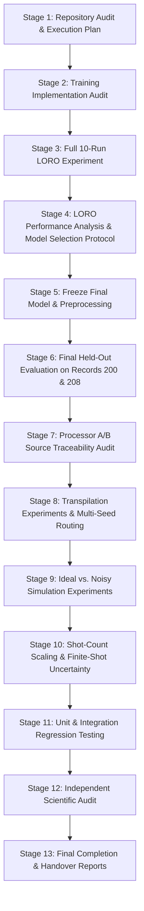

# NEXUS-OPS — Phase 5 & Phase 6 Master Execution Plan
## Quantum Machine Learning (VQC) and Quantum Hardware / Processor Evaluation

**Project:** NEXUS-OPS | PS-Q1 Biomedical Signal Classifier  
**Event / Competition:** IBM Quantum Qiskit Fall Fest 2026 (Project Q)  
**Author / Role:** Senior Quantum Machine Learning Research Engineer & Independent Technical Auditor  
**Date:** 13 October 2026 | 17:05 UTC+05:30  
**Status:** ACTIVE EXECUTION PLAN  
**Governing Mandates:** Phase 5 (QML / VQC) & Phase 6 (Hardware Architecture Experiments)  

---

## 1. Existing Implementation & Verified Milestones

An exhaustive inspection of the codebase establishes the following verified inventory:

### 1.1 Existing Verified Code & Modules
- **Data Ingestion & Signal Preprocessing (`src/data_loader.py`, `src/signal_preprocessing.py`, `src/dataset_builder.py`):**
  - MIT-BIH Arrhythmia Database (PhysioNet v1.0.0, team-selected benchmark).
  - 300 ECG segments (360 samples at 360 Hz, MLII lead), Normal (N) vs. VEB (V).
  - Training records: 106 ($N=100$), 119 ($N=100$). Total training cohort: 200 beats.
  - Quarantined test records: 200 ($N=50$), 208 ($N=50$). Total test cohort: 100 beats.
- **Feature Extraction & Scaling (`src/feature_extraction.py`, `src/feature_scaling.py`, `src/vqc_preprocessing.py`):**
  - 6 physiological features: `pre_rr`, `post_rr`, `qrs_rms`, `qrs_duration`, `p2p_amplitude`, `spectral_ratio`.
  - `QuantumFeatureScaler`: $[0, \pi]$ min-max scaling with hard clipping and out-of-bounds tracking.
  - `prepare_loro_fold`: Protocol A LORO isolation (Fold 1 fits exclusively on 106; Fold 2 fits exclusively on 119).
- **Core VQC Circuit Module (`src/vqc_circuit.py`):**
  - Frozen architecture (D1–D10): 6 qubits, first-order $R_y$ encoding, RealAmplitudes linear reps=1, 12 variational weights in $\mathcal{U}[-0.1, 0.1]$.
  - Ensemble Pauli-Z observable $O = \frac{1}{6}\sum_{i=0}^5 Z_i$ constructed via `SparsePauliOp.from_sparse_list`.
  - Deterministic ParameterVector prefix ordering (`p_enc`, `p_var`).
  - Readout mapping $p(\text{VEB}) = (E + 1) / 2$.
- **Classical Baselines (`src/classical_models.py`, `src/classical_evaluation.py`):**
  - Logistic Regression, SVM-RBF, Random Forest baselines documented in `results/classical_baseline.json`.
  - Classical audit documented in `report/classical_baseline_audit.md` (disclosing test-set model selection bias).
- **Processor A/B Definitions (`processors/`):**
  - Processor A: 5-qubit linear chain (canonical) & branching tree (exploratory).
  - Processor B: 9-qubit heavy-hex sparse tree (canonical) & 12-edge cyclic mesh (exploratory).
  - Transpilation and capacity enforcement verified in `tests/test_processor_ab.py`.
- **Training Prototype (`src/vqc_training.py`, `tests/test_vqc_training.py`):**
  - Objective function closure with Brier loss, parameter safety guards, SciPy COBYLA integration.
  - Verified Fold 1 Seed 42 diagnostic run (`maxiter=25`, 4.15s runtime, 19.3% train MSE decrease).
  - Test suite status: 107/107 passing tests across all 12 test files.

---

## 2. Missing Functionality & Required Work Breakdown

To satisfy the full Phase 5 and Phase 6 directives, the following components must be developed:

### Phase 5 Missing Components:
1. **Full 10-Run LORO Training Experiment:**
   - Execute 5 seeds ($42, 101, 202, 303, 404$) $\times$ 2 folds (Fold 1: 106 $\rightarrow$ 119, Fold 2: 119 $\rightarrow$ 106).
   - Standardized budget of 50 evaluations (`maxiter=50`) per run.
   - Comprehensive audit logging of convergence, parameters, probabilities, predictions, and metrics.
2. **Dedicated Evaluation & Model Selection Module (`src/vqc_evaluation.py`):**
   - ROC-AUC computation, confusion matrix generation, calibration curve computation.
   - Multi-seed statistical aggregation (mean, std, min, max; avoiding pseudo-replication claims).
   - Strict model selection engine based exclusively on LORO validation metrics.
3. **Model Selection Protocol Report (`report/vqc_model_selection_protocol.md`):**
   - Formally freeze selection rule BEFORE touching Records 200/208.
4. **Final Held-Out Cohort Evaluation (`results/vqc_heldout_evaluation.json`):**
   - Unquarantine Records 200 and 208 strictly post-freeze.
   - Evaluate the selected model; disclose classical comparison bias and sample size limits.
5. **Phase 5 Scientific Reports & Figures:**
   - `report/vqc_training_report.md`
   - `report/vqc_evaluation_report.md`
   - `report/PHASE5_FINAL_AUDIT.md`
   - Loss curves, calibration plots, ROC curves, confusion matrices in `figures/vqc/`.

### Phase 6 Missing Components:
1. **Processor Simulation & Transpilation Experiment Modules:**
   - `src/transpilation_experiments.py`: Multi-seed transpilation on Processor A (capacity rejection) and Processor B (routing, SWAP count, depth across multiple transpiler seeds).
   - `src/noise_experiments.py`: Challenge noise model vs ideal comparison on Processor B, sensitivity analysis across noise error strengths ($0.5\times, 1.0\times, 2.0\times$).
   - `src/processor_simulation.py`: Controlled shot-count scaling experiments (256, 512, 1024, 2048, 4096 shots) using Aer `EstimatorV2`.
2. **Hardware Access Disclosure:**
   - Formally document that physical quantum hardware access is NOT PERFORMED (no credentials used, simulation scope only).
3. **Phase 6 Scientific Reports & Figures:**
   - `report/processor_architecture_comparison.md`
   - `report/quantum_noise_analysis.md`
   - `report/quantum_hardware_experiment_report.md`
   - `report/PHASE6_FINAL_AUDIT.md`
   - Figures in `figures/phase6/`.

### Final Handover Deliverables:
- `report/PHASE5_PHASE6_COMPLETION_REPORT.md`
- `report/PHASE5_PHASE6_FINAL_HANDOVER.md`

---

## 3. Dependency-Ordered Execution Stages

---

## 4. Scientific Governance & Risk Controls

1. **Patient Quarantine Gate:**
   - Records 200 and 208 (`features_test.csv`) must remain completely untouched until Stage 6.
   - Stage 5 must formally serialize the model selection choice and write `report/vqc_model_selection_protocol.md` before `features_test.csv` is loaded.
2. **Optimizer Transparency:**
   - Objective evaluations (`nfev`) and simplex iterations (`nit`) must be logged separately in all runs.
   - All 10 runs must be reported without cherry-picking.
3. **Hardware Scope Transparency:**
   - Transpilation is compilation, not hardware execution.
   - Physical hardware execution is marked `NOT PERFORMED`.
4. **Git State Safety:**
   - Zero git history modifications (no commits, pushes, or resets).

---
*Execution plan approved for immediate autonomous execution.*
