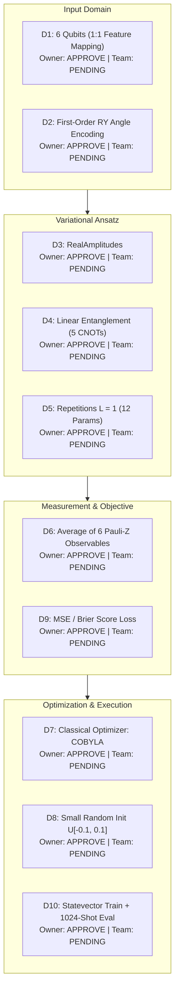

# Milestone 5B: VQC Architecture Decision Review & Scientific Validation

**Project:** Project Q — IBM Quantum Qiskit Fall Fest 2026  
**Challenge:** PS-Q1 — Biomedical Signal Classifier  
**Team:** NEXUS-OPS  
**Stage:** Milestone 5B.1 — Architecture Decision Validation & Scientific Review  
**Review Status:** **PROPOSED — NOT YET TEAM-APPROVED**  
**Decision Owner:** NEXUS-OPS team — pending confirmation  
**Date:** October 12, 2026 (Updated Milestone 5B.1)  

---

## 1. Executive Summary & Governance Status

Following the completion of the Milestone 5A architecture research ([`report/vqc_architecture_research.md`](file:///c:/Data/Projects/NEXUS-OPS/NEXUS-OPS/PS-Q1-Biomedical-Classifier/report/vqc_architecture_research.md)), the team lead submitted ten proposed design choices (D1 through D10) for formal scientific review.

### Governance Status & Individual Review Selections
The project owner has individually reviewed the proposed choices and recorded an individual position of **APPROVE** on:
* **D5:** Ansatz repetitions $L = 1$ as the primary baseline ($L = 2$ reserved for a later ablation study).
* **D6:** Measurement polarity: positive expectation ($E \to +1$) corresponds to class 1 (VEB); negative expectation ($E \to -1$) corresponds to class 0 (Normal).
* **D9:** Loss function: Mean Squared Error (Brier score) without adaptive bias terms.

> [!IMPORTANT]
> **Governance Enforcement:**  
> These endorsements represent the project owner's **individual review positions**. They do **NOT** constitute formal NEXUS-OPS team consensus.  
> **All ten architecture decisions strictly retain `"status": "PROPOSED_NOT_TEAM_APPROVED"`** in [`results/vqc_architecture_decisions.json`](file:///c:/Data/Projects/NEXUS-OPS/NEXUS-OPS/PS-Q1-Biomedical-Classifier/results/vqc_architecture_decisions.json). Formal team approval must be reached through team review before implementation in Milestone 5C.

**Core Circuit Status:** In accordance with the hackathon's AI-use policy, **no quantum circuit code, feature encoding unitary, variational ansatz, or training loops have been implemented in this milestone.**

---

## 2. Validation of Proposed Architecture Decisions (D1–D10)



---

### Decision D1: Qubit Count — 6 Qubits
* **Proposed Choice:** 6 Qubits.
* **Owner Position:** APPROVE | **Team Status:** PENDING (`PROPOSED_NOT_TEAM_APPROVED`).
* **Purpose:** Provide a direct $1:1$ mapping from the six engineered biomedical features ($\mathbf{x} \in [0, \pi]^6$) to quantum register states.
* **Technical Advantages:**
  * Avoids lossy dimensionality reduction (e.g., PCA), retaining all six distinct physiological dimensions: timing (`pre_rr`, `post_rr`), amplitude (`qrs_rms`, `p2p_amplitude`), width (`qrs_duration`), and frequency (`spectral_ratio`).
  * Theoretical state space is $2^6 = 64$ dimensions, which is computationally lightweight for classical statevector simulation.
* **Limitations & Risks:**
  * Requires maintaining two-qubit gate fidelities across 6 physical qubits if deployed to physical NISQ hardware.
* **Verification Requirements:**
  * Verify that feature columns map strictly to identical qubit indices across all batches (`x[0]` $\to q_0$, ..., `x[5]` $\to q_5$).
* **Scientific Verdict:** **`ACCEPTABLE FOR BASELINE`**.

---

### Decision D2: Feature Encoding — First-Order RY Angle Encoding
* **Proposed Choice:** First-Order $R_y$ Angle Encoding ($U_\Phi(\mathbf{x}) = \bigotimes_{i=0}^5 R_y(x_{i+1})$).
* **Owner Position:** APPROVE | **Team Status:** PENDING (`PROPOSED_NOT_TEAM_APPROVED`).
* **Purpose:** Map continuous scaled features into single-qubit rotation angles on the Bloch sphere along the $Y$-axis.
* **Technical Advantages:**
  * Theoretical depth $O(1)$ encoding with exactly zero two-qubit entangling gates.
  * Preserves real-valued probability amplitudes in the computational basis ($\cos(x_i/2)|0\rangle + \sin(x_i/2)|1\rangle$).
  * Perfectly matches the existing feature pipeline normalization domain $[0, \pi]$.
* **Limitations & Risks:**
  * Creates an unentangled product state at the encoding boundary; feature interactions must be learned solely by the downstream ansatz.
  * *Crucial Theoretical Distinction:* $R_y$ angle encoding does **NOT** make the VQC equivalent to classical Logistic Regression once downstream entanglement is applied (see Section 3).
* **Verification Requirements:**
  * Verify feature values are strictly clipped to $[0, \pi]$ prior to angle assignment.
  * Verify parameter vector binding order during Qiskit circuit evaluation.
* **Scientific Verdict:** **`ACCEPTABLE FOR BASELINE`**.

---

### Decision D3: Variational Ansatz — RealAmplitudes
* **Proposed Choice:** `RealAmplitudes` ansatz from Qiskit circuit library.
* **Owner Position:** APPROVE | **Team Status:** PENDING (`PROPOSED_NOT_TEAM_APPROVED`).
* **Purpose:** Parameterize the quantum state using parameterized $R_y(\theta)$ gates separated by entangling gates.
* **Technical Advantages:**
  * Restricts quantum states to real probability amplitudes ($\mathbb{R}^{64}$), cutting parameter count in half compared to full $SU(2)$ rotations (`EfficientSU2`).
  * Aligns with the real-valued nature of biological electrocardiogram signals.
  * Standardized Qiskit library construct supported in Qiskit 2.5.2.
* **Limitations & Risks:**
  * Discards complex phase degrees of freedom, which could theoretically restrict the expressivity of quantum interference.
* **Verification Requirements:**
  * Verify that gate construction matches standard RealAmplitudes parameter ordering.
  * Verify that no complex unitaries are introduced.
* **Scientific Verdict:** **`ACCEPTABLE FOR BASELINE`**.

---

### Decision D4: Entanglement Strategy — Linear Nearest-Neighbor
* **Proposed Choice:** Linear Entanglement (`"linear"`: $q_i \to q_{i+1}$).
* **Owner Position:** APPROVE | **Team Status:** PENDING (`PROPOSED_NOT_TEAM_APPROVED`).
* **Purpose:** Generate quantum entanglement across the 6-qubit register using nearest-neighbor CNOT gates.
* **Technical Advantages:**
  * Theoretical two-qubit gate count: exactly $n - 1 = 5$ CNOTs for 6 qubits.
  * Matches linear physical connectivity on superconducting processors without SWAP routing overhead.
  * Minimizes circuit depth relative to circular ($6$ CNOTs) or all-to-all ($15$ CNOTs) entanglement.
* **Limitations & Risks:**
  * Information flow between distant qubits (e.g., $q_0$ and $q_5$) is indirect across a single layer.
  * The order of features assigned to qubits dictates which features interact directly.
* **Verification Requirements:**
  * Confirm CNOT pairs are strictly $[(0, 1), (1, 2), (2, 3), (3, 4), (4, 5)]$.
* **Scientific Verdict:** **`ACCEPTABLE FOR BASELINE`**.

---

### Decision D5: Ansatz Repetitions — $L = 1$ Layer
* **Proposed Choice:** Single Repetition ($L = 1$).
* **Owner Position:** APPROVE (Primary Baseline; $L=2$ reserved for ablation) | **Team Status:** PENDING (`PROPOSED_NOT_TEAM_APPROVED`).
* **Purpose:** Restrict the parameterized entangling depth to a single block to maintain a shallow circuit.
* **Technical Advantages:**
  * Theoretical parameter count is $P = n \times (L + 1) = 6 \times 2 = 12$ trainable parameters.
  * Avoids deep circuit barren plateau phenomena and minimizes optimization landscape ruggedness.
  * Fast simulation runtime during multi-seed cross-validation.
* **Limitations & Risks:**
  * Underfitting risk: a single layer may have limited expressivity to separate complex non-linear boundary regions.
* **Verification Requirements:**
  * Verify theoretical parameter count equals 12 upon circuit construction.
  * Monitor training convergence to assess whether $L=2$ (18 parameters) is warranted as an ablation study.
* **Scientific Verdict:** **`ACCEPTABLE FOR BASELINE`**.

---

### Decision D6: Measurement Observable — Average of Six Pauli-Z Observables
* **Proposed Choice:** $E(\mathbf{x}, \boldsymbol{\theta}) = \frac{1}{6} \sum_{i=0}^5 \langle Z_i \rangle$.
* **Owner Position:** APPROVE (Polarity: positive = VEB, negative = Normal) | **Team Status:** PENDING (`PROPOSED_NOT_TEAM_APPROVED`).
* **Purpose:** Measure the local Pauli-Z expectation value on each qubit and average the outcomes across the register.
* **Technical Advantages:**
  * Local observable structure provably avoids cost-function-dependent barren plateaus in shallow circuits.
  * Symmetric readout aggregates discriminative signals from all six physiological feature channels.
  * Theoretical expectation value $E \in [-1, +1]$ maps linearly to probability $p \in [0, 1]$.
* **Limitations & Critical Polarity Requirement:**
  * *Polarity Convention:* The mapping $p(\text{VEB}) = \frac{E + 1}{2}$ assumes $E \to +1$ correlates with class 1 (VEB) and $E \to -1$ correlates with class 0 (Normal).
  * *Theoretical Zero-Angle Reference:* The mathematical statement that $E = +1.0$ ($p = 1.0$) at initialization applies strictly to the hypothetical reference state where both the input encoding angles and the variational parameters are exactly zero ($\mathbf{x} = \mathbf{0}, \boldsymbol{\theta} = \mathbf{0}$), yielding the unrotated ground state $|0\rangle^{\otimes 6}$. This must **NOT** be interpreted as implying that actual encoded ECG samples produce $E = +1.0$ at initialization.
  * *Evaluation on Actual ECG Data:* In practice, each ECG beat $\mathbf{x} \in [0, \pi]^6$ applies non-zero $R_y(x_i)$ rotations that rotate the qubits away from $|0\rangle^{\otimes 6}$, and variational parameters are drawn from $\boldsymbol{\theta}_0 \sim \mathcal{U}[-0.1, 0.1]$. Consequently, the initial predictions and empirical class polarity must be evaluated across the actual training cohort using the true six scaled input features and the initialized parameters.
  * Equal weighting ($1/6$ for each qubit) might dilute sensitivity if classification is heavily driven by 1 or 2 dominant features (such as `pre_rr`).
* **Verification Requirements:**
  * Verify dataset label convention ($0 = \text{Normal}, 1 = \text{VEB}$).
  * Verify `SparsePauliOp` little-endian construction for the 6 Pauli-Z terms with weight $1/6$ each.
  * Confirm that optimization drives Normal beats toward $E < 0$ and VEB beats toward $E > 0$ without introducing ad-hoc architecture changes.
* **Scientific Verdict:** **`ACCEPTABLE FOR BASELINE (VERIFICATION REQUIRED ON POLARITY)`**.

---

### Decision D7: Classical Optimizer — COBYLA
* **Proposed Choice:** COBYLA (`scipy.optimize.minimize(method="COBYLA")`).
* **Owner Position:** APPROVE | **Team Status:** PENDING (`PROPOSED_NOT_TEAM_APPROVED`).
* **Purpose:** Optimize the 12 variational parameters using a derivative-free linear approximation routine.
* **Technical Advantages:**
  * Derivative-free approach avoids expensive numerical or parameter-shift gradient evaluations.
  * Fast convergence in noise-free statevector simulation.
  * Fully available in `scipy.optimize` with zero third-party dependencies.
* **Limitations & Iteration vs. Evaluation Clarification:**
  * *Important Technical Distinction:* **COBYLA iterations and objective-function evaluations are distinct quantities.** An iteration can perform multiple function evaluations during simplex management, trust-region adjustment, and step validation.
  * Can get trapped in shallow local minima; step sizes are controlled by trust regions rather than line search.
* **Logging & Verification Requirements:**
  * Cap maximum iterations at 150.
  * Log separately: `iteration_count`, `objective_evaluation_count`, `best_objective_value`, `termination_reason`, `runtime_seconds`, and `convergence_status`.
* **Scientific Verdict:** **`ACCEPTABLE FOR BASELINE`**.

---

### Decision D8: Parameter Initialization — Small Uniform Random $\mathcal{U}[-0.1, 0.1]$
* **Proposed Choice:** $\boldsymbol{\theta}_0 \sim \mathcal{U}[-0.1, +0.1]$.
* **Owner Position:** APPROVE | **Team Status:** PENDING (`PROPOSED_NOT_TEAM_APPROVED`).
* **Purpose:** Initialize variational parameters near zero while introducing small asymmetry across qubits.
* **Technical Advantages:**
  * Starts the ansatz very close to identity ($W(\mathbf{0}) = I$), ensuring initial states are dominated by the feature encoding and avoiding chaotic random states.
  * Guarantees non-vanishing initial gradients and circumvents barren plateau initialization regions.
  * Fully reproducible when controlled by explicit integer random seeds.
* **Limitations & Risks:**
  * Restricted initial range may bias trajectories toward localized parameter space.
* **Verification Requirements:**
  * Seed random number generators explicitly (`np.random.default_rng(seed)`).
  * Validate that initial parameter values fall strictly within $[-0.1, 0.1]$.
* **Scientific Verdict:** **`ACCEPTABLE FOR BASELINE`**.

---

### Decision D9: Loss Function — Mean Squared Error (Brier Score)
* **Proposed Choice:** $\mathcal{L}_{\text{MSE}}(\boldsymbol{\theta}) = \frac{1}{N} \sum_{i=1}^N (\hat{p}_i - y_i)^2$.
* **Owner Position:** APPROVE | **Team Status:** PENDING (`PROPOSED_NOT_TEAM_APPROVED`).
* **Purpose:** Measure empirical risk using the Brier score between predicted probabilities and ground truth binary labels.
* **Technical Advantages:**
  * Direct algebraic connection to quantum expectation values:
    $$\mathcal{L}(\boldsymbol{\theta}) = \frac{1}{4N} \sum_{i=1}^N \left( E(\mathbf{x}_i, \boldsymbol{\theta}) - (2y_i - 1) \right)^2$$
  * Smooth, globally bounded in $[0, 1]$, and numerically stable with COBYLA.
  * Directly measures probability calibration without requiring adaptive bias parameters.
* **Limitations & Risks:**
  * MSE error gradients flatten when predictions saturate near 0 or 1, whereas Binary Cross-Entropy provides sharper penalization for confident misclassifications.
* **Verification Requirements:**
  * Verify calculation matches `sklearn.metrics.brier_score_loss`.
  * Ensure vectorized evaluation across all training samples in batch execution.
* **Scientific Verdict:** **`ACCEPTABLE FOR BASELINE`**.

---

### Decision D10: Simulation Paradigm — Ideal Statevector Training + 1,024-Shot Evaluation
* **Proposed Choice:** Statevector training (`StatevectorEstimator`) + Post-training 1,024-shot evaluation (`BackendEstimatorV2` with `AerSimulator`).
* **Owner Position:** APPROVE | **Team Status:** PENDING (`PROPOSED_NOT_TEAM_APPROVED`).
* **Purpose:** Decouple parameter learning from finite-shot statistical noise during optimization, then assess physical sampling robustness on the frozen model.
* **Technical Advantages:**
  * Fast, deterministic optimization convergence without stochastic gradient stalling.
  * Isolates model expressivity from quantum measurement noise during training.
* **Limitations & Theoretical Uncertainty Derivation:**
  * *Theoretical Worst-Case Sampling Bounds:*
    * For an expectation value $E = \frac{1}{6}\sum_{i=0}^5 \langle Z_i \rangle$, the worst-case standard error over $S = 1024$ shots is:
      $$\operatorname{SE}(E) \le \frac{1}{\sqrt{S}} = \frac{1}{\sqrt{1024}} = \frac{1}{32} \approx 0.03125$$
    * For the mapped probability $p = \frac{E + 1}{2}$, the standard error scales by $1/2$:
      $$\operatorname{SE}(p) = \frac{1}{2} \operatorname{SE}(E) \le \frac{1}{2\sqrt{S}} = \frac{1}{64} \approx 0.015625 \quad (\approx 1.56\%)$$
  * *Important Scientific Qualification:* These are **theoretical worst-case upper bounds**, NOT experimentally measured sampling errors. No circuit has been executed with shots yet.
  * Parameters converged under infinite shots may experience boundary fluctuation under shot noise if predictions lie within $p \in [0.50 \pm 0.016]$.
* **Verification Requirements:**
  * Verify that `StatevectorEstimator` is used exclusively during the optimization loop.
  * Verify that shot evaluation uses fixed simulator seeds for reproducibility.
* **Scientific Verdict:** **`ACCEPTABLE FOR BASELINE`**.

---

## 3. Mathematical Specification of the Proposed VQC

### 3.1 Composite Quantum State
Let $\mathbf{x} = (x_1, \dots, x_6)^T \in [0, \pi]^6$ denote the six normalized biomedical features for an ECG beat segment. The state of the 6-qubit register is:
$$|\psi(\mathbf{x}, \boldsymbol{\theta})\rangle = W(\boldsymbol{\theta}) U_\Phi(\mathbf{x}) |0\rangle^{\otimes 6}$$

### 3.2 Feature Encoding Unitary $U_\Phi(\mathbf{x})$
The first-order $R_y$ feature map applies independent single-qubit rotations:
$$U_\Phi(\mathbf{x}) = \bigotimes_{i=0}^5 R_y(x_{i+1})$$
where the rotation operator around the $Y$-axis is:
$$R_y(\alpha) = \exp\left( -i \frac{\alpha}{2} Y \right) = \begin{pmatrix} \cos(\alpha/2) & -\sin(\alpha/2) \\ \sin(\alpha/2) & \cos(\alpha/2) \end{pmatrix}$$
Acting on the ground state $|0\rangle^{\otimes 6}$, this prepares the product state:
$$|\psi(\mathbf{x})\rangle = \bigotimes_{i=0}^5 \left( \cos\left(\frac{x_{i+1}}{2}\right)|0\rangle + \sin\left(\frac{x_{i+1}}{2}\right)|1\rangle \right)$$

### 3.3 Variational Ansatz Unitary $W(\boldsymbol{\theta})$
The `RealAmplitudes` ansatz with linear entanglement and repetition count $L = 1$ is parameterized by $\boldsymbol{\theta} = (\theta_0, \theta_1, \dots, \theta_{11})^T \in \mathbb{R}^{12}$:
$$W(\boldsymbol{\theta}) = \left( \bigotimes_{i=0}^5 R_y(\theta_{i+6}) \right) U_{\text{ent}} \left( \bigotimes_{i=0}^5 R_y(\theta_i) \right)$$
where the linear entangling unitary $U_{\text{ent}}$ consists of a cascade of 5 nearest-neighbor CNOT gates:
$$U_{\text{ent}} = \text{CNOT}_{(4, 5)} \cdot \text{CNOT}_{(3, 4)} \cdot \text{CNOT}_{(2, 3)} \cdot \text{CNOT}_{(1, 2)} \cdot \text{CNOT}_{(0, 1)}$$

### 3.4 Expectation Value & Measurement
The model measures the ensemble average of the six single-qubit Pauli-Z operators:
$$E(\mathbf{x}, \boldsymbol{\theta}) = \frac{1}{6} \sum_{i=0}^5 \langle Z_i \rangle_{\mathbf{x}, \boldsymbol{\theta}} = \frac{1}{6} \sum_{i=0}^5 \langle \psi(\mathbf{x}, \boldsymbol{\theta}) | Z_i | \psi(\mathbf{x}, \boldsymbol{\theta}) \rangle$$
where $Z_i = I^{\otimes (5-i)} \otimes Z \otimes I^{\otimes i}$ in Qiskit little-endian notation. Since each $\langle Z_i \rangle \in [-1, +1]$, the average expectation satisfies $E(\mathbf{x}, \boldsymbol{\theta}) \in [-1, +1]$.

### 3.5 Probability Mapping & Class Polarity Convention
The predicted probability of a beat being a Ventricular Ectopic Beat (VEB, $y = 1$) is defined via the affine mapping:
$$p(\text{VEB} | \mathbf{x}, \boldsymbol{\theta}) = \frac{E(\mathbf{x}, \boldsymbol{\theta}) + 1}{2} \in [0, 1]$$

> [!WARNING]
> **Polarity Assumption & Label Convention Check:**  
> This formulation assumes that positive expectation values ($E \to +1$) correlate with **VEB** ($y = 1$), while negative expectation values ($E \to -1$) correlate with **Normal** ($y = 0$).  
> *Initial Prediction Clarification:* The theoretical property that $E = +1.0$ occurs strictly when both input encoding angles and variational parameters are identically zero ($\mathbf{x} = \mathbf{0}, \boldsymbol{\theta} = \mathbf{0}$). This does **NOT** imply that actual encoded ECG samples produce $E = +1.0$ at initialization. Real ECG samples apply non-zero rotation angles $\mathbf{x}_i \in [0, \pi]^6$ and initialized angles $\boldsymbol{\theta}_0 \sim \mathcal{U}[-0.1, 0.1]$. Baseline predictions must be evaluated using the actual six scaled input features and initialized parameters across the training cohort. Do NOT introduce an adaptive bias term or alter the proposed mapping without team consensus.

### 3.6 Non-Equivalence to Classical Logistic Regression
> [!IMPORTANT]
> **Scientific Clarity on Model Expressivity:**  
> It is **strictly incorrect** to claim that $R_y$ angle encoding makes the VQC equivalent to Logistic Regression.  
> *Proof:* In Logistic Regression, the log-odds is a strictly linear combination of features: $z = \mathbf{w}^T \mathbf{x} + b$. In this VQC, although the encoding uses single-qubit rotations, the subsequent CNOT entanglers entangle the qubits into a 64-dimensional non-separable state. The expectation value $\langle Z_i \rangle$ on the entangled state contains multi-linear trigonometric interaction terms of the form $\cos(x_j/2)\sin(x_k/2)$ across all entangled qubit pairs. Therefore, the decision boundary is inherently non-linear and operates in a quantum Hilbert space, not a classical linear hyperplane.

---

## 4. Parameter & Resource Verification Plan

To prevent confusion between theoretical formulas, constructed circuits, and transpiled hardware representations, the resource verification plan is categorized into three distinct tiers:

### 4.1 Resource Categorization Matrix

| Resource Dimension | Tier 1: Theoretical Architecture Expectation (Pre-Implementation Formula) | Tier 2: Constructed Circuit Metric (Requires Circuit Object in Code) | Tier 3: Transpiled Hardware Metric (Requires Hardware Compilation) |
| :--- | :---: | :---: | :---: |
| **Qubit Count** | **6** ($1:1$ feature mapping) | Verified via `qc.num_qubits` | Mapped to physical layout |
| **Feature Parameters** | **6** ($x_0, \dots, x_5$) | Verified via `len(fmap.parameters)` | Bound before execution |
| **Trainable Parameters** | **12** ($n \times (L+1) = 6 \times 2$) | Verified via `len(ansatz.parameters)` | 12 classical parameters |
| **Ansatz Layers ($L$)** | **1** | Verified via circuit inspection | 1 repetition block |
| **CNOT Count** | **5** ($n - 1 = 5$) | Verified via `qc.count_ops().get("cx", 0)` | $\ge 5$ (depends on SWAPs) |
| **Single-Qubit Rotations** | **18** ($6\text{ enc} + 12\text{ var}$) | Verified via `qc.count_ops().get("ry", 0)` | Decomposed into basis ($SX, R_z$) |
| **Untranspiled Depth** | **8** (theoretical formula) | Verified via `qc.depth()` | $\ge 8$ (basis gate dependent) |
| **Observables Count** | **6** terms | Verified via `len(observable)` | 6 Pauli-Z measurements |
| **Optimizer Iteration Limit** | **150** | Configured in `maxiter=150` | $\le 150$ iterations |
| **Objective Evals Logging** | Tracked separately from iterations | Logged via callback counter | Total function calls |

*Disclaimer:* Tier 1 represents the abstract architectural blueprint. Tier 2 values will be confirmed once the circuit object is constructed in Milestone 5C. Tier 3 metrics depend on the target hardware coupling map and native basis gate set.

---

## 5. Training & Evaluation Protocol

```
[ Training Cohort: Records 106 & 119 (n=200) ]
        │
        ├──> Fold 1: Train on 106 (n=100) -> Validate on 119 (n=100)  [5 Seeds] = 5 runs
        │
        └──> Fold 2: Train on 119 (n=100) -> Validate on 106 (n=100)  [5 Seeds] = 5 runs
                                                                       Total = 10 LORO Runs
        │
        └──> Full Training Fit on 106 + 119 (n=200)                   [5 Seeds] = 5 runs

[ Held-Out Test Cohort: Records 200 & 208 (n=100) ]
        │
        └──> STRICTLY POST-HOC EVALUATION (Single Final Evaluation of Frozen Model)
```

### 5.1 Protocol Specifications
1. **Multi-Seed Stability:** 5 fixed random seeds: $\mathcal{S} = \{42, 101, 202, 303, 404\}$.
2. **Leave-One-Record-Out (LORO) Validation:**
   * Fold 1: Train on Record 106 ($n=100$), validate on Record 119 ($n=100$).
   * Fold 2: Train on Record 119 ($n=100$), validate on Record 106 ($n=100$).
   * $5\text{ seeds} \times 2\text{ folds} = \mathbf{10\text{ LORO runs}}$.
3. **Full Training Fit:** 5 seed runs on Records 106 + 119 ($n=200$).
4. **COBYLA Optimizer Configuration:**
   * Maximum iterations: 150.
   * Convergence rule: loss change $\le 10^{-4}$ for 5 consecutive checks.
   * Mandatory separate logging of: iteration count, objective evaluation count, best loss, termination message, execution time, and convergence flag.
5. **Dual Simulation Tiers:**
   * Optimization performed under exact analytical `StatevectorEstimator`.
   * Robustness evaluation performed with $S = 1024$ shots using `BackendEstimatorV2` with `AerSimulator`.
6. **Reporting Requirements:** Accuracy, Sensitivity, Specificity, Precision, F1-Score, ROC-AUC, Brier score (MSE), Confusion Matrix, Loss curves, and execution runtimes.
7. **Test Set Isolation & Historical Bias Disclosure:**
   * Held-out records 200 and 208 must **NEVER** be used to select architectures, optimizers, initialization, or thresholds.
   * Milestone 4.1 historical test-set selection bias disclosure is preserved: the test set is strictly an observational benchmark.

---

## 6. Comprehensive Scientific Limitations

1. **Small Dataset & Cohort Scarcity:** The dataset comprises only four MIT-BIH recordings (two train, two test).
2. **Within-Record Beat Correlation:** Segments from the same recording share morphology, lead placement, and patient cardiac axis.
3. **Inter-Patient Generalization Uncertainty (Record 208 Physiological Context):**  
   * *Cautious Physiological Wording:* Some normal-labelled beats in Record 208 exhibited relatively rapid RR intervals ($0.48\text{--}0.56\text{ s}$), which may contribute to classification difficulty when compared against training set ectopic intervals.
   * Sinus tachycardia is an **unconfirmed clinical hypothesis**, not an established diagnosis. The empirical false-positive uncertainty is fully documented.
4. **Retrospective Post-RR Lookahead Latency:** Feature 2 (`post_rr`) introduces an unavoidable delay of $0.42\text{--}1.48\text{ seconds}$. The classifier is strictly an offline annotator.
5. **Heuristic QRS Duration Estimation:** QRS width is estimated from zero-crossing baselines, introducing heuristic variance.
6. **Finite-Shot Sampling Uncertainty:** Theoretical worst-case bound on probability is $\operatorname{SE}(p) \le 1.56\%$ at 1,024 shots. This is a mathematical bound, not an experimentally measured value.
7. **Optimizer Sensitivity & Local Minima:** COBYLA is a derivative-free heuristic; non-convex landscapes can yield disparate local optima across random seeds.
8. **No Clinical Validity or Diagnostic Safety Claims:** Academic engineering prototype only; **not clinically deployable**.
9. **Historical Test-Set Selection Bias:** Acknowledged and preserved from Milestone 4.1 findings.

---

## 7. Deliverables & Next Steps

1. **Decision Review Document:** [`report/vqc_architecture_decision_review.md`](file:///c:/Data/Projects/NEXUS-OPS/NEXUS-OPS/PS-Q1-Biomedical-Classifier/report/vqc_architecture_decision_review.md)
2. **Implementation Readiness Checklist:** [`report/vqc_implementation_readiness_checklist.md`](file:///c:/Data/Projects/NEXUS-OPS/NEXUS-OPS/PS-Q1-Biomedical-Classifier/report/vqc_implementation_readiness_checklist.md)
3. **Machine-Readable Decisions JSON:** [`results/vqc_architecture_decisions.json`](file:///c:/Data/Projects/NEXUS-OPS/NEXUS-OPS/PS-Q1-Biomedical-Classifier/results/vqc_architecture_decisions.json)
4. **Team Review Summary:** [`report/vqc_team_review_summary.md`](file:///c:/Data/Projects/NEXUS-OPS/NEXUS-OPS/PS-Q1-Biomedical-Classifier/report/vqc_team_review_summary.md)
