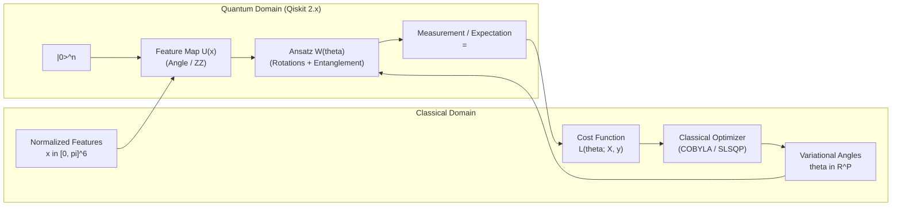
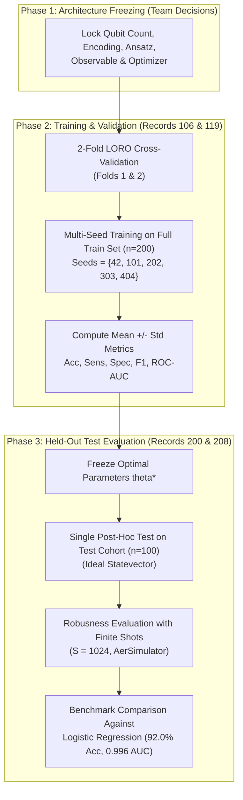

# Milestone 5A: Variational Quantum Classifier (VQC) Architecture Research & Experiment Design

**Project:** NEXUS-OPS | PS-Q1 Biomedical Signal Classifier  
**Discipline:** Quantum Machine Learning / Biomedical Signal Processing  
**Current Stage:** Classical Baseline Conditionally Approved — Quantum Architecture Design  
**Target Completion:** 14 October 2026  
**Status:** Pre-Implementation Architectural Blueprint (Awaiting Team Decisions)  

---

## 1. Problem Definition & Scope

The objective of the NEXUS-OPS PS-Q1 project is to classify short single-lead electrocardiogram (ECG) beat segments as either:
* **Class 0:** Normal Sinus Beat (`N`, label $y = 0$)
* **Class 1:** Ventricular Ectopic Beat (`V`, label $y = 1$)

### 1.1 Experimental Context & Established Invariants
From Milestones 1 through 4.1, the experimental foundation has been locked and validated:
* **Cohort:** Exactly 300 balanced ECG segments ($150\text{ N}, 150\text{ V}$) extracted from the MIT-BIH Arrhythmia Database.
* **Patient-Separated Partitions:**
  * **Training Cohort ($n=200$):** Record 106 ($50\text{ N}, 50\text{ V}$) and Record 119 ($50\text{ N}, 50\text{ V}$).
  * **Held-Out Test Cohort ($n=100$):** Record 200 ($50\text{ N}, 50\text{ V}$) and Record 208 ($50\text{ N}, 50\text{ V}$).
  * No recording or subject crosses the train/test divide.
* **Feature Vector ($\mathbf{x} \in [0, \pi]^6$):** Six engineered biomedical features, scaled into the quantum rotation interval $[0, \pi]$ using parameters fitted **exclusively on the training partition**:
  1. $x_1$: `pre_rr` (pre-ectopic interval, seconds)
  2. $x_2$: `post_rr` (post-ectopic compensatory pause interval, seconds)
  3. $x_3$: `qrs_rms` (root-mean-square amplitude across QRS window, mV)
  4. $x_4$: `qrs_duration` (width of QRS complex, seconds)
  5. $x_5$: `p2p_amplitude` (peak-to-peak voltage swing, mV)
  6. $x_6$: `spectral_ratio` (high-frequency 10–30 Hz band power ratio, dimensionless)
* **Classical Primary Benchmark:** L2-Regularized Logistic Regression on $[0, \pi]^6$ (Test Accuracy = $92.0\%$, ROC-AUC = $0.9960$, Training LORO Mean ROC-AUC = $1.0000$).
* **Hackathon AI Policy:** AI assistance is restricted to syntax guidance, documentation, mathematical formulation, and debugging. The core quantum circuit architecture, parameterization choices, and algorithmic decisions **must be owned, documented, and approved by the team**.

---

## 2. Mathematical Formulation of a Variational Quantum Classifier

A Variational Quantum Classifier (VQC) is a hybrid quantum-classical algorithm that maps classical feature vectors into quantum states via a parameterized quantum circuit (PQC) and iteratively optimizes variational angles using a classical optimizer.



### 2.1 State Preparation (Feature Encoding)
For a classical feature vector $\mathbf{x} = (x_1, \dots, x_d)^T \in [0, \pi]^d$, state preparation initializes the $n$-qubit register from $|0\rangle^{\otimes n}$ via a unitary encoding circuit $U_\Phi(\mathbf{x})$:
$$|\psi(\mathbf{x})\rangle = U_\Phi(\mathbf{x}) |0\rangle^{\otimes n}$$

### 2.2 Variational Ansatz (Parameterized Unitary)
The encoded state is transformed by an ansatz unitary $W(\boldsymbol{\theta})$ parameterized by classical angles $\boldsymbol{\theta} \in \mathbb{R}^P$:
$$|\psi(\mathbf{x}, \boldsymbol{\theta})\rangle = W(\boldsymbol{\theta}) |\psi(\mathbf{x})\rangle = W(\boldsymbol{\theta}) U_\Phi(\mathbf{x}) |0\rangle^{\otimes n}$$
The ansatz typically comprises $L$ repeating layers, where each layer interleaves single-qubit rotations $R_{\alpha}(\theta_{j, l})$ ($\alpha \in \{X, Y, Z\}$) and entangling gates (e.g., CNOT or CZ):
$$W(\boldsymbol{\theta}) = \prod_{l=1}^L \left( U_{\text{ent}} \bigotimes_{j=0}^{n-1} R_Y(\theta_{j, l}) \right)$$

### 2.3 Observable Measurement & Output Prediction
A Hermitian observable $\hat{O} = \hat{O}^\dagger$ is measured on the final state. The model expectation value is:
$$\langle \hat{O} \rangle_{\mathbf{x}, \boldsymbol{\theta}} = \langle \psi(\mathbf{x}, \boldsymbol{\theta}) | \hat{O} | \psi(\mathbf{x}, \boldsymbol{\theta}) \rangle \in [\lambda_{\min}, \lambda_{\max}]$$
For a single-qubit Pauli-Z measurement on qubit $0$ ($\hat{O} = Z_0 = Z \otimes I^{\otimes (n-1)}$), $\langle Z_0 \rangle \in [-1, +1]$.

The continuous expectation value is converted to a binary class probability $P(y = 1 | \mathbf{x}; \boldsymbol{\theta})$ via an affine transformation or sigmoid link function:
$$P(y = 1 | \mathbf{x}; \boldsymbol{\theta}) = \frac{\langle \hat{O} \rangle_{\mathbf{x}, \boldsymbol{\theta}} + 1}{2} \in [0, 1]$$
Alternatively, with an adaptive classical bias $b \in \mathbb{R}$:
$$P(y = 1 | \mathbf{x}; \boldsymbol{\theta}, b) = \sigma\left( \kappa \langle \hat{O} \rangle_{\mathbf{x}, \boldsymbol{\theta}} + b \right)$$
where $\sigma(z) = \frac{1}{1 + e^{-z}}$ and $\kappa > 0$ is a scaling hyperparameter.

### 2.4 Loss Function & Classical Optimization
Given training observations $\{(\mathbf{x}_i, y_i)\}_{i=1}^N$, parameters $\boldsymbol{\theta}$ are optimized by minimizing an empirical objective $\mathcal{L}(\boldsymbol{\theta})$:
1. **Binary Cross-Entropy (Log Loss):**
   $$\mathcal{L}_{\text{BCE}}(\boldsymbol{\theta}) = -\frac{1}{N} \sum_{i=1}^N \left[ y_i \ln \hat{p}_i + (1 - y_i) \ln (1 - \hat{p}_i) \right]$$
2. **Mean Squared Error (Brier Score):**
   $$\mathcal{L}_{\text{MSE}}(\boldsymbol{\theta}) = \frac{1}{N} \sum_{i=1}^N \left( \hat{p}_i - y_i \right)^2 = \frac{1}{4N} \sum_{i=1}^N \left( \langle \hat{O} \rangle_{\mathbf{x}_i, \boldsymbol{\theta}} - (2y_i - 1) \right)^2$$
The optimization problem is:
$$\boldsymbol{\theta}^* = \arg\min_{\boldsymbol{\theta}} \mathcal{L}(\boldsymbol{\theta})$$

---

## 3. Comprehensive Analysis of 10 VQC Design Dimensions

### Dimension 1: Qubit Count & Feature Mapping
* **Design Options:**
  1. **6 Qubits ($1:1$ direct mapping):** Each feature $x_j$ assigned to qubit $q_j$ ($j = 0, \dots, 5$).
  2. **3 Qubits (Dimensionality reduction or Data Re-uploading):** Apply PCA/feature selection from 6 to 3 dimensions, or re-upload 2 features per qubit across multiple layers.
  3. **1 Qubit (Sequential Data Re-uploading):** A single qubit interleaved with alternating data encodings and trainable rotations.
* **Mathematical Trade-offs:**
  * 6 qubits span a Hilbert space of dimension $2^6 = 64$. Direct $1:1$ mapping avoids lossy dimensionality reduction and retains all six biomedical features.
  * 3 qubits span $2^3 = 8$ dimensions, reducing simulation time by $\approx 8\times$, but requires discarding feature information or increasing circuit depth via re-uploading.
* **Qiskit 2.x Implementation:** `qc = QuantumCircuit(6)` vs `qc = QuantumCircuit(3)`.
* **Biomedical Relevance:** Our six features represent distinct physiological domains (timing, voltage, spectral). Preserving all 6 features without compression maintains clinical feature fidelity.

---

### Dimension 2: Feature Encoding Strategies
* **Design Options:**
  1. **First-Order Angle Encoding ($R_y(x_j)$):**
     $$U(\mathbf{x}) = \bigotimes_{j=0}^{n-1} R_y(x_j) = \bigotimes_{j=0}^{n-1} \begin{pmatrix} \cos(x_j/2) & -\sin(x_j/2) \\ \sin(x_j/2) & \cos(x_j/2) \end{pmatrix}$$
     Transforms $|0\rangle$ into $\cos(x_j/2)|0\rangle + \sin(x_j/2)|1\rangle$.
  2. **Dense Angle Encoding ($R_x(x_{2j}) R_y(x_{2j+1})$):** Packs two features per qubit using orthogonal rotation axes. Requires only 3 qubits for 6 features.
  3. **Second-Order Pauli-Z / ZZ Feature Map:**
     $$U_{\Phi}(\mathbf{x}) = \exp\left( i \sum_{j=1}^d x_j Z_j + \sum_{j < k} (\pi - x_j)(\pi - x_k) Z_j Z_k \right) H^{\otimes n}$$
     Introduces non-linear feature interactions via pairwise entanglement.
  4. **Amplitude Encoding:** Encodes $\mathbf{x}$ into state amplitudes $|\psi\rangle = \sum_{j=0}^{2^n-1} x_j |j\rangle$. Requires $\log_2(d)$ qubits ($3$ qubits for $6$ features padded to $8$).
* **Trade-off Comparison:**
  * Angle encoding has circuit depth $O(1)$ and zero two-qubit gates, but creates product states without quantum correlations in the encoding stage.
  * ZZ Feature Map introduces non-linear feature kernels $\phi(x_j, x_k)$, but incurs $O(n^2)$ CNOT gates (15 CNOTs per layer for 6 qubits), increasing sensitivity to noise.
  * Amplitude encoding requires deep state-preparation unitaries ($O(2^n)$ CNOTs) which are prohibitive on NISQ hardware.
* **Qiskit 2.x Implementation:**
  ```python
  # Option A: Manual Angle Encoding
  for j in range(6):
      qc.ry(x_params[j], j)

  # Option B: Library ZZFeatureMap
  from qiskit.circuit.library import ZZFeatureMap
  fmap = ZZFeatureMap(feature_dimension=6, reps=1, entanglement="linear")
  ```

---

### Dimension 3: Parameterized Rotation Gates (Ansatz Rotations)
* **Design Options:**
  1. **RealAmplitudes ($R_y(\theta)$ only):** Generates states with purely real amplitudes in the computational basis.
  2. **Rotations in Two Bases ($R_y(\theta) R_z(\phi)$ or EfficientSU2):** Allows exploration of the full single-qubit Bloch sphere.
  3. **General Euler Rotations ($U3(\theta, \phi, \lambda)$ or $R_z R_y R_z$):** 3 parameters per qubit per layer.
* **Trade-off Comparison:**
  * $R_y$ rotations ensure statevectors remain real-valued ($\psi \in \mathbb{R}^{2^n}$), halving the parameter count and matching the real-valued nature of the input features.
  * $R_y + R_z$ doubles parameter count ($12$ params per layer for 6 qubits) and introduces complex phases, expanding expressive capacity but increasing optimization difficulty.
* **Qiskit 2.x Implementation:**
  ```python
  from qiskit.circuit.library import RealAmplitudes, EfficientSU2
  # RealAmplitudes: single Ry per qubit per layer
  ansatz_real = RealAmplitudes(num_qubits=6, reps=1)
  # EfficientSU2: Ry and Rz per qubit per layer
  ansatz_su2 = EfficientSU2(num_qubits=6, reps=1, su2_gates=["ry", "rz"])
  ```

---

### Dimension 4: Entanglement Strategies & Connectivity
* **Design Options:**
  1. **Linear Nearest-Neighbor Entanglement:** Qubit $j$ entangled only with qubit $j+1$ (5 CNOTs for 6 qubits).
  2. **Circular (Ring) Entanglement:** Qubit $j$ entangled with $j+1$, plus a CNOT between qubit $n-1$ and qubit $0$ (6 CNOTs for 6 qubits).
  3. **Full (All-to-All) Entanglement:** Every pair of qubits entangled ($n(n-1)/2 = 15$ CNOTs for 6 qubits).
* **Topological Considerations:**
  * Superconducting quantum hardware (e.g., IBM Quantum heavy-hex lattices) has limited connectivity (qubit degree 2 or 3). Full entanglement requires numerous SWAP gates, expanding circuit depth by $3\text{--}5\times$.
  * Linear connectivity requires zero SWAP gates if mapped to a linear hardware chain.
* **Qiskit 2.x Implementation:** Controlled by the `entanglement` argument: `"linear"`, `"circular"`, `"full"`.

---

### Dimension 5: Measurement Observables
* **Design Options:**
  1. **Single-Qubit Observable ($\hat{O} = Z_0$):** Measure Pauli-Z on qubit 0 only.
  2. **Global Parity Observable ($\hat{O} = Z^{\otimes n} = Z_0 Z_1 \dots Z_5$):** Measure joint parity across all 6 qubits.
  3. **Multi-Qubit Sum Observable ($\hat{O} = \frac{1}{n} \sum_{j=0}^{n-1} Z_j$):** Average single-qubit magnetization.
* **Trade-off Comparison:**
  * Single-qubit observables are less prone to barren plateaus than global observables (Cerezo et al., *Cost function dependent barren plateaus in shallow quantum neural networks*, 2021).
  * Global parity $Z^{\otimes n}$ requires measuring multi-qubit correlations; as $n$ grows, its gradient decays exponentially even in shallow circuits.
  * Sum of local observables $\sum Z_j$ averages information across all feature-associated qubits while preserving non-zero gradients in shallow depth.
* **Qiskit 2.x Implementation:**
  ```python
  from qiskit.quantum_info import SparsePauliOp
  # Single qubit Z_0:
  obs_z0 = SparsePauliOp.from_list([("IIIIIZ", 1.0)])  # Note: Qiskit little-endian!
  # Averaged sum:
  obs_sum = SparsePauliOp.from_list([(f"{'I'*i}Z{'I'*(5-i)}", 1.0/6.0) for i in range(6)])
  ```

---

### Dimension 6: Classical Optimizer Options
* **Design Options:**
  1. **COBYLA (Constrained Optimization BY Linear Approximation):** Derivative-free, builds linear approximations of the objective.
  2. **SLSQP (Sequential Least Squares Programming):** Gradient-based, supports parameter bounds.
  3. **L-BFGS-B (Limited-memory BFGS with Bounds):** Quasi-Newton method using gradient evaluations.
  4. **Nelder-Mead (Simplex Search):** Robust heuristic derivative-free method.
  5. **SPSA (Simultaneous Perturbation Stochastic Approximation):** Approximates gradients using only 2 function evaluations per step; highly resilient to shot noise.
* **Gradient Evaluation in Qiskit:**
  * In modern Qiskit without external algorithm packages, gradients are computed via:
    * Finite differences: $\frac{\mathcal{L}(\theta + \epsilon) - \mathcal{L}(\theta - \epsilon)}{2\epsilon}$ ($2P$ evaluations per step).
    * Exact Parameter Shift Rule: $\frac{\partial \langle O \rangle}{\partial \theta_j} = \frac{\langle O \rangle_{\theta_j + \pi/2} - \langle O \rangle_{\theta_j - \pi/2}}{2}$ ($2P$ quantum evaluations per gradient step).
  * Derivative-free optimizers (COBYLA) require only 1 evaluation per iteration, making them significantly faster during statevector simulation.
* **Trade-off Summary:** COBYLA is the gold standard for noise-free statevector VQC benchmarks due to its low evaluation count; SPSA is preferred for shot-based and noisy simulation.

---

### Dimension 7: Parameter Initialization
* **Design Options:**
  1. **Zero Initialization ($\boldsymbol{\theta} = \mathbf{0}$):** All ansatz gates evaluate to the identity matrix ($W(\mathbf{0}) = I$).
  2. **Small Uniform Random ($\boldsymbol{\theta} \sim \mathcal{U}[-\epsilon, +\epsilon]$, e.g., $\epsilon = 0.1$):** Starts close to identity while breaking exact symmetry.
  3. **Full Random ($\boldsymbol{\theta} \sim \mathcal{U}[0, 2\pi)$):** Completely random state initialization.
* **Trade-off Comparison:**
  * Full random initialization in deep circuits can land directly in a barren plateau region where $\nabla \mathcal{L} \approx 0$.
  * Identity-like initialization ($W \approx I$) ensures initial gradients are non-vanishing and predictions initially reflect the input feature encoding alone.

---

### Dimension 8: Simulation Paradigm: Statevector vs. Shot-Based
* **Design Options:**
  1. **Ideal Statevector Simulation (`StatevectorEstimator`):**
     * Calculates exact mathematical inner products: $\langle \psi | \hat{O} | \psi \rangle$.
     * Number of shots = $\infty$. Variance due to quantum measurement = $0$.
     * Deterministic, reproducible, fast.
  2. **Shot-Based Simulation (`BackendEstimatorV2` with `AerSimulator`):**
     * Simulates quantum measurement collapse over $S$ finite shots (e.g., $S = 1024$ or $4096$).
     * Introduces statistical sampling variance: $\sigma_{\text{shot}} \approx \frac{1}{\sqrt{S}}$.
     * Reflects true quantum hardware operational behavior.
* **Protocol Recommendation:** Conduct architecture search and training using ideal statevector simulation first; then validate final models using shot-based and noisy simulation to decouple model expressivity from finite-shot stochasticity.

---

### Dimension 9: Circuit Depth & Two-Qubit Gate Budget
* **Design Options:**
  * **$L = 1$ Layer:** Minimal depth ($1$ rotation layer, $1$ entangling layer).
  * **$L = 2$ Layers:** Moderate depth ($2$ rotation layers, $2$ entangling layers).
  * **$L = 3$ Layers:** Deeper expressive ansatz.
* **Resource Scaling for 6 Qubits:**

| Layers ($L$) | Rotation Gates ($R_y$) | CNOTs (Linear) | CNOTs (Circular) | Trainable Parameters |
| :---: | :---: | :---: | :---: | :---: |
| **1** | $6$ (or $12$ with final layer) | $5$ | $6$ | $12$ |
| **2** | $18$ | $10$ | $12$ | $18$ |
| **3** | $24$ | $15$ | $18$ | $24$ |

* **Coherence & Depth Constraints:** Superconducting NISQ devices exhibit two-qubit gate errors of $0.5\%\text{--}1.5\%$ per CNOT. A circuit with $> 20$ CNOTs on 6 qubits suffers significant state fidelity degradation without error mitigation.

---

### Dimension 10: Measurement & Computational Cost Analysis
* **Cost Equation:**
  $$\text{Total Quantum Evaluations} = N_{\text{samples}} \times N_{\text{iterations}} \times K_{\text{evals\_per\_iter}}$$
  * For $N_{\text{train}} = 200$ samples:
    * With COBYLA ($K \approx 1$): $200 \times 100\text{ iterations} = 20,000$ circuit evaluations.
    * With SLSQP + Parameter Shift ($P = 12$, $K = 2 \times 12 + 1 = 25$): $200 \times 100 \times 25 = 500,000$ circuit evaluations!
* **Computational Feasibility:**
  * In Qiskit 2.x, `StatevectorEstimator` computes PUB batches vectorized across all 200 samples in parallel.
  * Derivative-free COBYLA or batch gradient computation is essential to maintain tractable execution runtimes ($< 5\text{ minutes}$ per training run).

---

## 4. Qiskit 2.x Environment Compatibility & API Audit

The project environment was audited to ensure full compatibility with modern Qiskit 2.x specifications:

### 4.1 Installed Versions
* **Qiskit Core:** `v2.5.2`
* **Qiskit Aer:** `v0.17.2`
* **SciPy:** `v1.18.1` (provides `scipy.optimize.minimize`)
* **NumPy:** `v2.5.4`
* **Python Runtime:** `3.13.7`

### 4.2 Verified Modern APIs (Supported & Operational)
```python
# 1. Parameterized Circuit Construction
from qiskit.circuit import QuantumCircuit, ParameterVector
x = ParameterVector("x", 6)      # Classical feature parameters
theta = ParameterVector("θ", 12)  # Variational ansatz parameters

# 2. Modern V2 Primitives (Qiskit 2.x Standard)
from qiskit.primitives import StatevectorEstimator, BackendEstimatorV2
from qiskit.quantum_info import SparsePauliOp
from qiskit_aer import AerSimulator

# Ideal Analytical Simulation:
estimator_ideal = StatevectorEstimator()
# PUB (Primitive Unified Bloc) execution format:
pub = (circuit, [observable], [parameter_values])
job = estimator_ideal.run([pub])
evs = job.result()[0].data.evs

# Finite-Shot Simulation:
sim = AerSimulator()
estimator_shots = BackendEstimatorV2(backend=sim)
estimator_shots.options.default_shots = 1024
```

### 4.3 Deprecated / Unavailable APIs to Avoid
* **DO NOT USE `qiskit.opflow`:** Completely removed in Qiskit 1.0+.
* **DO NOT USE `qiskit_algorithms`:** Not installed in the virtual environment. Use transparent `scipy.optimize.minimize` routines directly over primitive expectation values.
* **DO NOT USE `qiskit_aer.primitives.Estimator`:** Not exposed in modern Aer; use `BackendEstimatorV2(backend=AerSimulator())`.
* **DO NOT USE `qiskit.circuit.Parameter.assign` (deprecated):** Use `circuit.assign_parameters(...)`.

---

## 5. Scientific Risks & Theoretical Pitfalls

### 5.1 Barren Plateaus (Theoretical Phenomenon)
* **Mathematical Definition:** A barren plateau occurs when the variance of the partial derivatives of the cost function vanishes exponentially with the number of qubits $n$:
  $$\operatorname{Var}_{\boldsymbol{\theta}} \left[ \frac{\partial \mathcal{L}}{\partial \theta_k} \right] \in \mathcal{O}\left( \frac{1}{2^n} \right)$$
* **Contextual Risk in this Project:**
  * **Low Qubit Count ($n = 6$):** $2^6 = 64$. The Hilbert space dimension is small; severe exponential flattening is theoretically mitigated compared to $n \ge 20$ systems.
  * **Ansatz Depth:** For shallow ansatzes ($L = 1\text{--}2$), non-local 2-design Haar randomness is not reached, preventing deep barren plateaus.
  * **Mitigation:** Use local single-qubit observables ($\hat{O} = Z_0$ or $\frac{1}{n} \sum Z_i$) rather than global parity $Z^{\otimes n}$, and initialize parameters near zero.

### 5.2 Empirical Experimental Risks (Demonstrated in Project)
1. **Severe Cohort Scarcity ($n_{\text{records}} = 4$):**
   * Only four patient records are available (two train, two test).
   * As demonstrated in Milestone 4.1, Subject 208 exhibits sinus tachycardia which caused 5 false positives in Logistic Regression. Quantum models will face the exact same physiological shift.
2. **LORO Asymmetry (Only 2 Training Folds):**
   * Fold 1 (Train 106, Val 119) and Fold 2 (Train 119, Val 106) have disparate morphological baselines. Model evaluation across only 2 folds has high variance.
3. **Retrospective Latency ($0.42\text{--}1.48\text{ s}$):**
   * Feature $x_2$ (`post_rr`) requires observing the next heartbeat. The VQC is strictly an offline annotator.
4. **Finite-Shot Stochasticity:**
   * In shot-based simulation, expectation value estimates carry variance $\sigma \approx \frac{1}{\sqrt{S}}$. For $S = 1024$, $\sigma \approx 0.031$. Near the decision boundary ($p = 0.5 \pm 0.03$), shot noise can flip classification labels.

---

## 6. Reproducible Experiment Protocol (Milestone 5 Proposal)

To ensure strict scientific integrity, all VQC experiments must follow this formal protocol:



### Protocol Steps:
1. **Pre-Experiment Isolation:** Held-out test records (200 and 208) must **NEVER** participate in feature scaling, ansatz selection, optimizer selection, or threshold tuning.
2. **Multi-Seed Stability:** Because quantum optimization landscapes are non-convex, train each candidate configuration across **five independent random seeds**: $\mathcal{S} = \{42, 101, 202, 303, 404\}$. Report performance as $\text{Mean} \pm \text{Std}$.
3. **Training LORO Cross-Validation:** Evaluate each architecture on the exact same two training folds used for classical models:
   * Fold 1: Train on Record 106 ($n=100$), Validate on Record 119 ($n=100$).
   * Fold 2: Train on Record 119 ($n=100$), Validate on Record 106 ($n=100$).
4. **Predeclared Stopping Criteria:**
   * Objective: Binary Cross-Entropy or Mean Squared Error.
   * Maximum function evaluations: $N_{\max} = 150$.
   * Tolerance for termination: $\Delta \mathcal{L} \le 10^{-4}$ over 5 consecutive steps.
5. **Circuit Resource Profiling:** Record and publish:
   * Total active qubits ($n$)
   * Total quantum circuit depth
   * Number of 1-qubit gates
   * Number of 2-qubit CNOT gates
   * Total trainable parameters ($P$)
6. **Separation of Simulation Tiers:**
   * **Tier 1 (Ideal Simulation):** Run with `StatevectorEstimator` to establish the mathematical limit of the model.
   * **Tier 2 (Shot-Based Robustness):** Re-evaluate the frozen model on $S = 1024$ shots via `BackendEstimatorV2` with `AerSimulator`.
   * **Tier 3 (Noisy Robustness — Optional):** Evaluate under depolarizing and readout error models.

---

## 7. Open Architectural Decisions Requiring Team Approval

In compliance with the hackathon policy, the team must make and record the following decisions prior to implementation in Milestone 5B:

### Team Architecture Decision Table

| # | Design Dimension | Candidate Options | Team Selection (To Be Decided) | Selection Rationale |
| :---: | :--- | :--- | :---: | :--- |
| **D1** | **Qubit Count** | (A) 6 Qubits (1:1 feature mapping)<br>(B) 3 Qubits (PCA / dense encoding) | `[ PENDING ]` | Must balance simulation speed vs feature fidelity. |
| **D2** | **Feature Encoding** | (A) First-Order Angle $R_y(x_j)$<br>(B) Second-Order $ZZ\text{FeatureMap}$<br>(C) Dense Angle $R_x(x_{2j})R_y(x_{2j+1})$ | `[ PENDING ]` | Angle encoding maintains linear parity with LR; ZZ adds non-linear interactions. |
| **D3** | **Variational Ansatz** | (A) RealAmplitudes ($R_y$ rotations only)<br>(B) EfficientSU2 ($R_y + R_z$ rotations) | `[ PENDING ]` | RealAmplitudes keeps parameters real; EfficientSU2 explores complex phases. |
| **D4** | **Entanglement Strategy** | (A) Linear (nearest-neighbor CNOTs)<br>(B) Circular (ring CNOTs)<br>(C) Full (all-to-all CNOTs) | `[ PENDING ]` | Linear requires fewest CNOTs ($5$ gates for $6$ qubits). |
| **D5** | **Ansatz Repetitions ($L$)** | (A) $L = 1$ layer ($12$ parameters)<br>(B) $L = 2$ layers ($18$ parameters) | `[ PENDING ]` | Shallower circuit reduces noise and optimization burden. |
| **D6** | **Measurement Observable** | (A) Single-qubit $Z_0$<br>(B) Averaged sum $\frac{1}{n} \sum Z_i$<br>(C) Global Parity $Z^{\otimes n}$ | `[ PENDING ]` | Single-qubit or averaged sum avoids barren plateaus. |
| **D7** | **Classical Optimizer** | (A) COBYLA (derivative-free)<br>(B) SLSQP (bounded gradient)<br>(C) SPSA (stochastic approximation) | `[ PENDING ]` | COBYLA has low evaluation cost for statevector simulation. |
| **D8** | **Parameter Initialization** | (A) Small random $\mathcal{U}[-0.1, 0.1]$<br>(B) Zero initialization $\boldsymbol{\theta} = \mathbf{0}$<br>(C) Full random $\mathcal{U}[0, 2\pi)$ | `[ PENDING ]` | Small random avoids flat saddle points and initial barren regions. |
| **D9** | **Loss Function** | (A) Mean Squared Error (Brier score)<br>(B) Binary Cross-Entropy | `[ PENDING ]` | MSE connects directly to expectation values $[-1, +1]$. |
| **D10**| **Simulation Shots** | (A) Statevector ideal (shots = $\infty$)<br>(B) $S = 1024$ shots<br>(C) $S = 4096$ shots | `[ PENDING ]` | Recommend ideal for training, finite shots for test verification. |

---

## 8. Official Qiskit Documentation References

1. **Qiskit Circuit Construction & Parameters:**  
   [https://docs.quantum.ibm.com/build/circuit-construction](https://docs.quantum.ibm.com/build/circuit-construction)
2. **Qiskit Circuit Library (Feature Maps & N-Local Circuits):**  
   [https://docs.quantum.ibm.com/api/qiskit/circuit_library](https://docs.quantum.ibm.com/api/qiskit/circuit_library)
3. **Qiskit 2.x V2 Primitives (StatevectorEstimator & BackendEstimatorV2):**  
   [https://docs.quantum.ibm.com/api/qiskit/primitives](https://docs.quantum.ibm.com/api/qiskit/primitives)
4. **Qiskit Aer Simulation & Noise Models:**  
   [https://qiskit.github.io/qiskit-aer/](https://qiskit.github.io/qiskit-aer/)
5. **Barren Plateaus in Quantum Neural Networks:**  
   McClean et al., *Nature Communications* 9, 4812 (2018). [arXiv:1803.11173](https://arxiv.org/abs/1803.11173).
6. **Cost-Function-Dependent Barren Plateaus:**  
   Cerezo et al., *Nature Communications* 12, 1791 (2021). [arXiv:2001.00550](https://arxiv.org/abs/2001.00550).
