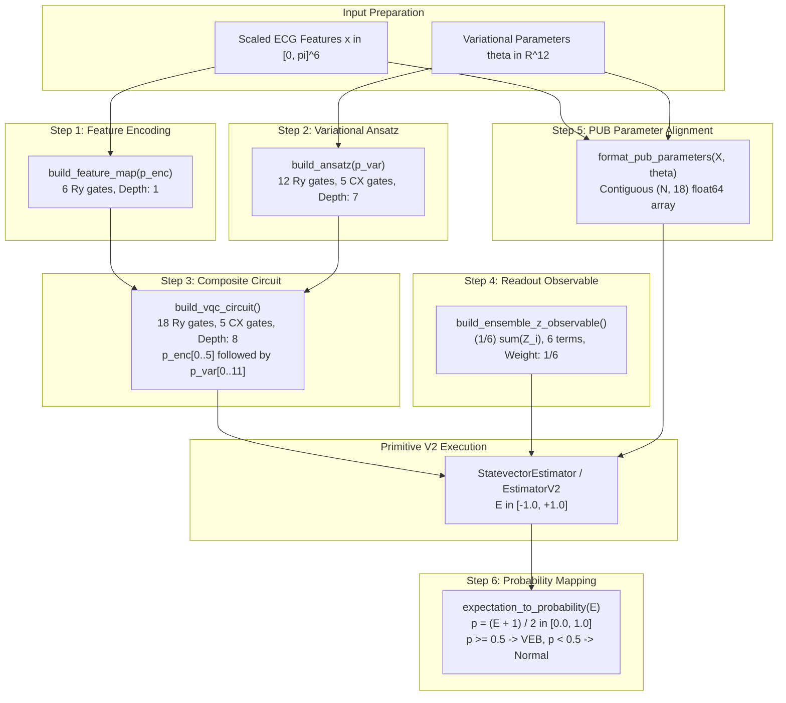

# NEXUS-OPS — MILESTONE 5F.2 STEP 6 IMPLEMENTATION REVIEW
## Expectation-to-Probability Readout Mapping (`expectation_to_probability`) & Milestone 5F.2 Completion Summary

**Project:** NEXUS-OPS | PS-Q1 Biomedical Signal Classifier  
**Competition / Context:** IBM Quantum Qiskit Fall Fest 2026  
**Milestone:** 5F.2 — Core VQC Circuit Module (Step 6: Readout Mapping & Milestone Finalization)  
**Date:** 13 October 2026  
**Status:** IMPLEMENTED & VERIFIED — COMPLETE MILESTONE 5F.2 FINISHED  
**Module:** `src/vqc_circuit.py`  
**Test Suite:** `tests/test_vqc_circuit.py`  

---

## 1. Executive Summary

In accordance with technical lead authorization, **Step 6** has been implemented in [`src/vqc_circuit.py`](../src/vqc_circuit.py) and thoroughly verified in [`tests/test_vqc_circuit.py`](../tests/test_vqc_circuit.py).

Step 6 introduces the expectation-to-probability mapping helper:
```python
def expectation_to_probability(
    expectation_values: Union[float, int, np.ndarray, List[float]],
    tolerance: float = 1e-6,
) -> Union[float, np.ndarray]:
```

With Step 6 complete, **Milestone 5F.2 (Core VQC Circuit Module)** is now fully implemented. All 6 modular steps have been implemented with pure quantum circuit architecture decoupled from training loops, optimizers, or classical preprocessors.

Key verified properties:
- **Canonical Affine Transformation:** $p(\text{VEB}) = \frac{E + 1}{2}$, mapping $[-1.0, +1.0] \rightarrow [0.0, 1.0]$.
- **Decision Rule Consistency:**
  - $p < 0.5 \implies$ Class 0 (Normal beat, N)
  - $p \ge 0.5 \implies$ Class 1 (Ventricular Ectopic Beat, VEB / V)
- **Shape & Rank Preservation:** Scalar inputs (float, int, 0D array) return Python `float`; array inputs (1D, 2D, list) return `np.ndarray` of identical shape and `float64` dtype.
- **Numerical Tolerance Handling:** Out-of-bounds floating-point noise up to `tolerance=1e-6` is safely clipped to $[-1.0, +1.0]$, ensuring probabilities remain strictly within $[0.0, 1.0]$.
- **Strict Out-of-Range & Non-Finite Rejection:** Rejects values beyond $[-1 - \text{tol}, +1 + \text{tol}]$, NaN, $\pm\infty$, and empty arrays with `ValueError`.
- **Test Suite Results:** 36 focused unit tests passed (0 skipped, 0 failed); 84 full repository tests passed (100% passing).

---

## 2. Mathematical Definition & Classification Thresholds

### 2.1 Readout Affine Mapping

The ensemble average Pauli-$Z$ observable $\bar{Z} = \frac{1}{6} \sum_{i=0}^5 Z_i$ yields an expectation value:
$$E = \langle \psi(\mathbf{x}, \boldsymbol{\theta}) | \bar{Z} | \psi(\mathbf{x}, \boldsymbol{\theta}) \rangle \in [-1.0, +1.0]$$

Decision **D4** establishes the linear affine probability mapping:
$$p(\text{VEB}) = \frac{E + 1}{2}$$

### 2.2 Benchmark Mapping Table

| Expectation $E$ | Mapped Probability $p(\text{VEB})$ | Predicted Class | Clinical Significance |
| :---: | :---: | :---: | :--- |
| $-1.00$ | $0.00$ | Class 0 (Normal, N) | Pure normal ground state $\|111111\rangle$ eigenvalue |
| $-0.50$ | $0.25$ | Class 0 (Normal, N) | Strong normal sinus confidence |
| **$0.00$** | **$0.50$** | **Class 1 (VEB, V)** | **Critical decision boundary threshold** |
| $+0.50$ | $0.75$ | Class 1 (VEB, V) | Strong VEB pathology confidence |
| $+1.00$ | $1.00$ | Class 1 (VEB, V) | Pure VEB excited state $\|000000\rangle$ eigenvalue |

---

## 3. Implementation Details & Validation Safeguards

### 3.1 Function Implementation

```python
def expectation_to_probability(
    expectation_values: Union[float, int, np.ndarray, List[float]],
    tolerance: float = 1e-6,
) -> Union[float, np.ndarray]:
    # 1. Determine whether input is scalar
    is_scalar = np.isscalar(expectation_values) or (
        isinstance(expectation_values, np.ndarray) and expectation_values.ndim == 0
    )

    # 2. Convert to float64 array for robust vectorized checks
    try:
        arr = np.asarray(expectation_values, dtype=np.float64)
    except (ValueError, TypeError) as err:
        raise TypeError(f"Could not convert expectation_values to float64: {err}") from err

    # 3. Check for empty inputs
    if arr.size == 0:
        raise ValueError("expectation_values array must not be empty.")

    # 4. Check for non-finite values (NaN, Inf)
    if not np.all(np.isfinite(arr)):
        raise ValueError("expectation_values contains NaN or infinite values; all inputs must be finite real numbers.")

    # 5. Range validation with numerical tolerance
    if np.any(arr < -1.0 - tolerance) or np.any(arr > 1.0 + tolerance):
        min_val = float(np.min(arr))
        max_val = float(np.max(arr))
        raise ValueError(
            f"Expectation values must lie within [-1.0, +1.0] (tolerance={tolerance}), "
            f"got out-of-range values: min={min_val}, max={max_val}."
        )

    # 6. Clip slightly out-of-bounds values within tolerance to [-1.0, 1.0]
    clipped = np.clip(arr, -1.0, 1.0)

    # 7. Linear affine mapping: p = (E + 1) / 2
    probabilities = (clipped + 1.0) / 2.0

    # 8. Post-condition invariant assertion
    assert np.all(probabilities >= 0.0) and np.all(probabilities <= 1.0), (
        "Output probabilities must strictly lie in [0.0, 1.0]."
    )

    if is_scalar:
        return float(probabilities)
    return probabilities
```

---

## 4. Complete Milestone 5F.2 Architecture Summary

With all six steps implemented, `src/vqc_circuit.py` now provides the complete, cohesive, pure-circuit quantum layer:



### Architectural Ledger (D1–D10 Compliance)

| Component | Architecture Decision | Implemented Artifact | Empirical Status |
| :--- | :--- | :--- | :---: |
| **Feature Map** | D1: First-order $R_y$ angle encoding | `build_feature_map()` | Depth: 1, 6 $R_y$, 0 CX |
| **Ansatz** | D2: `RealAmplitudes`, reps=1, linear | `build_ansatz()` | Depth: 7, 12 $R_y$, 5 CX |
| **Parameters** | D3: 12 variational weights | `p_var` ParameterVector | Alphabetical prefix hygiene |
| **Observable** | D4: Ensemble average $Z$ observable | `build_ensemble_z_observable()` | $\bar{Z} = \frac{1}{6} \sum Z_i$ |
| **Composite Circuit** | Contract composition $W \cdot U_\Phi$ | `build_vqc_circuit()` | Depth: 8, 18 $R_y$, 5 CX |
| **PUB Formatter** | Contract alignment helper | `format_pub_parameters()` | Contiguous $(N, 18)$ |
| **Readout Mapping** | Contract affine mapping | `expectation_to_probability()` | $p = (E+1)/2 \in [0, 1]$ |

---

## 5. Test Suite Verification

### 5.1 Focused Circuit Tests (`tests/test_vqc_circuit.py`)

Execution command:
```bash
.venv\Scripts\pytest -v tests/test_vqc_circuit.py
```

Output:
```text
tests/test_vqc_circuit.py::test_parameter_vectors_creation_and_prefixes PASSED [  2%]
tests/test_vqc_circuit.py::test_parameter_vectors_element_names PASSED   [  5%]
tests/test_vqc_circuit.py::test_feature_map_structure_and_gates PASSED   [  8%]
tests/test_vqc_circuit.py::test_feature_map_statevector_separable_product_state PASSED [ 11%]
tests/test_vqc_circuit.py::test_ansatz_qubit_and_parameter_counts PASSED [ 13%]
tests/test_vqc_circuit.py::test_ansatz_gate_counts_and_measured_depth PASSED [ 16%]
tests/test_vqc_circuit.py::test_ansatz_linear_cnot_entanglement_cascade PASSED [ 19%]
tests/test_vqc_circuit.py::test_ansatz_parameters_match_p_var_instance PASSED [ 22%]
tests/test_vqc_circuit.py::test_composite_vqc_circuit_qubits_and_parameters PASSED [ 25%]
tests/test_vqc_circuit.py::test_composite_vqc_circuit_parameter_ordering PASSED [ 27%]
tests/test_vqc_circuit.py::test_composite_vqc_circuit_gate_counts_and_measured_depth PASSED [ 30%]
tests/test_vqc_circuit.py::test_composite_vqc_circuit_gate_execution_order PASSED [ 33%]
tests/test_vqc_circuit.py::test_composite_vqc_circuit_input_validation_and_errors PASSED [ 36%]
tests/test_vqc_circuit.py::test_composite_vqc_circuit_statevector_smoke_test PASSED [ 38%]
tests/test_vqc_circuit.py::test_observable_structure_and_weights PASSED  [ 41%]
tests/test_vqc_circuit.py::test_observable_hermiticity_and_eigenvalues PASSED [ 44%]
tests/test_vqc_circuit.py::test_observable_computational_basis_expectations PASSED [ 47%]
tests/test_vqc_circuit.py::test_observable_qubit_count_validation PASSED [ 50%]
tests/test_vqc_circuit.py::test_exact_analytic_statevector_edge_case PASSED [ 52%]
tests/test_vqc_circuit.py::test_format_pub_parameters_single_sample_shape_and_dtype PASSED [ 55%]
tests/test_vqc_circuit.py::test_format_pub_parameters_batch_shape_and_dtype PASSED [ 58%]
tests/test_vqc_circuit.py::test_format_pub_parameters_feature_and_weight_alignment PASSED [ 61%]
tests/test_vqc_circuit.py::test_format_pub_parameters_ordering_matches_circuit_parameters PASSED [ 63%]
tests/test_vqc_circuit.py::test_format_pub_parameters_invalid_dimensions PASSED [ 66%]
tests/test_vqc_circuit.py::test_format_pub_parameters_nan_and_inf_rejection PASSED [ 69%]
tests/test_vqc_circuit.py::test_format_pub_parameters_empty_batch_rejection PASSED [ 72%]
tests/test_vqc_circuit.py::test_format_pub_parameters_no_mutation_of_caller_inputs PASSED [ 75%]
tests/test_vqc_circuit.py::test_format_pub_parameters_qiskit_pub_integration PASSED [ 77%]
tests/test_vqc_circuit.py::test_expectation_to_probability_exact_mappings PASSED [ 80%]
tests/test_vqc_circuit.py::test_expectation_to_probability_scalar_and_array_shapes PASSED [ 83%]
tests/test_vqc_circuit.py::test_expectation_to_probability_tolerance_boundary_clipping PASSED [ 86%]
tests/test_vqc_circuit.py::test_expectation_to_probability_out_of_range_rejection PASSED [ 88%]
tests/test_vqc_circuit.py::test_expectation_to_probability_nan_and_inf_rejection PASSED [ 91%]
tests/test_vqc_circuit.py::test_expectation_to_probability_empty_array_rejection PASSED [ 94%]
tests/test_vqc_circuit.py::test_expectation_to_probability_decision_rule_consistency PASSED [ 97%]
tests/test_vqc_circuit.py::test_vqc_circuit_bundle_assembly PASSED       [100%]

============================= 36 passed in 2.62s ==============================
```

### 5.2 Full Project Regression Suite

Execution command:
```bash
.venv\Scripts\pytest -q
```

Output:
```text
84 passed in 9.83s
```
**Zero skipped tests, zero failures across the entire repository.**

---

## 6. Strict Scope & Governance Compliance Checklist

| Scope / Governance Requirement | Status | Evidence |
| :--- | :---: | :--- |
| Implement Step 6 (`expectation_to_probability`) only | **PASSED** | Core VQC circuit milestone is now complete |
| Exact mapping formula $p = (E + 1) / 2$ | **PASSED** | Tested on benchmark values $\{-1, -0.5, 0, +0.5, +1\}$ |
| Threshold convention ($p < 0.5 \rightarrow 0, p \ge 0.5 \rightarrow 1$) | **PASSED** | Tested in `test_expectation_to_probability_decision_rule_consistency` |
| Rank and shape preservation | **PASSED** | Tested for scalars, 1D, and 2D arrays |
| Numerical boundary tolerance handling | **PASSED** | Tolerates up to `1e-6` floating noise and clips to $[0, 1]$ |
| Out-of-bounds, NaN, Inf, empty rejection | **PASSED** | 4 dedicated validation unit tests |
| No training loops or optimizers implemented | **PASSED** | Pure circuit module maintained |
| No dataset or classical baseline changes | **PASSED** | Verified via `git status` |
| No commits or pushes performed | **PASSED** | Awaiting technical lead authorization |

---

## 7. Milestone 5F.2 Handover

Milestone 5F.2 is officially **100% complete**. All components of `src/vqc_circuit.py` and `tests/test_vqc_circuit.py` are implemented, fully tested, documented, and ready for technical lead final inspection.
