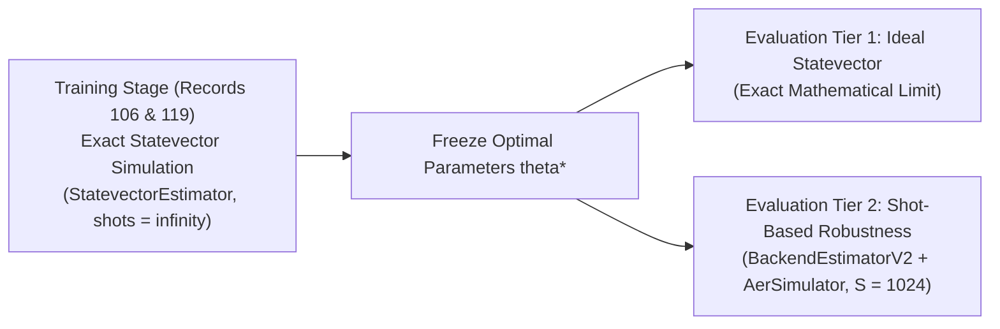

# Milestone 5C: VQC Implementation Contract & Pre-Implementation Technical Specification

**Project:** Project Q — IBM Quantum Qiskit Fall Fest 2026  
**Challenge:** PS-Q1 — Biomedical Signal Classifier  
**Team:** NEXUS-OPS  
**Stage:** Milestone 5C Pre-Implementation Technical Contract  
**Document Purpose:** Architectural and Scientific Implementation Contract for Core VQC Development  
**Governance Notice:** **ALL ARCHITECTURE CHOICES REMAIN PROPOSED — NOT YET TEAM-APPROVED**  
**Submission Deadline:** 14 October 2026  
**Date:** October 13, 2026  

---

## 1. Overview & Implementation Boundaries

This document defines the formal software and mathematical contract governing the development of the **Variational Quantum Classifier (VQC)** for Milestone 5C.

In accordance with the hackathon rules and Project Q AI policies:
* This is an **inspection and planning specification**.
* The core quantum circuit architecture, parameter binding routines, and optimizer loops must be implemented and owned by the team.
* **All ten architecture decisions (D1–D10) remain PROPOSED (`PROPOSED_NOT_TEAM_APPROVED`)** pending explicit team approval. The project owner's individual review selections on D5 ($L=1$), D6 (positive polarity = VEB), and D9 (MSE loss) are recorded separately and do not constitute team consensus.

---

## 2. Input / Output Data Interface

### 2.1 Input Data Specification
The quantum classifier accepts batches of patient-separated ECG beat segments formatted as continuous numerical arrays.

| Property | Specification | Implementation Verification |
| :--- | :--- | :--- |
| **Input Feature Count** | Exactly 6 numerical dimensions | `X.shape[1] == 6` |
| **Input Feature Domain** | Strictly bounded in $[0, \pi]$ | `np.all((X >= 0.0) & (X <= np.pi))` |
| **Input Data Type** | `float64` (or `float32`) | `X.dtype in [np.float32, np.float64]` |
| **Missing / Infinite Values** | $0$ NaN, $0$ Inf | `np.isnan(X).sum() == 0` and `np.isinf(X).sum() == 0` |
| **Batch Dimension** | Arbitrary batch size $N \ge 1$ | Vectorized PUB batching |

### 2.2 Feature Ordering & Mapping to Qubit Register
The six features must be assigned to the quantum register in the exact order defined by `FEATURE_NAMES` in [`src/feature_extraction.py`](file:///c:/Data/Projects/NEXUS-OPS/NEXUS-OPS/PS-Q1-Biomedical-Classifier/src/feature_extraction.py):

| Index | Feature Name | Description | Physical Unit | Mapped Qubit |
| :---: | :--- | :--- | :---: | :---: |
| `0` | `pre_rr` | Interval from previous R-peak to current R-peak | seconds | Qubit $0$ ($q_0$) |
| `1` | `post_rr` | Interval from current R-peak to subsequent R-peak | seconds | Qubit $1$ ($q_1$) |
| `2` | `qrs_rms` | Root-mean-square amplitude in 100-ms QRS window | mV | Qubit $2$ ($q_2$) |
| `3` | `qrs_duration` | Morphological width of QRS complex | seconds | Qubit $3$ ($q_3$) |
| `4` | `p2p_amplitude` | Peak-to-peak voltage differential across beat | mV | Qubit $4$ ($q_4$) |
| `5` | `spectral_ratio` | High-frequency (10–30 Hz) power ratio | dimensionless | Qubit $5$ ($q_5$) |

### 2.3 Label Convention & Target Encoding
* **Class 0:** Normal Sinus Beat (`'N'`) $\to y = 0$ (Negative class)
* **Class 1:** Ventricular Ectopic Beat (`'V'`) $\to y = 1$ (Positive class)
* **Dataset Balance:** Exactly 1:1 balanced across all partitions:
  * Training Cohort (`data/processed/features_train.csv`): 200 samples ($100\text{ N}, 100\text{ V}$).
  * Testing Cohort (`data/processed/features_test.csv`): 100 samples ($50\text{ N}, 50\text{ V}$).

---

## 3. Quantum Circuit Architecture Contract

```
       [ Feature Map U_Φ(x) ]      [ Variational Ansatz W(θ) ]      [ Measurement ]
  |0⟩ --- [ Ry(x0) ] --------------- [ Ry(θ0) ] ---●--- [ Ry(θ6)  ] --- [ Z0 ] ---
  |0⟩ --- [ Ry(x1) ] --------------- [ Ry(θ1) ] ---X--- [ Ry(θ7)  ] --- [ Z1 ] ---
  |0⟩ --- [ Ry(x2) ] --------------- [ Ry(θ2) ] ---●--- [ Ry(θ8)  ] --- [ Z2 ] ---  ===> E(x, θ) = (1/6) Σ ⟨Zi⟩
  |0⟩ --- [ Ry(x3) ] --------------- [ Ry(θ3) ] ---X--- [ Ry(θ9)  ] --- [ Z3 ] ---       p(VEB) = (E + 1) / 2
  |0⟩ --- [ Ry(x4) ] --------------- [ Ry(θ4) ] ---●--- [ Ry(θ10) ] --- [ Z4 ] ---
  |0⟩ --- [ Ry(x5) ] --------------- [ Ry(θ5) ] ---X--- [ Ry(θ11) ] --- [ Z5 ] ---
```

### 3.1 Composite State Mathematical Formulation
The quantum state $|\psi(\mathbf{x}, \boldsymbol{\theta})\rangle$ is prepared by applying the feature map and ansatz onto the 6-qubit ground state $|0\rangle^{\otimes 6}$:
$$|\psi(\mathbf{x}, \boldsymbol{\theta})\rangle = W(\boldsymbol{\theta}) U_\Phi(\mathbf{x}) |0\rangle^{\otimes 6}$$

### 3.2 Proposed Feature Encoding Interface ($U_\Phi(\mathbf{x})$) — Decision D2
* **Unitary:** $U_\Phi(\mathbf{x}) = \bigotimes_{i=0}^5 R_y(x_{i})$
* **ParameterVector:** `x = ParameterVector('x', 6)`
* **Theoretical Properties:** Depth $O(1)$, exactly zero two-qubit gates, generates purely real probability amplitudes.
* **Non-Equivalence Clarification:** $R_y$ angle encoding does **NOT** make the model equivalent to classical Logistic Regression once downstream multi-qubit entanglement is applied.

### 3.3 Proposed Variational Ansatz Interface ($W(\boldsymbol{\theta})$) — Decisions D3, D4, D5
* **Ansatz Class:** `RealAmplitudes(num_qubits=6, reps=1, entanglement='linear')`
* **ParameterVector:** `theta = ParameterVector('θ', 12)`
* **Entanglement Topology:** Linear nearest-neighbor cascade: $[(0, 1), (1, 2), (2, 3), (3, 4), (4, 5)]$ ($5$ CNOTs).
* **Trainable Parameters:** Exactly 12 parameters ($\theta_0, \dots, \theta_{11}$).
* **Theoretical Gate Counts (Pre-Transpilation):**
  * Qubits: 6
  * CNOT gates: 5
  * Single-qubit $R_y$ rotations: 18 ($6\text{ enc} + 12\text{ var}$)
  * Untranspiled depth expectation: 8

---

## 4. Measurement, Observable & Probability Mapping Contract

### 4.1 Observable Definition — Decision D6
The model measures the ensemble average of the six local Pauli-Z operators:
$$E(\mathbf{x}, \boldsymbol{\theta}) = \frac{1}{6} \sum_{i=0}^5 \langle Z_i \rangle_{\mathbf{x}, \boldsymbol{\theta}} = \frac{1}{6} \sum_{i=0}^5 \langle \psi(\mathbf{x}, \boldsymbol{\theta}) | Z_i | \psi(\mathbf{x}, \boldsymbol{\theta}) \rangle \in [-1, +1]$$
In Qiskit 2.x, this is represented using `SparsePauliOp`:
```python
from qiskit.quantum_info import SparsePauliOp
# Qiskit little-endian format (qubit i is character (5 - i))
observable = SparsePauliOp.from_list([
    (f"{'I' * (5 - i)}Z{'I' * i}", 1.0 / 6.0) for i in range(6)
])
```

### 4.2 Probability Mapping
The predicted probability of a beat being a Ventricular Ectopic Beat (VEB, $y = 1$) is defined via the affine link:
$$p(\text{VEB} | \mathbf{x}, \boldsymbol{\theta}) = \frac{E(\mathbf{x}, \boldsymbol{\theta}) + 1}{2} \in [0, 1]$$
* Predicted label: $\hat{y} = \mathbb{I}\left( p(\text{VEB} | \mathbf{x}, \boldsymbol{\theta}) \ge 0.5 \right) = \mathbb{I}\left( E(\mathbf{x}, \boldsymbol{\theta}) \ge 0 \right)$.

### 4.3 Essential Polarity Verification Rule
* **Polarity Convention:** Positive expectation ($E \to +1$) corresponds to class 1 (VEB); negative expectation ($E \to -1$) corresponds to class 0 (Normal).
* **Zero-Angle Theoretical Reference:** The property $E = +1.0$ ($p = 1.0$) at initialization applies **strictly to the theoretical reference state where both features and parameters are zero ($\mathbf{x} = \mathbf{0}, \boldsymbol{\theta} = \mathbf{0}$)**.
* **Mandatory Evaluation on Real Data:** Actual ECG samples apply non-zero rotation angles $\mathbf{x}_i \in [0, \pi]^6$ and initialized angles $\boldsymbol{\theta}_0 \sim \mathcal{U}[-0.1, 0.1]$. Baseline predictions must be evaluated using the actual six scaled input features and initialized parameters across the training cohort. Do NOT introduce an adaptive bias term or alter the proposed mapping without team consensus.

---

## 5. Loss Function & Optimization Contract

### 5.1 Proposed Loss Objective — Decision D9
The model minimizes the Mean Squared Error (Brier score):
$$\mathcal{L}_{\text{MSE}}(\boldsymbol{\theta}) = \frac{1}{N} \sum_{i=1}^N \left( p(\text{VEB} | \mathbf{x}_i, \boldsymbol{\theta}) - y_i \right)^2 = \frac{1}{4N} \sum_{i=1}^N \left( E(\mathbf{x}_i, \boldsymbol{\theta}) - (2y_i - 1) \right)^2$$

### 5.2 Optimizer Configuration — Decision D7
* **Optimizer:** COBYLA via `scipy.optimize.minimize(method="COBYLA")`.
* **Iteration Cap:** Exactly 150 iterations (`options={'maxiter': 150, 'rhobeg': 0.2, 'tol': 1e-4}`).
* **Early Stopping Rule:** Terminate optimization if $|\mathcal{L}_{t} - \mathcal{L}_{t-1}| \le 10^{-4}$ for **5 consecutive checks**.

### 5.3 Mandatory Optimizer Accounting & Logging
COBYLA iterations and objective-function evaluations are **distinct quantities**. The implementation must log both:
1. `iteration_count`: Number of outer COBYLA iterations.
2. `objective_evaluation_count`: Total number of batch quantum circuit evaluations.
3. `best_objective_value`: Minimum loss achieved.
4. `termination_reason`: Exact message returned by optimizer upon exit.
5. `runtime_seconds`: Total wall-clock execution time.
6. `convergence_status`: Boolean flag indicating whether stopping tolerance was achieved.

### 5.4 Parameter Initialization — Decision D8
* Variational angles initialized from small uniform distribution: $\boldsymbol{\theta}_0 \sim \mathcal{U}[-0.1, +0.1]$.
* Generated via `np.random.default_rng(seed)`.

---

## 6. Execution Tiers & Simulation Contract — Decision D10



1. **Tier 1 (Ideal Analytical Training & Evaluation):**
   * Uses Qiskit 2.x `StatevectorEstimator`.
   * Evaluates exact mathematical inner products without finite-shot variance.
   * Used exclusively for training and primary benchmark validation.
2. **Tier 2 (Finite-Shot Robustness Verification):**
   * Uses `BackendEstimatorV2` with `AerSimulator`.
   * Evaluates frozen parameters on $S = 1024$ shots to measure sampling robustness.
   * *Theoretical Uncertainty:* Theoretical worst-case standard error bound on mapped probability is $\operatorname{SE}(p) \le 1/(2\sqrt{S}) = 1/64 \approx 0.0156$ ($\approx 1.56\%$). This is a theoretical worst-case bound, not an experimentally observed variance.

---

## 7. Experimental Protocol & Partition Isolation Contract

### 7.1 Cross-Validation Structure (10 LORO Runs)
Leave-One-Record-Out (LORO) cross-validation is performed strictly within the training cohort across 5 fixed random seeds $\mathcal{S} = \{42, 101, 202, 303, 404\}$:
* **Fold 1:** Train on Record 106 ($n=100$), Validate on Record 119 ($n=100$) (5 runs).
  * *Scaler Rule:* Fitted strictly on Record 106 features; Record 119 features transformed and clipped.
* **Fold 2:** Train on Record 119 ($n=100$), Validate on Record 106 ($n=100$) (5 runs).
  * *Scaler Rule:* Fitted strictly on Record 119 features; Record 106 features transformed and clipped.
* Total LORO runs: $5\text{ seeds} \times 2\text{ folds} = \mathbf{10\text{ runs}}$.

### 7.2 Full Training Cohort Runs (5 Runs)
* Train on all 200 samples from Records 106 + 119 across the same 5 seeds $\mathcal{S} = \{42, 101, 202, 303, 404\}$.
* Scaler is fitted on the full 200-sample training cohort (`features_train.csv`).

### 7.3 Held-Out Test Set Quarantine Contract
* **Records 200 & 208 ($n=100$):** Strictly held-out and quarantined.
* **Post-Hoc Observational Role:** Evaluated **strictly once** on the frozen optimal model.
* **Historical Bias Disclosure:** Preserves the Milestone 4.1 finding regarding earlier test-set selection bias; the test set is an observational evaluation, not a tuning set.

---

## 8. Software Architecture & Required Unit Tests

### 8.1 Target Source File Layout for Milestone 5C
```
src/
├── vqc_circuit.py       # Pure circuit definitions (feature map, ansatz, composite circuit, observables)
├── vqc_model.py         # VQC classifier wrapper (PUB batching, loss, COBYLA optimization, logging)
└── vqc_evaluation.py    # Multi-seed LORO cross-validation and test benchmark evaluation routines
```

### 8.2 Required Unit Tests (`tests/`)
1. **`test_vqc_circuit.py`:**
   * Test circuit qubit count equals 6.
   * Test parameter vector count (6 feature parameters, 12 trainable parameters).
   * Test CNOT count equals 5 (untranspiled).
   * Test observable construction (6 Pauli-Z terms with weight $1/6$).
   * Test output expectation range falls strictly in $[-1, +1]$ for arbitrary valid parameters.
2. **`test_vqc_model.py`:**
   * Test forward pass prediction outputs probabilities strictly in $[0, 1]$.
   * Test loss evaluation matches theoretical MSE calculation.
   * Test deterministic execution across fixed random seeds.
   * Test parameter initialization values fall strictly within $[-0.1, 0.1]$.
   * Test that input clipping prevents out-of-range feature errors.

---

## 9. Scientific Safeguards & Compliance Checklist

- [x] **Patient-Level Segregation:** Records 106/119 for training; Records 200/208 for testing.
- [x] **Training-Only Scaler Hygiene:** Scalers fitted exclusively on active training cohorts.
- [x] **Quarantine of Held-Out Test Records:** No fitting, hyperparameter selection, or threshold tuning on test records.
- [x] **Historical Bias Disclosure:** Milestone 4.1 disclosure preserved in all reporting.
- [x] **Retrospective Latency Acknowledgment:** Feature $x_2$ (`post_rr`) carries $0.42\text{--}1.48\text{ s}$ delay; classifier is retrospective/offline.
- [x] **Cautious Physiological Context:** Record 208 normal beats with rapid RR ($0.48\text{--}0.56\text{ s}$) noted; sinus tachycardia designated an unconfirmed clinical hypothesis.
- [x] **Clinical Disclaimer:** Academic engineering prototype only; not for clinical diagnosis.
- [x] **Hardware Contextualization:** No claims of quantum advantage; 6-qubit simulation framed as an engineering feasibility benchmark.
