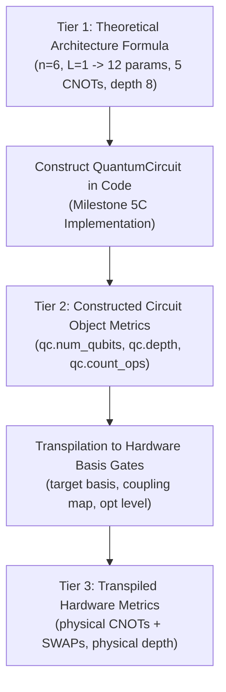

# Milestone 5B: VQC Implementation Readiness Checklist

**Project:** Project Q — IBM Quantum Qiskit Fall Fest 2026  
**Challenge:** PS-Q1 — Biomedical Signal Classifier  
**Team:** NEXUS-OPS  
**Stage:** Milestone 5B.1 — Implementation Readiness & Scientific Verification Checklist  
**Status:** **AWAITING FORMAL TEAM APPROVAL**  
**Date:** October 12, 2026 (Updated Milestone 5B.1)  

---

## 1. Overview & Governance

This checklist defines the technical gates and verification criteria that must be satisfied before any quantum circuit implementation code is written.

### Governance Status:
* The project owner has individually reviewed and endorsed D5 ($L=1$), D6 (positive expectation = VEB, negative expectation = Normal), and D9 (MSE/Brier score).
* These represent individual review positions. **All ten decisions strictly retain `"status": "PROPOSED_NOT_TEAM_APPROVED"`** pending formal consensus from the NEXUS-OPS team.
* In accordance with hackathon rules, the core circuit architecture and algorithm must remain the team's own implementation.

---

## 2. Architecture Decisions Readiness Gate

Every decision D1–D10 must have a clear implementation verification plan:

| Decision ID | Item | Proposed Choice | Project Owner Position | Formal Team Status | Review Verdict | Implementation Readiness Action |
| :---: | :--- | :--- | :---: | :---: | :---: | :--- |
| **D1** | Qubit Count | 6 Qubits | APPROVE | PENDING | **ACCEPTABLE** | Verify `QuantumCircuit(6)` allocation and feature-to-qubit alignment. |
| **D2** | Feature Encoding | First-order $R_y$ | APPROVE | PENDING | **ACCEPTABLE** | Verify clipping of inputs to $[0, \pi]$ and parameter binding order. |
| **D3** | Ansatz | RealAmplitudes | APPROVE | PENDING | **ACCEPTABLE** | Verify real amplitudes; confirm no complex phases introduced. |
| **D4** | Entanglement | Linear | APPROVE | PENDING | **ACCEPTABLE** | Verify CNOT pairs $[(0,1), (1,2), (2,3), (3,4), (4,5)]$. |
| **D5** | Repetitions ($L$) | $L = 1$ | APPROVE | PENDING | **ACCEPTABLE** | Primary baseline ($L=1$); monitor convergence to see if $L=2$ ablation is needed. |
| **D6** | Measurement | Average of 6 Pauli-Z | APPROVE | PENDING | **VERIFICATION REQUIRED** | **CRITICAL:** Verify polarity mapping ($E \to +1 \implies \text{VEB}$) against dataset binary labels using actual scaled features and initialized parameters. |
| **D7** | Optimizer | COBYLA | APPROVE | PENDING | **ACCEPTABLE** | Max 150 iterations; log iterations and objective evaluations separately. |
| **D8** | Initialization | $\mathcal{U}[-0.1, 0.1]$ | APPROVE | PENDING | **ACCEPTABLE** | Verify random seed generator control across all 5 seeds. |
| **D9** | Loss Function | MSE / Brier Score | APPROVE | PENDING | **ACCEPTABLE** | Verify exact MSE formulation: $\mathcal{L} = \frac{1}{N}\sum (p_i - y_i)^2$. |
| **D10**| Simulation | Statevector + 1024 Shots | APPROVE | PENDING | **ACCEPTABLE** | Verify `StatevectorEstimator` for training, `AerSimulator` for shots. |

---

## 3. Quantum Resource & Circuit Verification Checklist

The implementation must categorize and verify circuit properties across three distinct tiers to distinguish theoretical formulas from constructed and compiled circuits:



| Resource Metric | Tier 1: Theoretical Architecture Expectation | Tier 2: Constructed Circuit Object Metric (Requires Code) | Tier 3: Transpiled Hardware Metric (Requires Target Backend) |
| :--- | :---: | :--- | :--- |
| **Qubit Count** | **6** | `qc.num_qubits == 6` | Matches physical layout |
| **Feature Parameters** | **6** ($x_0, \dots, x_5$) | `len(feature_map.parameters) == 6` | Bound before circuit execution |
| **Trainable Parameters** | **12** ($n \times (L+1) = 6 \times 2$) | `len(ansatz.parameters) == 12` | 12 classical parameters |
| **Entangling CNOT Count** | **5** ($n - 1 = 5$) | `qc.count_ops().get("cx", 0) == 5` | $\ge 5$ (depends on hardware SWAPs) |
| **Single-Qubit Rotations** | **18** ($6\text{ enc} + 12\text{ var}$) | `qc.count_ops().get("ry", 0) == 18` | Decomposed into basis ($SX, R_z$) |
| **Untranspiled Depth** | **8** (theoretical formula) | `qc.depth() == 8` | $\ge 8$ (basis gate dependent) |
| **Observables Count** | **6** terms | `len(observable) == 6` | 6 Pauli-Z measurements |
| **PUB Execution Compatibility** | Valid PUB format | `(qc, [obs], [params])` run in `StatevectorEstimator` | Expectation value in $[-1, +1]$ |

*Important Clarification:* No circuit has been implemented yet. All current resource claims are Tier 1 theoretical expectations. Tier 2 and Tier 3 values cannot be reported until the circuit is constructed and transpiled in Milestone 5C.

---

## 4. Optimizer & Runtime Logging Checklist

COBYLA iterations and objective-function evaluations are **distinct quantities**. The optimization loop must log each quantity independently:

- [ ] **Iteration Limit:** Maximum 150 iterations enforced (`options={'maxiter': 150}`).
- [ ] **Separate Tracking Fields:**
  - [ ] `iteration_count`: Number of outer COBYLA optimization iterations.
  - [ ] `objective_evaluation_count`: Total number of batch quantum circuit evaluations.
  - [ ] `best_objective_value`: Minimum loss value achieved during optimization.
  - [ ] `termination_reason`: Exact message returned by optimizer upon completion.
  - [ ] `runtime_seconds`: Total wall-clock execution time for the run.
  - [ ] `convergence_status`: Boolean flag indicating whether tolerance criteria were met.
- [ ] **Early Stopping Rule:** Terminate if $|\mathcal{L}_t - \mathcal{L}_{t-1}| \le 10^{-4}$ for **5 consecutive checks**.

---

## 5. Experimental Protocol Execution Checklist

Before running experiments in Milestone 5C, verify protocol constraints:

- [ ] **Multi-Seed Configuration:** Explicitly declare seeds `[42, 101, 202, 303, 404]`.
- [ ] **LORO Fold Isolation:**
  - [ ] Fold 1: Train on Record 106 ($n=100$) $\to$ Validate on Record 119 ($n=100$).
  - [ ] Fold 2: Train on Record 119 ($n=100$) $\to$ Validate on Record 106 ($n=100$).
  - [ ] Exactly **10 LORO runs** generated ($5\text{ seeds} \times 2\text{ folds}$).
- [ ] **Full Training Cohort Configuration:**
  - [ ] Fit candidate models on Records 106 + 119 ($n=200$) across 5 seeds (**5 full training runs**).
- [ ] **Test Set Quarantine:**
  - [ ] Records 200 and 208 strictly excluded from all training, scaling, and threshold adjustments.
  - [ ] Test evaluation executed only once on frozen final models.
- [ ] **Simulation Tiers:**
  - [ ] Training executed in `StatevectorEstimator`.
  - [ ] Post-training evaluation executed with $S = 1024$ shots in `BackendEstimatorV2`.
  - [ ] *Theoretical Bound:* Standard error bound on mapped probability is $\operatorname{SE}(p) \le 1.56\%$ (theoretical worst-case bound, not an experimentally measured result).
- [ ] **Cautious Physiological Wording:**
  - [ ] Acknowledge that some normal-labelled beats in Record 208 exhibited relatively rapid RR intervals ($0.48\text{--}0.56\text{ s}$), contributing to classification difficulty; sinus tachycardia is an unconfirmed clinical hypothesis.

---

## 6. Software Architecture Plan for Milestone 5C

When formal team approval is granted, the implementation must be organized into clean modules:

```
src/
├── vqc_circuit.py          # Circuit construction, feature map, ansatz, and observables
├── vqc_model.py            # Model wrapper, loss calculation, and COBYLA optimization loop
├── vqc_evaluation.py       # LORO cross-validation and benchmark evaluation routines
tests/
├── test_vqc_circuit.py     # Unit tests verifying qubits, parameters, depth, and CNOT count
└── test_vqc_model.py       # Unit tests verifying forward pass, loss calculation, and reproducibility
```

---

## 7. Team Decision Sign-Off Gate

Implementation cannot proceed until the NEXUS-OPS team records formal approval below:

| Decision Item | Project Owner Position | Team Consensus | Date Confirmed | Signature / Confirmation ID |
| :--- | :---: | :---: | :---: | :---: |
| D1–D10 Architecture Choices | APPROVE | `PENDING` | *Pending* | NEXUS-OPS Team Lead |
| D6 Output Polarity Convention | APPROVE | `PENDING` | *Pending* | NEXUS-OPS Biomedical Lead |
| Multi-Seed Protocol Authorization | APPROVE | `PENDING` | *Pending* | NEXUS-OPS Validation Lead |
