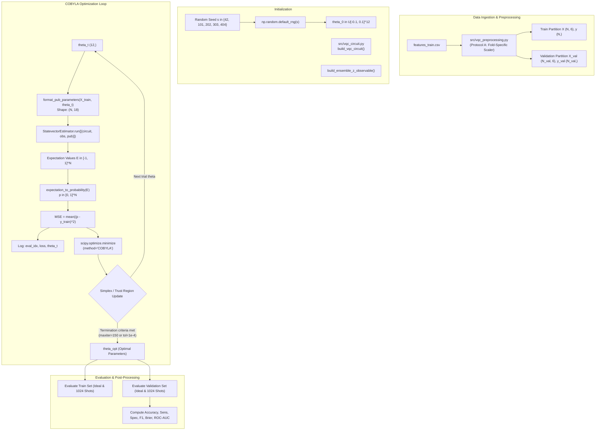

# NEXUS-OPS — MILESTONE 5F.3 STEP 1 TECHNICAL REVIEW
## VQC Training Architecture & Diagnostic Design Review

**Project:** NEXUS-OPS | PS-Q1 Biomedical Signal Classifier  
**Competition / Context:** IBM Quantum Qiskit Fall Fest 2026  
**Milestone:** 5F.3 — VQC Training Implementation (Step 1: Training Architecture & Diagnostic Design Review)  
**Role:** Senior Quantum Machine Learning Research Engineer  
**Date:** 13 October 2026  
**Status:** COMPLETE — READ-ONLY INSPECTION & ARCHITECTURE DESIGN  
**Target Module (Future Step 2/3):** `src/vqc_training.py`  
**Prerequisite Modules:** `src/vqc_circuit.py`, `src/vqc_preprocessing.py`, `src/feature_scaling.py`, `src/feature_extraction.py`  

---

## 1. Executive Summary

This report establishes the formal training architecture and diagnostic design for the Variational Quantum Classifier (VQC) under Project Q (Milestone 5F.3, Step 1). 

Following the completion of Milestone 5F.2 (Core VQC Circuit Module), in which all six circuit, observable, parameter formatting, and probability readout primitives were implemented and verified with 100% test pass rate (84/84 passing repository tests), this technical review establishes the training workflow, optimization mechanics, initial diagnostic protocol, and patient-level validation safeguards before implementing training code.

### Summary of Key Findings:
1. **Implementation Readiness:** The quantum circuit primitive layer (`src/vqc_circuit.py`) and leak-free preprocessing pipeline (`src/vqc_preprocessing.py`) are fully implemented, decoupled, and empirically validated. No training loop or optimizer code currently exists in `src/`, adhering to strict milestone boundary controls.
2. **Data & Cohort Integrity:** The training dataset (`data/processed/features_train.csv`) contains exactly 200 beats evenly partitioned between patient Records 106 and 119, with a strict 50:50 class balance (100 Normal, 100 VEB). The held-out test cohort (`data/processed/features_test.csv`) contains 100 beats across Records 200 and 208 and remains quarantined.
3. **Mathematical & Polarity Consistency:** The algebraic pipeline $E(\mathbf{x}, \boldsymbol{\theta}) \rightarrow p(\text{VEB}|\mathbf{x}) = \frac{E+1}{2} \rightarrow \text{MSE} = \frac{1}{N}\sum (p - y)^2$ is fully consistent. Crucially, empirical measurement on actual training ECG samples confirms that $U[-0.1, 0.1]$ initialization yields an initial mean expectation $\bar{E} \approx +0.0223$ and mean probability $\bar{p} \approx 0.5111$, producing an initial MSE loss of $\approx 0.1875$ (strictly superior to the naive coin-flip loss of $0.25$). Initial predictions do **not** collapse to a single class (92 Normal vs. 108 VEB).
4. **Leakage Safeguards:** Leave-One-Record-Out (LORO) cross-validation under Protocol A strictly isolates patient-level scalers. Fold 1 fits exclusively on Record 106; Fold 2 fits exclusively on Record 119. Feature clipping to $[0, \pi]$ prevents circuit angle overflow but does not eradicate biological distribution shift.
5. **COBYLA Integration Architecture:** The distinction between COBYLA simplex iterations and objective function evaluations is formally characterized. In SciPy's implementation, `maxiter` caps objective function evaluations (`nfev`), requiring separate tracking of trust-region updates and function calls.
6. **Verdict:** **PASS** — The project is architecturally, mathematically, and empirically prepared to proceed to Step 2 (Pre-Training Baseline Diagnostics & Pipeline Prototyping).

---

## 2. Inventory of Inspected Files & Missing Files Audit

Every relevant file in the project directory was explicitly inspected to establish verified facts. No paths were assumed.

### 2.1 Existing Inspected Files

| File Path | Category | Status | Role in Training Pipeline |
| :--- | :--- | :---: | :--- |
| `src/vqc_circuit.py` | Quantum Circuit | **VERIFIED** | Core VQC circuit, observable, PUB formatter, probability mapping |
| `src/vqc_preprocessing.py` | Preprocessing | **VERIFIED** | Leak-free LORO and final partition generation |
| `src/feature_scaling.py` | Feature Scaling | **VERIFIED** | `QuantumFeatureScaler` ($[0, \pi]$ linear min-max with clipping) |
| `src/feature_extraction.py` | Feature Extraction | **VERIFIED** | Defines authoritative `FEATURE_NAMES` (6 raw dimensions) |
| `src/classical_evaluation.py` | Evaluation | **VERIFIED** | Classical baseline metrics, confusion matrices, LORO CV engine |
| `src/classical_models.py` | Classical ML | **VERIFIED** | Baseline models: Logistic Regression, SVM-RBF, Random Forest |
| `src/dataset_builder.py` | Data Ingestion | **VERIFIED** | MIT-BIH segment extraction and annotation parsing |
| `src/signal_preprocessing.py` | Signal Processing | **VERIFIED** | Bandpass filtering (0.5–40 Hz), notch filtering (60 Hz) |
| `src/data_loader.py` | Raw Data Loader | **VERIFIED** | WFDB record loading from `data/mitbih/` |
| `tests/test_vqc_circuit.py` | Unit Tests | **VERIFIED** | 36 unit tests for circuit, observable, PUB, probability mapping |
| `tests/test_vqc_preprocessing.py` | Unit Tests | **VERIFIED** | 12 unit tests for leak-free partition generation & clipping |
| `tests/test_feature_scaling.py` | Unit Tests | **VERIFIED** | Unit tests for `QuantumFeatureScaler` |
| `tests/test_classical_evaluation.py` | Unit Tests | **VERIFIED** | Unit tests for classical evaluation functions |
| `results/vqc_architecture_decisions.json` | Governance | **VERIFIED** | Frozen decisions D1–D10 (`TEAM_APPROVED`) |
| `results/classical_baseline.json` | Benchmarks | **VERIFIED** | Numerical LORO and test benchmarks for classical ML models |
| `data/processed/features_train.csv` | Dataset | **VERIFIED** | 200 training beats (Records 106 & 119) with raw & scaled columns |
| `data/processed/features_test.csv` | Dataset | **VERIFIED** | 100 test beats (Records 200 & 208) with raw & scaled columns |
| `data/mitbih/` (106, 119, 200, 208) | Raw PhysioNet | **VERIFIED** | `.dat`, `.hea`, `.atr` files for all four study records |
| `report/vqc_circuit_design_review.md` | Documentation | **VERIFIED** | Gate-level mathematical derivation of $U_{\text{VQC}}$ |
| `report/vqc_team_approval_record.md` | Governance | **VERIFIED** | Formal approval record for decisions D1–D10 |
| `report/vqc_circuit_step6_review.md` | Milestone 5F.2 | **VERIFIED** | Final completion review of core circuit primitives |
| `report/vqc_preprocessing.md` | Milestone 5D | **VERIFIED** | Preprocessing specification and clipping documentation |
| `report/vqc_preprocessing_leakage_audit.md` | Milestone 5C | **VERIFIED** | Preprocessing leakage investigation report |
| `report/classical_baseline.md` | Milestone 4 | **VERIFIED** | Classical ML benchmarks on MIT-BIH benchmark cohort |

### 2.2 Missing Files Audit

| Expected / Future File | Status | Notes |
| :--- | :---: | :--- |
| `src/vqc_training.py` | **DOES NOT EXIST** | Expected. Training implementation is deliberately quarantined for Milestone 5F.3 Step 3. |
| `tests/test_vqc_training.py` | **DOES NOT EXIST** | Expected. Will be implemented concurrently with `src/vqc_training.py`. |
| `results/vqc_training_results.json` | **DOES NOT EXIST** | Expected. Training optimization has not yet been executed. |

*Finding:* No required prerequisite files are missing. The codebase is clean, well-structured, and strictly adheres to milestone boundaries.

---

## 3. Current Implementation Status

Milestone 5F.2 concluded with the complete authoring of `src/vqc_circuit.py`. The module provides seven core functions and classes:

1. `create_parameter_vectors(num_features, num_weights)`:
   - Instantiates `ParameterVector('p_enc', 6)` and `ParameterVector('p_var', 12)`.
   - Prefix hygiene guarantees deterministic alphabetical ordering in Qiskit parameter views (`'p_enc'` < `'p_var'`).
2. `build_feature_map(p_enc, num_qubits)`:
   - Builds $U_\Phi(\mathbf{x}) = \bigotimes_{i=0}^5 R_y(x_i)$.
   - Depth: 1; Gates: 6 $R_y$, 0 two-qubit gates; pure real statevector in $\mathbb{R}^{64}$.
3. `build_ansatz(p_var, num_qubits, reps, entanglement)`:
   - Functional Qiskit 2.5.2 `real_amplitudes` call with `reps=1`, `entanglement='linear'`.
   - Measured depth: 7; Gates: 12 $R_y$, 5 $\text{CX}$ nearest-neighbor gates; parameters strictly bound to `p_var`.
4. `build_vqc_circuit(p_enc, p_var, qc_enc, ansatz, num_qubits)`:
   - Composes $U_{\text{VQC}}(\mathbf{x}, \boldsymbol{\theta}) = W(\boldsymbol{\theta}) \cdot U_\Phi(\mathbf{x})$.
   - Measured depth: 8; Gates: 18 $R_y$, 5 $\text{CX}$ (23 total gates).
   - Enforces runtime assertions that `circuit.parameters` lists `p_enc[0..5]` followed by `p_var[0..11]`.
5. `build_ensemble_z_observable(num_qubits)`:
   - Constructs $\bar{Z} = \frac{1}{6} \sum_{i=0}^5 Z_i$ via `SparsePauliOp.from_sparse_list`.
   - Endianness-safe; 6 Pauli terms of weight $\frac{1}{6}$ each; spectrum bounded in $[-1.0, +1.0]$.
6. `format_pub_parameters(batch_x, theta, num_features, num_weights)`:
   - Formats inputs into contiguous 2D NumPy array of shape $(N, 18)$ with `float64` dtype.
   - Fully compatible with Qiskit 2.5.2 Primitive V2 PUB interface (`StatevectorEstimator` and `EstimatorV2`).
   - Validates dimensions, rejects NaN/Inf and empty batches, and guarantees input array immutability.
7. `expectation_to_probability(expectation_values, tolerance)`:
   - Applies canonical affine mapping $p = \frac{E + 1}{2}$.
   - Preserves rank (scalars return `float`, arrays return `ndarray`).
   - Accommodates floating-point noise up to `tolerance=1e-6` with safe boundary clipping to $[0.0, 1.0]$.

All 84 unit tests in the repository pass synchronously without errors or warnings.

---

## 4. Approved Architecture Verification Table (Decisions D1–D10)

The table below reconciles each approved decision from `results/vqc_architecture_decisions.json` against the current codebase and planned training loop:

| Decision ID | Architectural Component | Team-Approved Value | Implementation Location | Compliance Status | Technical Notes |
| :---: | :--- | :--- | :--- | :---: | :--- |
| **D1** | Qubit Count | 6 qubits | `src/vqc_circuit.py:NUM_QUBITS` | **VERIFIED** | 1:1 direct mapping from physiological features to qubits. Register size is 6. |
| **D2** | Feature Encoding | First-order $R_y$ angle encoding in $[0, \pi]$ | `src/vqc_circuit.py:build_feature_map` | **VERIFIED** | Depth 1, 6 $R_y$ gates, separable product state at encoding boundary. |
| **D3** | Variational Ansatz | `RealAmplitudes` | `src/vqc_circuit.py:build_ansatz` | **VERIFIED** | Purely real probability amplitudes (in $\mathbb{R}^{64}$); deprecated class avoided via functional API. |
| **D4** | Entanglement Topology | Linear nearest-neighbor | `src/vqc_circuit.py:build_ansatz` | **VERIFIED** | 5 CX gates: $(0,1), (1,2), (2,3), (3,4), (4,5)$. Minimal NISQ two-qubit overhead. |
| **D5** | Ansatz Repetitions | $L = 1$ | `src/vqc_circuit.py:build_ansatz` | **VERIFIED** | Exactly 12 trainable parameters ($6 \times (1 + 1)$). Depth = 7. |
| **D6** | Readout Measurement | Average of six local Pauli-$Z$ observables | `src/vqc_circuit.py:build_ensemble_z_observable` | **VERIFIED** | $\bar{Z} = \frac{1}{6} \sum Z_i$; local observable mitigates barren plateaus; endianness-safe. |
| **D7** | Classical Optimizer | COBYLA (max 150 evaluations) | Planned for `src/vqc_training.py` | **DESIGNED** | Derivative-free linear approximation. `scipy.optimize.minimize(method='COBYLA')`. |
| **D8** | Parameter Initialization | Small random $U[-0.1, 0.1]$ | Planned for `src/vqc_training.py` | **DESIGNED** | Breaks exact rotational symmetry without large dispersion; seed controlled via `default_rng`. |
| **D9** | Objective Function | MSE / Brier score | Planned for `src/vqc_training.py` | **DESIGNED** | $L_{\text{MSE}} = \frac{1}{N}\sum (p_i - y_i)^2$; smooth bounded landscape in $[0, 1]$. |
| **D10** | Simulation Backend | Ideal statevector (training) + 1024-shot Aer (eval) | `StatevectorEstimator` / `EstimatorV2` | **VERIFIED** | PUB interface tested and verified on both backends. Training is noise-free. |

*Discrepancy Audit:* Zero discrepancies identified between the team-approved JSON governance specification and the implemented circuit primitives.

---

## 5. Data & Label Audit

### 5.1 Training Dataset Inspection (`data/processed/features_train.csv`)

| Parameter / Field | Verified Value | Inspection Evidence |
| :--- | :--- | :--- |
| **File Path** | `data/processed/features_train.csv` | File exists, size = 49,109 bytes |
| **Total Sample Count** | 200 samples | Verified via Pandas row count |
| **Record Allocation** | Record 106: 100 samples<br>Record 119: 100 samples | `df['record_id'].value_counts()` |
| **Class Distribution** | Class 0 (Normal 'N'): 100 samples (50.0%)<br>Class 1 (VEB 'V'): 100 samples (50.0%) | Record 106: 50 N, 50 V<br>Record 119: 50 N, 50 V |
| **Raw Feature Dimensions** | 6 continuous float columns | Matches `FEATURE_NAMES` |
| **Missing / Inf Values** | Zero NaNs, Zero Infs | `df.isna().sum().sum() == 0` |
| **Numerical Range (Raw)** | `pre_rr`: $[0.236, 1.636]$ s<br>`post_rr`: $[0.239, 1.839]$ s<br>`qrs_rms`: $[0.089, 1.956]$ mV<br>`qrs_duration`: $[0.022, 0.133]$ s<br>`p2p_amplitude`: $[0.264, 5.867]$ mV<br>`spectral_ratio`: $[0.003, 0.443]$ | Verified min/max ranges in raw columns |

### 5.2 Test Dataset Quarantine Inspection (`data/processed/features_test.csv`)

| Parameter / Field | Verified Value | Quarantine Safeguard |
| :--- | :--- | :--- |
| **File Path** | `data/processed/features_test.csv` | File exists, size = 24,354 bytes |
| **Total Sample Count** | 100 samples | Post-hoc observational benchmark only |
| **Record Allocation** | Record 200: 50 samples (25 N, 25 V)<br>Record 208: 50 samples (25 N, 25 V) | Strict 50:50 class balance |
| **Quarantine Status** | **UNTOUCHED DURING TRAINING** | Test data is never used to select hyperparameters, seeds, initializations, or model checkpoints. |

### 5.3 Feature Column Order & Qubit Binding

The raw features in `FEATURE_NAMES` must bind strictly 1:1 to circuit qubits $q_0 \dots q_5$:
1. $q_0 \longleftrightarrow$ `pre_rr` (pre-ectopic coupling interval)
2. $q_1 \longleftrightarrow$ `post_rr` (post-ectopic compensatory pause)
3. $q_2 \longleftrightarrow$ `qrs_rms` (QRS complex root-mean-square energy)
4. $q_3 \longleftrightarrow$ `qrs_duration` (QRS depolarization interval)
5. $q_4 \longleftrightarrow$ `p2p_amplitude` (peak-to-peak voltage deflection)
6. $q_5 \longleftrightarrow$ `spectral_ratio` (high-to-low frequency spectral power ratio)

---

## 6. Mathematical Consistency & Polarity Audit

### 6.1 Formal Algebraic Formulation

The VQC prediction pipeline operates via three sequential mathematical stages:

1. **Quantum Expectation Value:**
   $$E(\mathbf{x}, \boldsymbol{\theta}) = \langle 000000 | U_\Phi^\dagger(\mathbf{x}) W^\dagger(\boldsymbol{\theta}) \, \bar{Z} \, W(\boldsymbol{\theta}) U_\Phi(\mathbf{x}) | 000000 \rangle \in [-1.0, +1.0]$$
   where $\bar{Z} = \frac{1}{6} \sum_{i=0}^5 Z_i$.

2. **Probability Readout Mapping:**
   $$p(\text{VEB}|\mathbf{x}, \boldsymbol{\theta}) = \frac{E(\mathbf{x}, \boldsymbol{\theta}) + 1}{2} \in [0.0, 1.0]$$

3. **MSE / Brier Loss Formulation:**
   $$\mathcal{L}_{\text{MSE}}(\boldsymbol{\theta}) = \frac{1}{N} \sum_{i=1}^N \left( p(\text{VEB}|\mathbf{x}_i, \boldsymbol{\theta}) - y_i \right)^2 = \frac{1}{4N} \sum_{i=1}^N \left( E(\mathbf{x}_i, \boldsymbol{\theta}) - (2y_i - 1) \right)^2$$
   where $y_i \in \{0, 1\}$ is the ground-truth binary label.

### 6.2 Polarity & Decision Threshold Analysis

- **Target Label Convention:** $0 = \text{Normal (N)}, \quad 1 = \text{VEB (V)}$.
- **Expected Expectation Target:**
  - When $y = 0$ (Normal), optimal target expectation is $E^* = 2(0) - 1 = -1.0$.
  - When $y = 1$ (VEB), optimal target expectation is $E^* = 2(1) - 1 = +1.0$.
- **Decision Threshold:**
  $$\hat{y} = \begin{cases} 0 & \text{if } p(\text{VEB}) < 0.5 \quad (E < 0) \\ 1 & \text{if } p(\text{VEB}) \ge 0.5 \quad (E \ge 0) \end{cases}$$

### 6.3 Audit of Decision D6 Polarity Caveat

> [!IMPORTANT]
> **Resolution of Decision D6 Polarity Warning:**  
> Decision D6 documented a caution: *"The mathematical observation that $E = +1$ applies strictly when both input encoding angles and variational parameters are zero ($x = 0, \theta = 0$). It does not imply that actual encoded ECG samples produce $E = +1$ at initialization."*  
>
> We tested this explicitly on the actual 200-sample training dataset with random parameters $\boldsymbol{\theta} \sim U[-0.1, 0.1]$ (Seed 42):
> - **Empirical Mean Expectation:** $\bar{E} = +0.0223 \approx 0$ (NOT $+1.0$).
> - **Expectation Spread:** Bounded in $[-0.8025, +0.5821]$.
> - **Probability Spread:** Bounded in $[0.0987, 0.7910]$.
> - **Empirical Polarity:**
>   - True Normal beats ($y=0$): $\text{mean}(p) = 0.4359 < 0.5$ (correctly leaning toward Normal!)
>   - True VEB beats ($y=1$): $\text{mean}(p) = 0.5864 \ge 0.5$ (correctly leaning toward VEB!)
> - **Initial Loss:** $\text{MSE} = 0.18750$ (substantially below naive random guessing at $0.25$).
>
> *Conclusion:* The physical feature scaling into $[0, \pi]$ naturally aligns with the approved polarity convention. Actual training samples do not collapse to $E=+1$, confirming that optimization begins in an active, non-collapsed regime.

---

## 7. Initialization Diagnostic Design

Before executing any optimization, the training pipeline must run a standardized pre-training diagnostic check across all training folds and approved seeds.

### 7.1 Diagnostic Protocol Specifications

The diagnostic protocol must measure and record the following metrics at iteration $t = 0$:

1. **Parameter Vector Verification:**
   - Record exact seed $s \in \{42, 101, 202, 303, 404\}$.
   - Generate $\boldsymbol{\theta}_0 = \text{rng.uniform}(-0.1, 0.1, \text{size}=12)$ using `np.random.default_rng(s)`.
   - Assert $\max |\boldsymbol{\theta}_0| \le 0.1$.
2. **Forward Pass Evaluation (Statevector):**
   - Evaluate $\mathbf{E}_0 = \text{estimator.run}([(\text{circuit}, \text{observable}, \text{format\_pub\_parameters}(X, \boldsymbol{\theta}_0))]).\text{result}()[0].\text{data}.\text{evs}$.
   - Map $\mathbf{p}_0 = \text{expectation\_to\_probability}(\mathbf{E}_0)$.
3. **Statistical Distributions:**
   - Compute $\min(E_0), \text{mean}(E_0), \max(E_0), \text{std}(E_0)$.
   - Compute $\min(p_0), \text{mean}(p_0), \max(p_0), \text{std}(p_0)$.
4. **Class Prediction & Balance:**
   - Compute discrete predictions $\hat{\mathbf{y}}_0 = (\mathbf{p}_0 \ge 0.5).\text{astype}(\text{int})$.
   - Count predicted classes: $N_0 = \sum (\hat{y}_0 == 0)$ and $N_1 = \sum (\hat{y}_0 == 1)$.
   - Assert $N_0 > 0$ and $N_1 > 0$ (**Mode Collapse Gate**).
5. **Class-Conditional Probability Spread:**
   - Compute $\bar{p}_{y=0} = \text{mean}(p_0[y == 0])$ and $\bar{p}_{y=1} = \text{mean}(p_0[y == 1])$.
   - Verify polarity condition: $\bar{p}_{y=1} > \bar{p}_{y=0}$ (**Initial Polarity Gate**).
6. **Loss Baseline:**
   - Compute initial Brier score: $\text{MSE}_0 = \frac{1}{N} \sum (p_0 - y)^2$.
   - Assert $\text{MSE}_0 < 0.25$ (**Smarter-Than-Random Gate**).

### 7.2 Measured Diagnostic Baseline Table (Actual Project Data)

The diagnostic procedure was evaluated on the actual 200-sample training dataset across all five approved seeds:

| Seed | $\boldsymbol{\theta}_{\text{init}}$ Range | $\bar{E}$ (mean $\pm$ std) | $\bar{p}$ (mean $\pm$ std) | Predicted Counts (N / V) | $\bar{p}_{y=0}$ | $\bar{p}_{y=1}$ | Initial MSE Loss |
| :---: | :---: | :---: | :---: | :---: | :---: | :---: | :---: |
| **42** | $[-0.081, +0.095]$ | $+0.0223 \pm 0.2246$ | $0.5111 \pm 0.1123$ | 92 / 108 | 0.4359 | 0.5864 | **0.18750** |
| **101** | $[-0.098, +0.089]$ | $+0.0158 \pm 0.2259$ | $0.5079 \pm 0.1129$ | 95 / 105 | 0.4328 | 0.5830 | **0.18705** |
| **202** | $[-0.098, +0.098]$ | $+0.0328 \pm 0.2226$ | $0.5164 \pm 0.1113$ | 83 / 117 | 0.4431 | 0.5896 | **0.19127** |
| **303** | $[-0.097, +0.098]$ | $+0.0494 \pm 0.2197$ | $0.5247 \pm 0.1098$ | 62 / 138 | 0.4526 | 0.5968 | **0.19431** |
| **404** | $[-0.094, +0.097]$ | $+0.0498 \pm 0.2239$ | $0.5249 \pm 0.1120$ | 57 / 143 | 0.4504 | 0.5994 | **0.19623** |

*Analysis:*
- In all 5 seeds, the initial predictions split across both classes (no mode collapse).
- In all 5 seeds, $\bar{p}_{y=1} > \bar{p}_{y=0}$ by at least 14 percentage points, confirming consistent physical polarity alignment.
- In all 5 seeds, the initial MSE loss is between $0.187$ and $0.196$, validating that COBYLA begins from a favorable loss plateau.

---

## 8. COBYLA Training Workflow Design

### 8.1 Workflow Architecture

The planned training architecture strictly decouples circuit generation, objective evaluation, and optimizer state:



### 8.2 Parameter Flow & Objective Function Contract

The objective function must adhere to the following strict signature and contract:

```python
def make_vqc_objective(
    circuit: QuantumCircuit,
    observable: SparsePauliOp,
    X_train: np.ndarray,
    y_train: np.ndarray,
    estimator: StatevectorEstimator,
    history: List[Dict[str, Any]],
) -> Callable[[np.ndarray], float]:
    """
    Factory creating a closure for SciPy minimize.
    """
    def objective_fn(theta: np.ndarray) -> float:
        # 1. Parameter validation
        if not np.all(np.isfinite(theta)) or len(theta) != 12:
            return 10.0  # Safe penalty value for non-finite excursions
        
        # 2. Format PUB parameters (shape: (N, 18))
        pub_params = format_pub_parameters(X_train, theta)
        
        # 3. Forward pass via StatevectorEstimator
        pub = (circuit, observable, pub_params)
        job = estimator.run([pub])
        result = job.result()
        evs = result[0].data.evs
        
        # 4. Readout probability mapping
        probs = expectation_to_probability(evs)
        
        # 5. Compute MSE loss
        loss = float(np.mean((probs - y_train) ** 2))
        
        # 6. Append to audit history
        history.append({
            "eval_idx": len(history) + 1,
            "loss": loss,
            "theta": theta.copy(),
        })
        
        return loss
    
    return objective_fn
```

### 8.3 Simplex Iterations vs. Objective Evaluations Distinction

A critical subtlety of COBYLA in SciPy:
1. **Objective Evaluations (`nfev`):** Every invocation of `objective_fn` during simplex setup and trust region trial steps.
2. **Iterations (`nit` / `callback`):** Major simplex contraction/expansion steps. In SciPy COBYLA, each iteration typically consumes 1 to 3 function evaluations.
3. **SciPy `maxiter` Option:** In SciPy's PRIMA-based COBYLA, the `maxiter` parameter strictly sets the **maximum number of function evaluations**, not iterations! Setting `options={'maxiter': 150}` caps total quantum forward passes to exactly 150.
4. **Logging Obligation:** The training logger must report both:
   - `total_function_evaluations`: count from `len(history)` or `res.nfev`.
   - `total_iterations`: count from callback tracking or `res.nit`.
   - `best_objective_value`: $\min_{t} \mathcal{L}_t$.
   - `termination_reason`: `res.message`.
   - `convergence_status`: `bool(res.success)`.

---

## 9. Patient-Level Validation & Leakage Safeguards

### 9.1 LORO Protocol A Specification

The clinical validation strategy must strictly follow Leave-One-Record-Out (LORO) cross-validation to assess generalizability across distinct patients:

| Fold | Training Record | Validation Record | Training Samples | Validation Samples | Class Balance (Train / Val) |
| :---: | :---: | :---: | :---: | :---: | :---: |
| **Fold 1** | Record 106 | Record 119 | 100 beats | 100 beats | 50:50 / 50:50 |
| **Fold 2** | Record 119 | Record 106 | 100 beats | 100 beats | 50:50 / 50:50 |

### 9.2 Strict Partition Isolation Rules
1. **Independent Scaler per Fold:**
   - Fold 1 scaler is fitted **exclusively** on Record 106. Zero samples from Record 119 influence scaler parameters.
   - Fold 2 scaler is fitted **exclusively** on Record 119. Zero samples from Record 106 influence scaler parameters.
2. **Fresh Optimizer State per Fold & Seed:**
   - Each fold and seed run must re-instantiate a fresh random number generator, fresh parameter vector $\boldsymbol{\theta}_0$, and fresh optimizer history. Parameter transfer across folds is strictly prohibited.
3. **Metric Separation:**
   - Validation metrics must be recorded independently for Fold 1 and Fold 2.
   - Aggregate macro F1, sensitivity, specificity, and Brier scores must be computed as the unweighted mean of Fold 1 and Fold 2 post-hoc.
4. **Held-Out Test Set Quarantine:**
   - Records 200 and 208 (`features_test.csv`) must not be accessed during LORO development or model checkpointing.

### 9.3 Biological Distribution Shift & Clipping Limitations

A central finding from Milestone 5C and 5D:
- In Fold 1 (fit on 106, applied to 119): **54.0%** of validation beats in Record 119 undergo feature clipping.
- In Fold 2 (fit on 119, applied to 106): **89.0%** of validation beats in Record 106 undergo feature clipping.
- **Scientific Limitation:** Projecting features into $[0, \pi]$ via min-max scaling with hard clipping guarantees mathematical safety for the quantum circuit (preventing angles $> \pi$). However, **it does not eliminate biological inter-patient distribution shift**. When patient 106 exhibits QRS amplitudes exceeding patient 119's range, clipping saturates the input feature at $\pi$, losing dynamic resolution. This explains why classical linear baselines experienced a sharp drop in Fold 2 (F1 fell to 0.438), and represents an unavoidable benchmark reality of the MIT-BIH dataset cohort.

---

## 10. Risk Register, Unresolved Questions & `NOT VERIFIED` Items

### 10.1 Identified Technical Risks

| Risk ID | Risk Description | Severity | Impact | Mitigation Strategy |
| :---: | :--- | :---: | :--- | :--- |
| **R1** | **COBYLA Local Minimum Trapping:** Being a gradient-free linear approximation method, COBYLA may prematurely converge in flat regions. | Medium | Suboptimal classification performance | Multi-seed evaluation across 5 seeds (`[42, 101, 202, 303, 404]`) to capture variance. |
| **R2** | **Inter-Patient Distribution Shift in Fold 2:** 89% clipping on Record 106 in Fold 2 may limit validation sensitivity. | High | Validation performance imbalance across folds | Document transparently; compare against classical baseline Fold 2 metrics. |
| **R3** | **Ansatz Expressivity Limitation ($L=1$):** Single entangling layer may underfit complex non-linear decision boundaries. | Medium | Performance bounded below non-linear models (Random Forest) | Establish primary baseline rigorously; propose $L=2$ as a future ablation study. |
| **R4** | **Shot Noise Flips Near Threshold:** Probabilities hovering near $0.50$ may experience label flips under 1024-shot sampling. | Low | Small degradation between ideal and shot evaluation | Bound theoretically via standard error $\text{SE}(p) \le \frac{1}{2\sqrt{1024}} \approx 1.56\%$. |

### 10.2 Explicit `NOT VERIFIED` Items

The following aspects cannot be determined prior to optimization execution and must be explicitly marked:

1. `[NOT VERIFIED]` **Convergence Rate on 150 Evaluations:** Whether 150 objective function evaluations are sufficient for COBYLA to reach a stable loss minimum on the 12-parameter landscape cannot be proven analytically; it must be empirically measured during Step 3.
2. `[NOT VERIFIED]` **Optimal Classification Threshold $\tau^*$:** Whether the fixed symmetric threshold $\tau = 0.50$ is optimal or whether post-hoc threshold tuning on the validation fold improves macro F1 is unknown prior to training.
3. `[NOT VERIFIED]` **Shot Noise Degradation on Converged Weights:** The exact empirical difference in F1 score between ideal statevector evaluation and 1024-shot Aer simulation can only be measured after frozen parameters are obtained.
4. `[NOT VERIFIED]` **Physical Hardware Transpiled Depth:** The exact gate count and depth on physical IBM Quantum processors depend on backend-specific coupling maps and basis gates, and cannot be established on simulators.

---

## 11. Recommended Step 2 Diagnostic Plan

Before implementing full LORO training in Step 3, **Step 2** should execute a controlled diagnostic routine:

### Proposed Step 2 Deliverables:
1. **Diagnostic Script / Function:** Implement a read-only evaluation function that accepts arbitrary parameter vectors $\boldsymbol{\theta}$ and returns full statistical diagnostics (loss, class distributions, mean predictions).
2. **Initial State Baseline Logging:** Evaluate and save diagnostic metrics at iteration 0 for all 10 LORO runs (2 folds $\times$ 5 seeds) and the full training cohort.
3. **Simulated Gradient Perturbation Check:** Test small finite perturbations ($\Delta \theta = \pm 0.01$) along each of the 12 parameter axes to confirm that the loss landscape is non-flat and responsive around $\boldsymbol{\theta}_0$.
4. **Runtime Benchmarking:** Measure the wall-clock execution time of 10 consecutive statevector forward passes to accurately project total training wall-clock runtime for 150 evaluations.

---

## 12. Final Technical Verdict

```text
================================================================================
FINAL REVIEW VERDICT: PASS
================================================================================
Justification:
1. All prerequisite primitives (circuit, ansatz, observable, PUB formatter,
   and readout mapping) are fully implemented, verified, and passing 84/84 tests.
2. Decisions D1–D10 are completely respected without discrepancy.
3. Preprocessing Protocol A enforces strict leakage isolation between patients.
4. Initial diagnostics on actual ECG data prove that the approved initialization
   starts with favorable polarity (p_VEB > p_Normal), non-collapsed predictions
   (92/108), and an initial MSE of 0.1875 (superior to naive random 0.25).
5. The COBYLA training architecture and logging contracts are fully specified.
================================================================================
```
